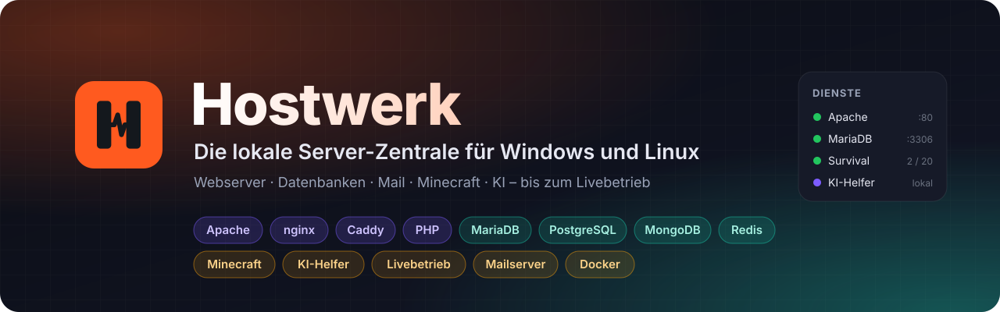
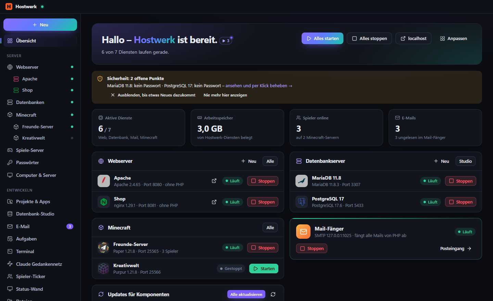
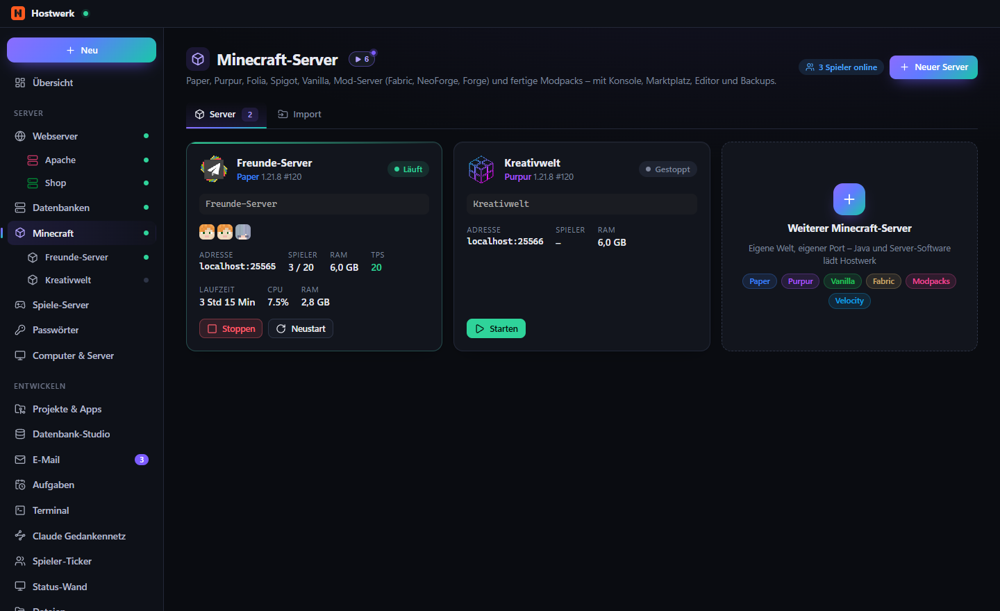
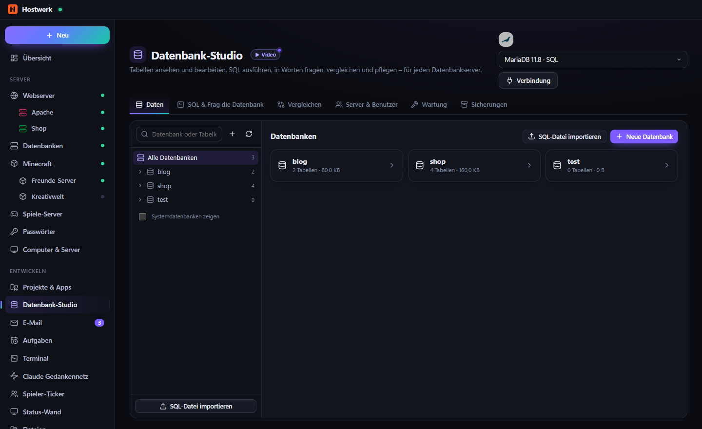
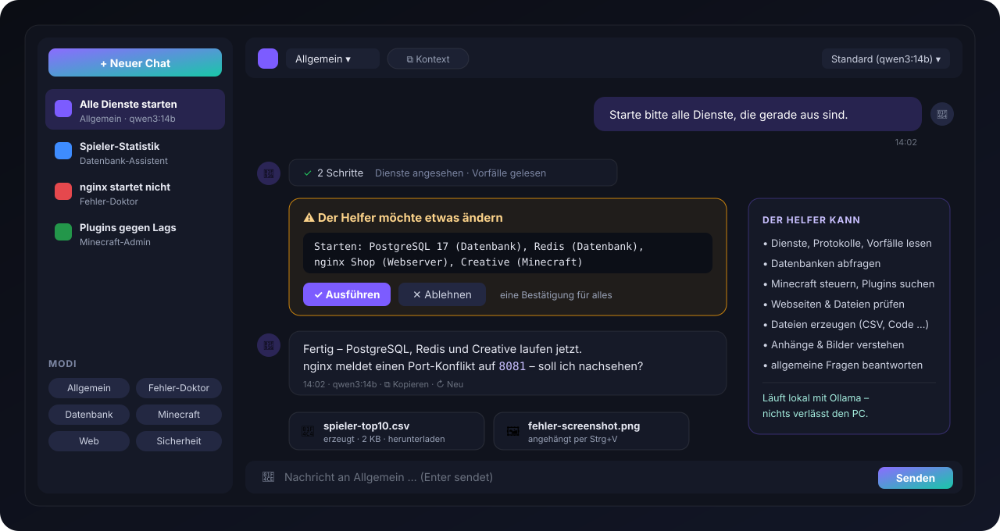
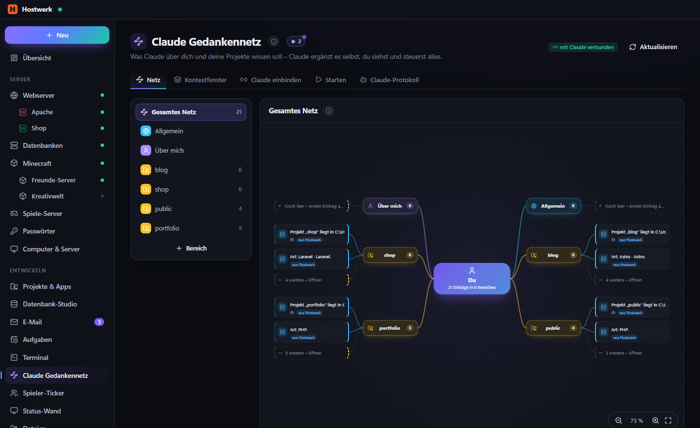
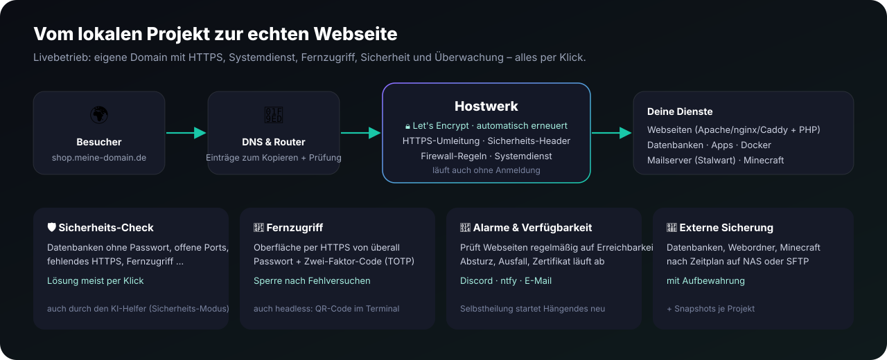
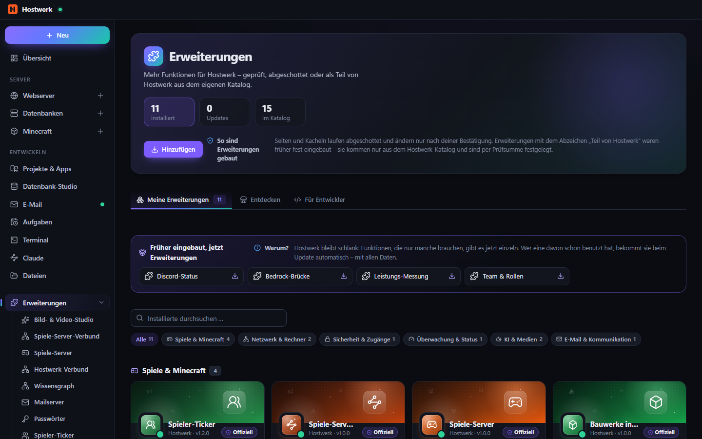
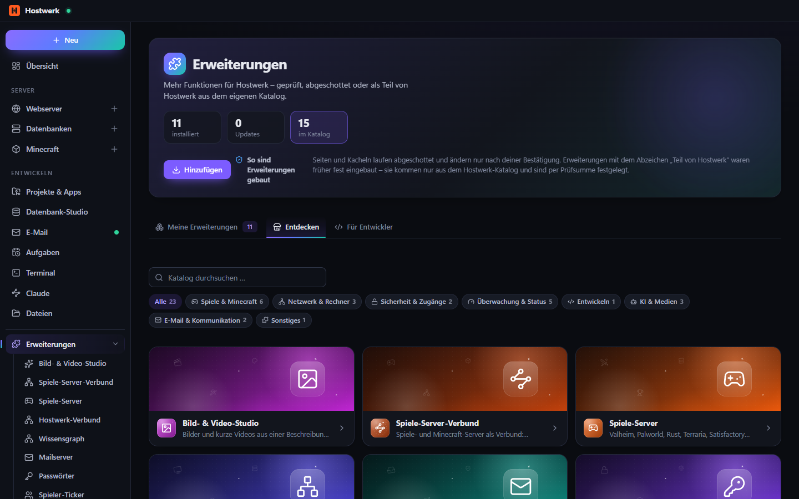

<a href="README.md">English</a> · <b>Deutsch</b>

  <b>Die lokale Server-Zentrale für Windows und Linux</b> 
  Webserver, Datenbanken, Mail, Minecraft- und Spiele-Server und ein KI-Helfer – in einer App, vom ersten Projekt bis zum Livebetrieb.

## Was Hostwerk kann

- **Alles lokal, in einer Oberfläche** – Apache, nginx, Caddy, PHP 7.4–8.5, MariaDB, MySQL, PostgreSQL, MongoDB, Redis, Mail-Fänger, Apps, Docker und Minecraft-Server installieren, starten und überwachen – ohne Konfigurationsdateien von Hand.
- **Mehrere Versionen nebeneinander** – beliebig viele Web- und Datenbankserver, jedes Projekt mit eigener PHP-Version.
- **KI-Helfer mit Werkzeugen** – schaut selbst in Dienste, Protokolle und Datenbanken und ändert nur nach deiner Bestätigung. Läuft auf Wunsch lokal.
- **Bereit für den Livebetrieb** – eine Anleitung führt Schritt für Schritt ins Internet: echte Domains mit HTTPS, Systemdienst, Fernzugriff mit Zwei-Faktor, Alarme und Sicherung außer Haus.
- **Erweiterungen** – Hostwerk bleibt schlank: Funktionen, die nur manche brauchen (Passwort-Manager, Spiele-Server, Mailserver, Router, mehrere Rechner …), kommen als Erweiterungen aus dem offiziellen Katalog – mit allen Daten.
- **Leicht umziehen** – übernimmt vorhandene Webserver, Datenbanken und Minecraft-Server (z. B. aus XAMPP), geprüft und mit Weg zurück.

| Minecraft-Server | Datenbank-Studio |
|---|---|
|  |  |

| KI-Helfer | KI-Anbindung (Claude & andere) |
|---|---|
|  |  |

## Dieses Repository

Hostwerk selbst wird in einem privaten Repository entwickelt. Dieses öffentliche liefert, was jede Hostwerk-Installation
**ohne Zugangsdaten** abruft:

| Ordner | Inhalt |
|---|---|
| **Releases** | Installationsdateien und App-Updates (gespiegelt vom Hauptprojekt) und die Erklärvideos (Release `videos`). |
| [`catalog/`](catalog) | KI-Modellkatalog, Projektvorlagen, Berater-Regeln, Passwort-Manager-Katalog und die Erweiterungs-Kataloge: `extensions.json` (offiziell, täglich aus den Erweiterungs-Repositorys gebaut), `community.json`, `verified.json`. |
| [`sdk/`](sdk) | **Erweiterungs-SDK 2.7** – `hostwerk-sdk.js`, Design-Baukasten, Manifest-Schema, `check.js`, `build-native.js` und die [Anleitung für Entwickler](sdk/README.de.md). |
| [`packages/`](packages) | Geprüfte Kopien der Community-Erweiterungen (per SHA-256 festgelegt). |
| `katalog/` | Alte Dateinamen für Hostwerk vor 2.9 – werden automatisch aktuell gehalten. |

## Erweiterungen

Alles an einem Ort: **Erweiterungen** in der Seitenleiste – deine installierten Erweiterungen nach Kategorien, der
Katalog unter *Entdecken* und Werkzeuge für Entwickler. Erweiterungen können aufeinander aufbauen; Hostwerk installiert,
was gebraucht wird, und warnt, bevor du etwas entfernst, das noch genutzt wird.

| Meine Erweiterungen | Entdecken |
|---|---|
|  |  |

### Offizielle Erweiterungen

**Spiele & Minecraft**

| | Erweiterung | Was sie kann |
|---|---|---|
|  | [Bauwerke in 3D](https://github.com/Passimoritz/hostwerk-ext-schematics-3d) · *Teil von Hostwerk* | Minecraft-Bauwerke in 3D ansehen, bevor du sie setzt |
|  | [Bedrock-Brücke](https://github.com/Passimoritz/hostwerk-ext-bedrock-bridge) · *Teil von Hostwerk* | Freunde auf Handy, Konsole und der Windows-Edition spielen auf deinen Java-Servern mit |
|  | [MOTD-Studio](https://github.com/Passimoritz/hostwerk-ext-motd-studio) | Die Beschreibung deines Minecraft-Servers in der Serverliste mit Farben und Formaten gestalten |
|  | [Spiele-Server](https://github.com/Passimoritz/hostwerk-ext-game-servers) · *Teil von Hostwerk* | Valheim, Palworld, Rust, Terraria, Satisfactory und über 100 weitere Spiele über LinuxGSM – nativ auf Linux, unter Windows als Docker-Container |
|  | [Spiele-Server-Verbund](https://github.com/Passimoritz/hostwerk-ext-game-network) · *Teil von Hostwerk* | Spiele- und Minecraft-Server als Verbund |
|  | [Spieler-Bestenliste](https://github.com/Passimoritz/hostwerk-ext-player-leaderboard) | Wer am meisten spielt, abbaut oder stirbt |
|  | [Spieler-Ticker](https://github.com/Passimoritz/hostwerk-ext-player-ticker) | Wer ist gerade auf deinen Minecraft-Servern? Live-Liste mit Köpfen, TPS und Spielzeit-Rangliste |

**Netzwerk & Rechner**

| | Erweiterung | Was sie kann |
|---|---|---|
|  | [Hostwerk-Verbund](https://github.com/Passimoritz/hostwerk-ext-hostwerk-network) · *Teil von Hostwerk* | Mehrere Rechner als ein Verbund |
|  | [Port-Übersicht](https://github.com/Passimoritz/hostwerk-ext-port-map) | Alle Ports deiner Dienste in einer Liste |
|  | [Router & Portfreigaben](https://github.com/Passimoritz/hostwerk-ext-router) · *Teil von Hostwerk* | Macht deine Server aus dem Internet erreichbar |

**Sicherheit & Zugang**

| | Erweiterung | Was sie kann |
|---|---|---|
|  | [Passwort-Manager](https://github.com/Passimoritz/hostwerk-ext-passwords) · *Teil von Hostwerk* | Eigener verschlüsselter Tresor oder Bitwarden/Vaultwarden, 1Password, KeePass, pass und LastPass |
|  | [Team & Rollen](https://github.com/Passimoritz/hostwerk-ext-team) · *Teil von Hostwerk* | Freunde und Kollegen mit eigener Anmeldung im Fernzugriff |
|  | [Zertifikats-Wache](https://github.com/Passimoritz/hostwerk-ext-cert-watch) | Alle Zertifikate auf einen Blick |

**Überwachung & Status**

| | Erweiterung | Was sie kann |
|---|---|---|
|  | [Backup-Kalender](https://github.com/Passimoritz/hostwerk-ext-backup-calendar) | Alle geplanten Sicherungen der nächsten Tage als Kalender |
|  | [Server-Steckbrief](https://github.com/Passimoritz/hostwerk-ext-server-card) | Alles Wichtige über diesen PC und seine Dienste auf einer Seite |
|  | [Speicher je Dienst](https://github.com/Passimoritz/hostwerk-ext-disk-usage) | Wie viel Platz jeder Dienst belegt |
|  | [Status-Wand](https://github.com/Passimoritz/hostwerk-ext-status-wall) | Alle Dienste groß und farbig auf einen Blick |
|  | [Uptime-Wand](https://github.com/Passimoritz/hostwerk-ext-uptime-wall) | Alle Erreichbarkeits-Prüfungen groß und farbig |

**Entwickler-Werkzeuge**

| | Erweiterung | Was sie kann |
|---|---|---|
|  | [Leistungs-Messung](https://github.com/Passimoritz/hostwerk-ext-profiler) · *Teil von Hostwerk* | Findet heraus, warum eine Seite oder App langsam ist |
|  | [Schnell-Aufgaben](https://github.com/Passimoritz/hostwerk-ext-quick-tasks) | Deine Aufgaben als große Knöpfe |

**KI & Medien**

| | Erweiterung | Was sie kann |
|---|---|---|
|  | [Bild- & Video-Studio](https://github.com/Passimoritz/hostwerk-ext-ai-media) · *Teil von Hostwerk* | Bilder und kurze Videos aus einer Beschreibung erzeugen |
|  | [KI-Anbindung](https://github.com/Passimoritz/hostwerk-ext-claude) | Deine KIs mit Hostwerk verbinden |
|  | [Wissensgraph](https://github.com/Passimoritz/hostwerk-ext-knowledge-graph) | Macht aus deinen Projekten (Code, Doku, Obsidian-Notizen) einen durchsuchbaren Wissensgraphen |

**Mail & Kommunikation**

| | Erweiterung | Was sie kann |
|---|---|---|
|  | [Discord-Status](https://github.com/Passimoritz/hostwerk-ext-discord-status) · *Teil von Hostwerk* | Zeigt in deinem Discord-Profil „Spielt Hostwerk“ – mit den laufenden Dienstarten, nie mit Projekt- oder Servernamen |
|  | [Mail-Statistik](https://github.com/Passimoritz/hostwerk-ext-mail-stats) | Wie viele Mails deine Projekte verschicken |
|  | [Mailserver](https://github.com/Passimoritz/hostwerk-ext-mail-server) · *Teil von Hostwerk* | Echte Postfächer mit eigener Domain |

**Sonstiges**

| | Erweiterung | Was sie kann |
|---|---|---|
|  | [Dienst-Notizen](https://github.com/Passimoritz/hostwerk-ext-service-notes) | Notizen und Checklisten zu jedem Dienst |

*Teil von Hostwerk* = native Erweiterung: war früher fest eingebaut, läuft als Teil von Hostwerk und kommt deshalb nur
aus diesem Katalog (per Prüfsumme festgelegt). Wer die Funktion schon genutzt hat, bekommt sie beim Update automatisch –
mit allen Daten.

## Eine Erweiterung bauen

Alles – Paket, SDK, Design-Baukasten, Übersetzungen, Rechte, Abhängigkeiten, native Erweiterungen, Prüfen,
Veröffentlichen und Verifizierung – steht in der **[Anleitung für Entwickler](sdk/README.de.md)** ([English](sdk/README.md)).

Schnellstart: [hostwerk-ext-template](https://github.com/Passimoritz/hostwerk-ext-template) → *Use this template*.

## Eine Erweiterung einreichen

1. In ein eigenes Repository legen und ein Release erstellen (die Vorlage macht das bei jedem Tag).
2. In Hostwerk: **Erweiterungen → Für Entwickler → Einreichen** – oder [Erweiterung einreichen](../../issues/new?template=extension.yml) öffnen.
3. Eine GitHub-Action prüft mit `sdk/check.js --strict` (Manifest, Sicherheit, Design, Deutsch + Englisch):
   - **Seiten und Kacheln** (abgeschottet, ändern nur nach Rückfrage) kommen sofort dazu.
   - **Dienste** (starten Programme auf dem PC) sieht sich ein Mensch an; sie kommen mit dem Label *approved* dazu.
4. Hostwerk zeigt sie unter **Entdecken** – per Prüfsumme festgelegt, installiert wird genau die geprüfte Datei.

Updates: mit höherer Version erneut einreichen. Eine Kennung gehört dem, der sie zuerst eingereicht hat.
Paket testen ohne Einreichen: *Actions → Add extension → Run workflow* (Probelauf).

## Abzeichen

| Abzeichen | Bedeutung |
|---|---|
| **Offiziell** | Von Hostwerk – eigenes Repository, in `catalog/extensions.json`. |
| **Teil von Hostwerk** | Offizielle Erweiterung mit eigenem Server- und Oberflächen-Code (früher fest eingebaut) – nur aus diesem Katalog. |
| **Verifizierter Entwickler** | Das Projekt hat die Person verifiziert (`catalog/verified.json`). Jedes Paket wird trotzdem geprüft und festgelegt. |
| **Begutachtet** | Zusätzlich von einem Menschen angesehen – Pflicht für Dienste. |
| **Geprüft** | Hat die automatische Prüfung bestanden, läuft abgeschottet. |
| **Extern** | Aus einer Quelle, die der Nutzer selbst hinzugefügt hat – nur beim Installieren geprüft. |

## Als Entwickler verifizieren lassen

1. Mindestens eine Erweiterung im Community-Katalog haben.
2. [Verifizierung beantragen](../../issues/new?template=verification.yml) – wer du bist und welche Erweiterungen dir gehören.
3. Eine Action bestätigt, dass die Erweiterungen von deinem Konto eingereicht wurden.
4. Das Projekt sieht sich den Antrag an und setzt das Label **verified** – du kommst in `catalog/verified.json`, und
   alle deine Erweiterungen tragen das Abzeichen. Wer gegen die Regeln verstößt (versteckter Code, heimliches Sammeln von Daten), verliert es.
