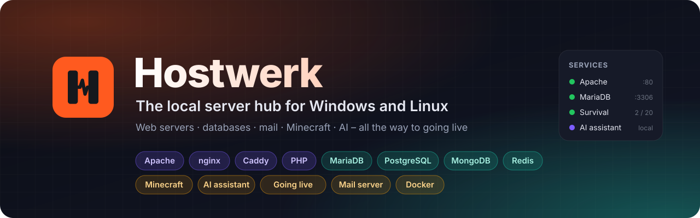
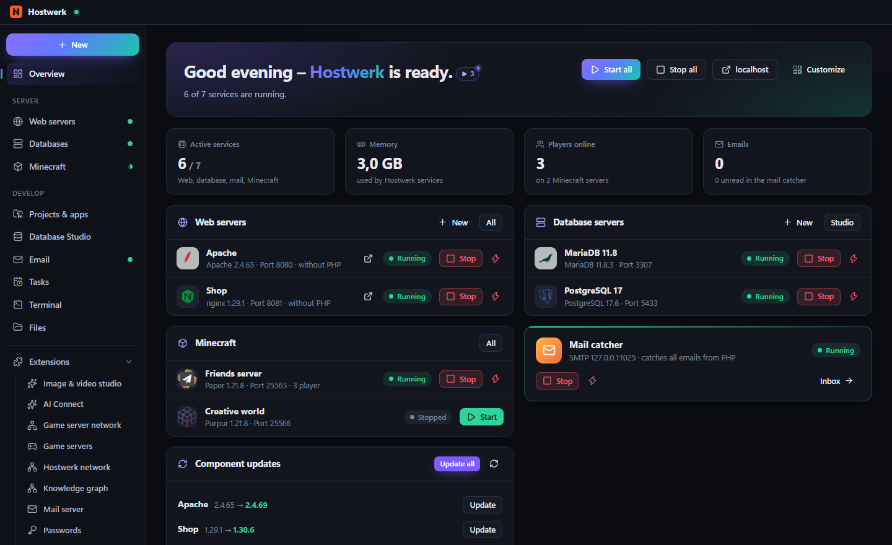
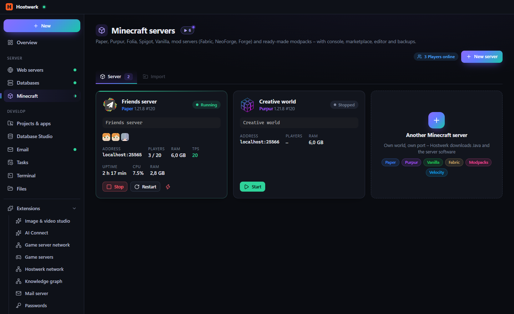
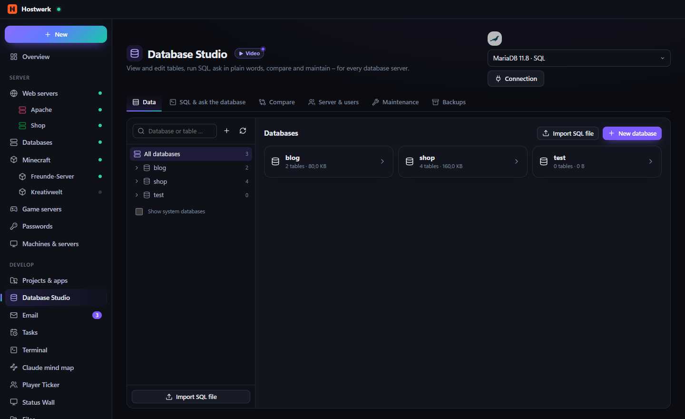
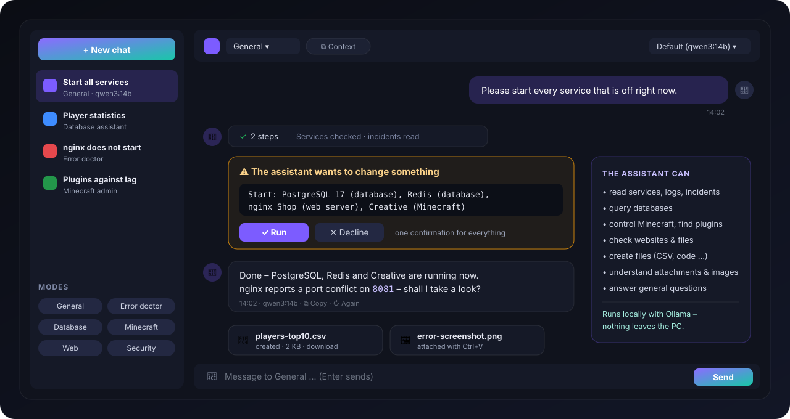
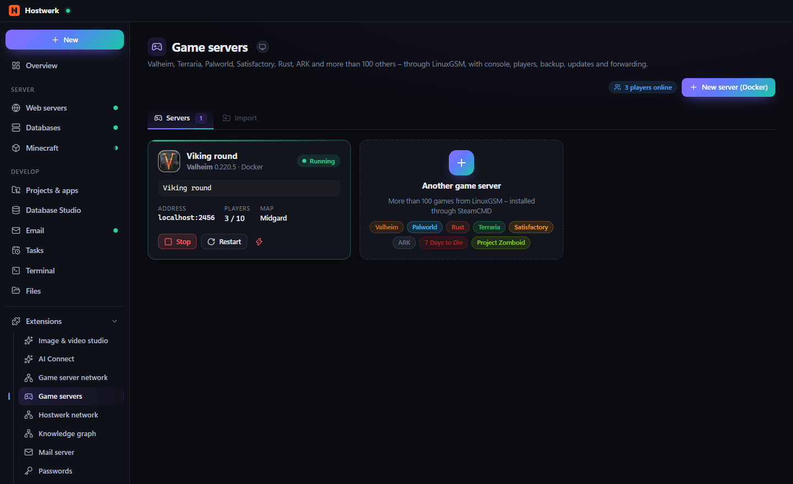
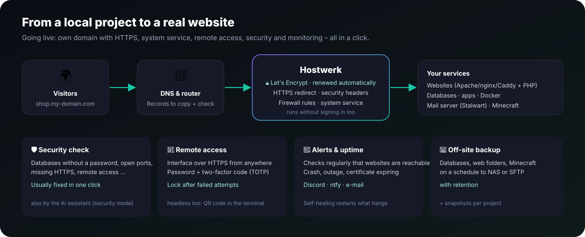
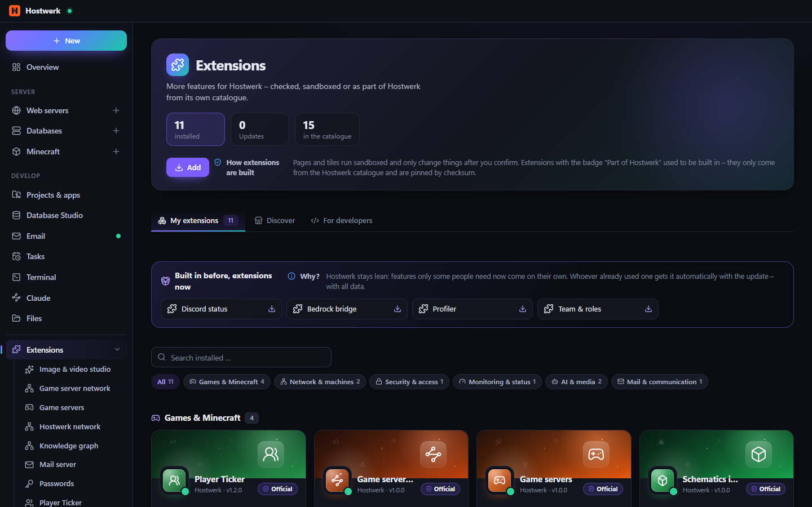
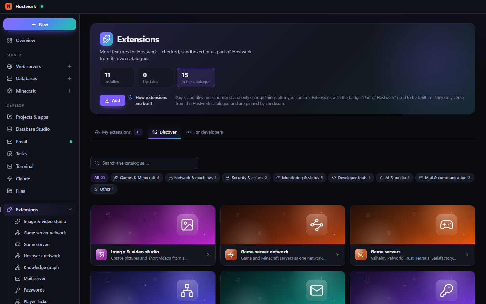

<b>English</b> · <a href="README.de.md">Deutsch</a>

  <b>The local server hub for Windows and Linux</b> 
  Web servers, databases, mail, Minecraft and game servers and an AI assistant – in one app, from your first project to going live.

## What Hostwerk does

- **Everything local, in one interface** – install, start and watch Apache, nginx, Caddy, PHP 7.4–8.5, MariaDB, MySQL, PostgreSQL, MongoDB, Redis, a mail catcher, apps, Docker and Minecraft servers – without editing config files by hand.
- **Several versions side by side** – as many web and database servers as you like, every project with its own PHP version.
- **AI assistant with tools** – looks into services, logs and databases itself and only changes things after you confirm. Runs locally if you want.
- **Ready to go live** – a guide takes you to the internet step by step: real domains with HTTPS, system service, remote access with two-factor, alerts and off-site backup.
- **Extensions** – Hostwerk stays lean: features only some people need (password manager, game servers, mail server, router, several machines …) come as extensions from the official catalogue – with all your data.
- **Moving made easy** – takes over existing web servers, databases and Minecraft servers (e.g. from XAMPP), tested and with a way back.

| Minecraft servers | Database Studio |
|---|---|
|  |  |

| AI assistant | Game servers |
|---|---|
|  |  |

## This repository

Hostwerk itself is developed in a private repository. This public one holds what every Hostwerk installation fetches
**without credentials**:

| Folder | Contents |
|---|---|
| **Releases** | Installers and app updates (mirrored from the main project) and the explainer videos (release `videos`). |
| [`catalog/`](catalog) | AI model catalogue, project templates, advisor rules, password-manager catalogue and the extension catalogues: `extensions.json` (official, built daily from the extension repositories), `community.json`, `verified.json`. |
| [`docs/`](docs) | **[Extensions explained](docs/extensions.md)** – what each permission allows, how Hostwerk sandboxes extensions, where they show up, synergies and templates (with pictures). |
| [`sdk/`](sdk) | **Extension SDK 2.8** – `hostwerk-sdk.js`, design kit, manifest schema, `check.js`, `build-native.js` and the [developer guide](sdk/README.md). |
| [`packages/`](packages) | Checked copies of community extensions (pinned by SHA-256). |
| `katalog/` | Old file names for Hostwerk versions before 2.9 – kept up to date automatically. |

## Extensions

> **New in 2.11:** extensions fit in like built-in features (sidebar, settings, tabs, “New” menu) and everything that is not from the Hostwerk catalog runs **sandboxed**. All details with pictures: **[docs/extensions.md](docs/extensions.md)** · [Deutsch](docs/erweiterungen.md)

Everything lives in one place: **Extensions** in the sidebar – your installed extensions by category, the catalogue
under *Discover*, and tools for developers. Extensions can depend on each other; Hostwerk installs what is needed and
warns before you remove something that is still in use.

| My extensions | Discover |
|---|---|
|  |  |

### Official extensions

**Games & Minecraft**

| &nbsp;&nbsp;&nbsp;&nbsp;&nbsp;&nbsp;&nbsp;&nbsp; | Extension | What it does |
|---|---|---|
|  | [Bedrock bridge](https://github.com/Passimoritz/hostwerk-ext-bedrock-bridge) · *part of Hostwerk* | Friends on phones, consoles and the Windows edition play on your Java servers |
|  | [Game server network](https://github.com/Passimoritz/hostwerk-ext-game-network) · *part of Hostwerk* | Game and Minecraft servers as one network |
|  | [Game servers](https://github.com/Passimoritz/hostwerk-ext-game-servers) · *part of Hostwerk* | Valheim, Palworld, Rust, Terraria, Satisfactory and more than 100 other games through LinuxGSM – natively on Linux, as Docker containers on Windows |
|  | [MOTD studio](https://github.com/Passimoritz/hostwerk-ext-motd-studio) | Design your Minecraft server's description in the server list with colours and formats |
|  | [Player leaderboard](https://github.com/Passimoritz/hostwerk-ext-player-leaderboard) | Who plays, mines or dies the most |
|  | [Player Ticker](https://github.com/Passimoritz/hostwerk-ext-player-ticker) | Who is on your Minecraft servers right now? Live list with heads, TPS and a playtime ranking |
|  | [Schematics in 3D](https://github.com/Passimoritz/hostwerk-ext-schematics-3d) · *part of Hostwerk* | Look at Minecraft builds in 3D before you place them |

**Network & machines**

| &nbsp;&nbsp;&nbsp;&nbsp;&nbsp;&nbsp;&nbsp;&nbsp; | Extension | What it does |
|---|---|---|
|  | [Hostwerk network](https://github.com/Passimoritz/hostwerk-ext-hostwerk-network) · *part of Hostwerk* | Several machines as one network |
|  | [Port map](https://github.com/Passimoritz/hostwerk-ext-port-map) | All ports of your services in one list |
|  | [Router & port forwarding](https://github.com/Passimoritz/hostwerk-ext-router) · *part of Hostwerk* | Makes your servers reachable from the internet |

**Security & access**

| &nbsp;&nbsp;&nbsp;&nbsp;&nbsp;&nbsp;&nbsp;&nbsp; | Extension | What it does |
|---|---|---|
|  | [Certificate watch](https://github.com/Passimoritz/hostwerk-ext-cert-watch) | All certificates at a glance |
|  | [Password manager](https://github.com/Passimoritz/hostwerk-ext-passwords) · *part of Hostwerk* | Own encrypted vault or Bitwarden/Vaultwarden, 1Password, KeePass, pass and LastPass |
|  | [Team & roles](https://github.com/Passimoritz/hostwerk-ext-team) · *part of Hostwerk* | Friends and colleagues with their own sign-in for remote access |

**Monitoring & status**

| &nbsp;&nbsp;&nbsp;&nbsp;&nbsp;&nbsp;&nbsp;&nbsp; | Extension | What it does |
|---|---|---|
|  | [Backup calendar](https://github.com/Passimoritz/hostwerk-ext-backup-calendar) | All scheduled backups of the coming days as a calendar |
|  | [Server profile](https://github.com/Passimoritz/hostwerk-ext-server-card) | Everything important about this PC and its services on one page |
|  | [Status Wall](https://github.com/Passimoritz/hostwerk-ext-status-wall) | All services big and colourful at a glance |
|  | [Storage per service](https://github.com/Passimoritz/hostwerk-ext-disk-usage) | How much space each service takes |
|  | [Uptime wall](https://github.com/Passimoritz/hostwerk-ext-uptime-wall) | All uptime checks big and colourful |

**Developer tools**

| &nbsp;&nbsp;&nbsp;&nbsp;&nbsp;&nbsp;&nbsp;&nbsp; | Extension | What it does |
|---|---|---|
|  | [Profiler](https://github.com/Passimoritz/hostwerk-ext-profiler) · *part of Hostwerk* | Finds out why a page or app is slow |
|  | [Quick tasks](https://github.com/Passimoritz/hostwerk-ext-quick-tasks) | Your tasks as big buttons |

**AI & media**

| &nbsp;&nbsp;&nbsp;&nbsp;&nbsp;&nbsp;&nbsp;&nbsp; | Extension | What it does |
|---|---|---|
|  | [AI Connect](https://github.com/Passimoritz/hostwerk-ext-claude) | Connect your AIs with Hostwerk |
|  | [Image & video studio](https://github.com/Passimoritz/hostwerk-ext-ai-media) · *part of Hostwerk* | Create pictures and short videos from a description |
|  | [Knowledge graph](https://github.com/Passimoritz/hostwerk-ext-knowledge-graph) | Turns your projects (code, docs, Obsidian notes) into a searchable knowledge graph |

**Mail & communication**

| &nbsp;&nbsp;&nbsp;&nbsp;&nbsp;&nbsp;&nbsp;&nbsp; | Extension | What it does |
|---|---|---|
|  | [Discord status](https://github.com/Passimoritz/hostwerk-ext-discord-status) · *part of Hostwerk* | Shows “Playing Hostwerk” in your Discord profile |
|  | [Mail server](https://github.com/Passimoritz/hostwerk-ext-mail-server) · *part of Hostwerk* | Real mailboxes with your own domain |
|  | [Mail statistics](https://github.com/Passimoritz/hostwerk-ext-mail-stats) | How many e-mails your projects send |

**Other**

| &nbsp;&nbsp;&nbsp;&nbsp;&nbsp;&nbsp;&nbsp;&nbsp; | Extension | What it does |
|---|---|---|
|  | [Service notes](https://github.com/Passimoritz/hostwerk-ext-service-notes) | Notes and checklists for every service |

*Part of Hostwerk* = native extension: used to be built in, runs as part of Hostwerk and therefore only comes from this
catalogue (pinned by checksum). If you used the feature before, the update installs it for you – with all data.

## Build an extension

Everything – package, SDK, design kit, translations, permissions, dependencies, native extensions, checking, releasing
and getting verified – is in the **[developer guide](sdk/README.md)** ([Deutsch](sdk/README.de.md)).

Quick start: [hostwerk-ext-template](https://github.com/Passimoritz/hostwerk-ext-template) → *Use this template*.

## Submit an extension

1. Put it in its own repository and create a release (the template does this on every tag).
2. In Hostwerk: **Extensions → For developers → Submit** – or open [Submit an extension](../../issues/new?template=extension.yml).
3. A GitHub Action runs `sdk/check.js --strict` (manifest, security, design, German + English):
   - **Pages and tiles** (sandboxed, change things only after asking) are added at once.
   - **Services** (start programs on the PC) are reviewed by a person and added with the label *approved*.
4. Hostwerk shows it under **Discover** – pinned by checksum, so exactly the checked file is installed.

Updates: submit again with a higher version. An id belongs to whoever submitted it first.
Test a package without submitting: *Actions → Add extension → Run workflow* (dry run).

## Badges

| Badge | Meaning |
|---|---|
| **Official** | By Hostwerk – own repository, in `catalog/extensions.json`. |
| **Part of Hostwerk** | Official extension with its own server and interface code (used to be built in) – only from this catalogue. |
| **Verified developer** | The project has verified the person (`catalog/verified.json`). Every package is still checked and pinned. |
| **Reviewed** | Additionally looked at by a person – required for services. |
| **Checked** | Passed the automatic check, runs sandboxed. |
| **External** | From a source the user added – checked on install only. |

## Get verified as a developer

1. Have at least one extension in the community catalogue.
2. Open [Get verified](../../issues/new?template=verification.yml) – who you are and which extensions are yours.
3. An action confirms the extensions were submitted by your account.
4. The project looks at the request and sets the label **verified** – you are added to `catalog/verified.json`, and
   all your extensions carry the badge. Breaking the rules (hidden code, collecting data without saying so) revokes it.
