# Erweiterungen in Hostwerk – was sie dürfen, wo sie erscheinen, wie sie zusammenspielen

*Ab Hostwerk 2.11 · Erweiterungs-SDK 2.8 · [English version](extensions.md)*

Erweiterungen bringen neue Funktionen in Hostwerk – vom API-Tester über Spiele-Server bis zur Cloud-Sicherung. Sie fügen sich ein wie eingebaute Bereiche: mit eigenem Platz in der Seitenleiste, Einstellungen in Hostwerks Einstellungen, Reitern in vorhandenen Bereichen, Kacheln im „Neu“-Menü und auf der Übersicht. Dabei bleibt eins immer gleich: **Eine Erweiterung kommt nur an das, was du ihr erlaubst – und an manches nie.**

- [Auf einen Blick](#auf-einen-blick)
- [Was jede Freigabe erlaubt](#was-jede-freigabe-erlaubt)
- [Wie Hostwerk dich schützt](#wie-hostwerk-dich-schützt)
- [So sieht es in Hostwerk aus](#so-sieht-es-in-hostwerk-aus)
- [Einbaupunkte – für Entwickler](#einbaupunkte--für-entwickler)
- [Synergien, Dienste und Vorlagen](#synergien-dienste-und-vorlagen)
- [Häufige Fragen](#häufige-fragen)

---

## Auf einen Blick

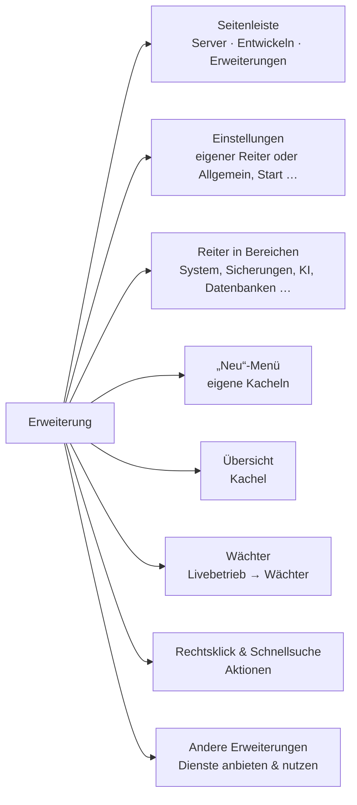

| Vertrauensstufe | Woher | Wie sie läuft |
|---|---|---|
| **Offiziell** | Hostwerk-Katalog, per Prüfsumme festgelegt | als Teil von Hostwerk (das sind auch die früher eingebauten Funktionen wie Passwörter oder Spiele-Server) |
| **Community / Link / Datei** | Community-Katalog, eigener Link, ZIP | **abgeschottet**: Seite im Rahmen, eigener Server-Code in einem eigenen Prozess |
| **Eigener Code** | Ordner im Entwickler-Modus | abgeschottet – für eigenen Code lässt sich die Abschottung bewusst abschalten |

Erweiterungen, die ein **eigenes Programm** starten (z. B. eine Datenbank oder einen Suchdienst), sind nicht abgeschottet – Programme laufen mit deinen Rechten. Außerhalb des Hostwerk-Katalogs fragt Hostwerk deshalb ausdrücklich nach, bevor so ein Paket installiert wird.

---

## Was jede Freigabe erlaubt

Jede Erweiterung nennt in ihrem Paket (`manifest.json` → `permissions`), was sie braucht. Du siehst die Liste **vor dem Installieren**, in den Details jeder Erweiterung und im Zugriffsprotokoll.

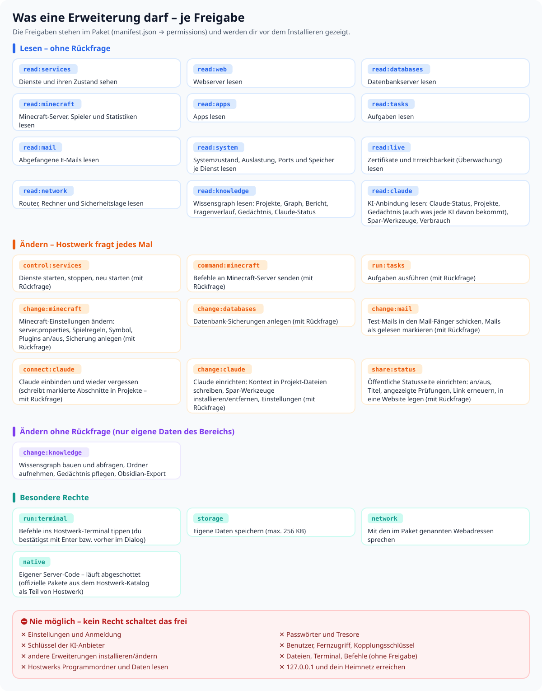

**Gut zu wissen**

- **Lesen** geht ohne Rückfrage, aber nur in den genannten Bereichen. Geheimnisse (Passwörter, Token, Schlüssel, Zugangsdaten in Adressen) kommen **geschwärzt** an: `••••••`.
- **Ändern** fragt dich jedes Mal: „Änderungsnotizen möchte etwas ändern – erlauben?“ Ohne dein Ja passiert nichts.
- **`storage`** ist ein kleiner eigener Speicher (256 KB) – nur für die Erweiterung selbst.
- **`network`** erlaubt nur die Internet-Adressen, die im Paket stehen (`network`). Dein Heimnetz und 127.0.0.1 bleiben trotzdem gesperrt.
- **`native`** heißt: Die Erweiterung bringt eigenen Server-Code mit. Der läuft abgeschottet – nur Pakete aus dem Hostwerk-Katalog laufen als Teil von Hostwerk.

---

## Wie Hostwerk dich schützt

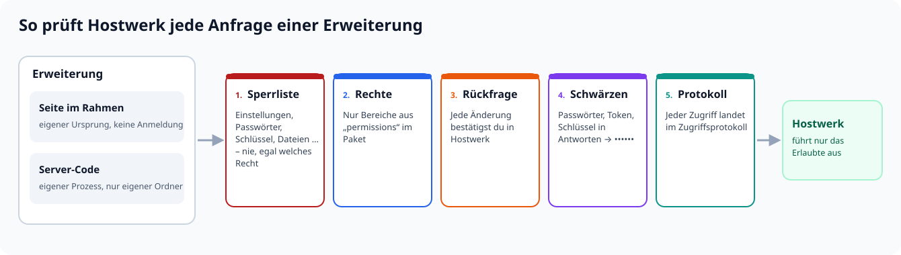

### Seiten im Rahmen

Die Seite einer Erweiterung läuft in einem abgeschotteten Rahmen mit eigenem Ursprung. Sie sieht weder Hostwerks Anmeldung noch Cookies und kann Hostwerk nur über das SDK (`/ext-sdk.js`) fragen. Jede Anfrage geht an **eine** Stelle im Server (`/api/extmarket/<id>/call`), die Sperrliste, Rechte, Rückfrage und Schwärzen prüft und alles protokolliert.

### Eigener Server-Code – abgeschottet

Bringt eine Erweiterung eigenen Server-Code mit (`backend`), startet Hostwerk ihn in einem **eigenen Prozess** mit Nodes Rechte-Modus:

| Darf | Darf nicht |
|---|---|
| den eigenen Paket-Ordner lesen | Hostwerks Einstellungen, Tresore, Schlüssel oder Programmordner lesen |
| in den eigenen Datenordner schreiben | irgendwo sonst schreiben |
| Routen unter `/api/x/<id>/…` anbieten (öffentlich: `/api/x/<id>/pub/…`) | Hostwerks eigene Routen belegen oder abfangen |
| Hostwerk über `host.api()` fragen – mit denselben Rechten wie die Seite | 127.0.0.1, das Heimnetz oder Named Pipes erreichen (also auch nicht Hostwerks API an der Prüfung vorbei) |
| ins Internet zu den Adressen aus `network` (mit Recht `network`) | Programme starten, Worker, native Module, `eval` |
| Wächter melden, Dienste anbieten und nutzen | Hostwerks Umgebungsvariablen sehen (dort könnten Schlüssel stehen) |

Anfragen an den Server-Code kommen **ohne** Cookies, Token oder Kopplungsschlüssel an. Stürzt der Prozess ab, startet Hostwerk ihn zweimal neu und zeigt danach den Fehler an.

### Nie möglich

Diese Bereiche schaltet **kein** Recht frei: Einstellungen und Anmeldung, Benutzer und Fernzugriff, Passwörter und Tresore, Schlüssel der KI-Anbieter, andere Erweiterungen (installieren, ändern), Dateien und Terminal ohne eigene Freigabe, Selbstwartung, MCP, Profile und Umzug.

### Zugriffsprotokoll

Unter *Erweiterungen → Details → Zugriffe* steht für jede Erweiterung, was sie wann gelesen oder geändert hat – und was abgelehnt wurde. Will eine Erweiterung immer wieder an Gesperrtes, meldet Hostwerk das (höchstens einmal am Tag).

---

## So sieht es in Hostwerk aus

Die Bilder zeigen die Beispiel-Erweiterung **„Änderungsnotizen“** (aus anderer Quelle, also abgeschottet) neben Hostwerks eigenen Erweiterungen.

**Eigene Seite – in der Seitenleiste dort, wo sie hingehört** (hier unter „Entwickeln“). „Erweiterungen“ hat eigene Unterpunkte: Meine, Entdecken, Ideen & Synergien, Für Entwickler.

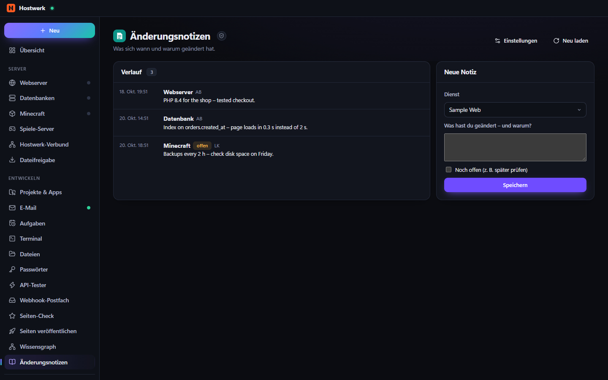

**Details: was sie darf, wie sie läuft, was nie erlaubt ist**

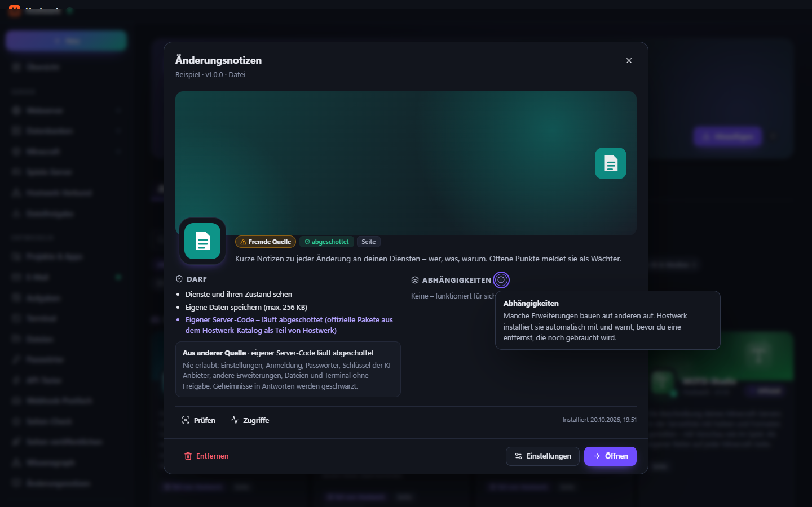

**Ein Reiter in einem Hostwerk-Bereich** – hier „Änderungsnotizen“ unter *System*

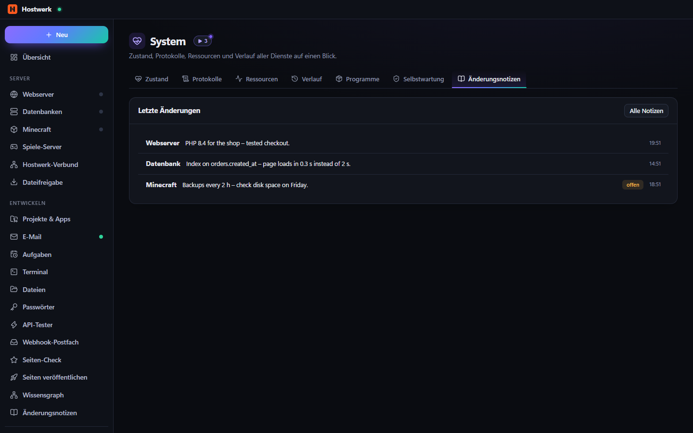

**Eine Kachel im „Neu“-Menü**

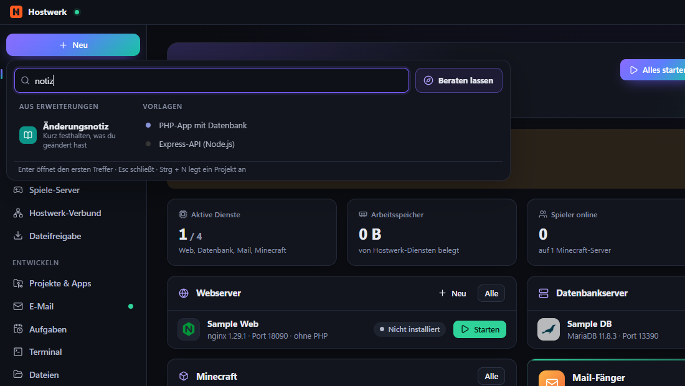

**Einstellungen in Hostwerks Einstellungen** – im eigenen Reiter „Erweiterungen“ (mit Platz in der Seitenleiste) oder, wenn die Erweiterung es so festlegt, in einem vorhandenen Reiter wie „Allgemein“

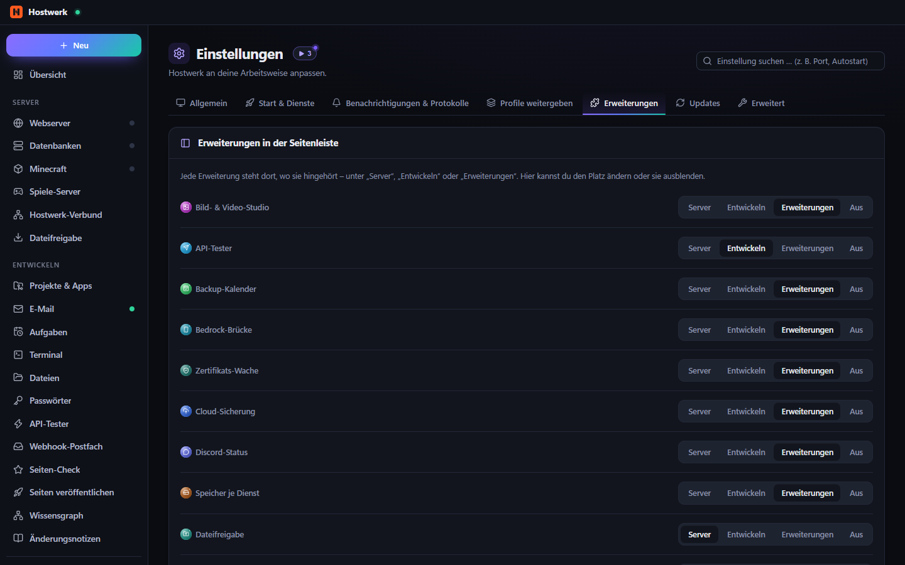

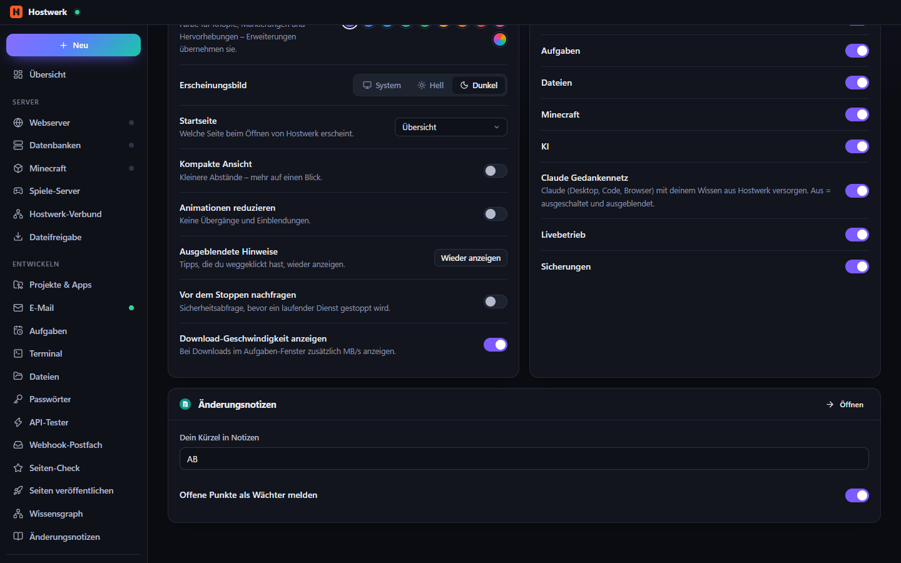

**Ideen & Synergien** – Rezepte für einen Zweck und Paare, die zusammen mehr können

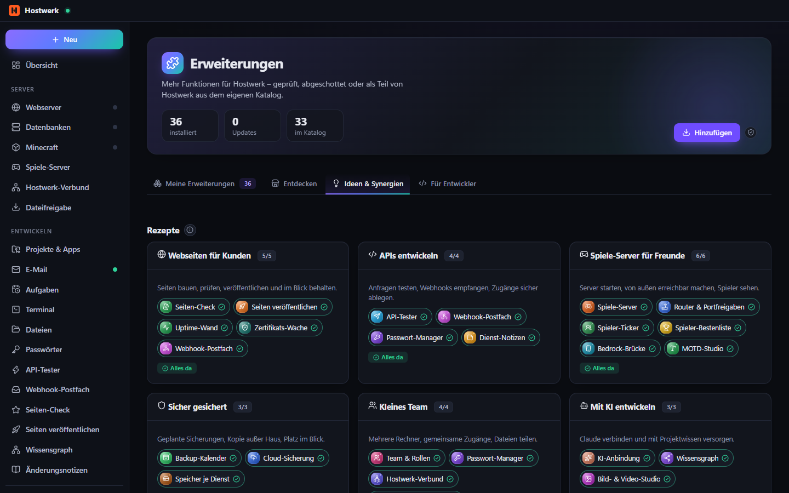

**Wächter** – Erweiterungen melden in Hostwerks gemeinsame Liste (Livebetrieb → Wächter)

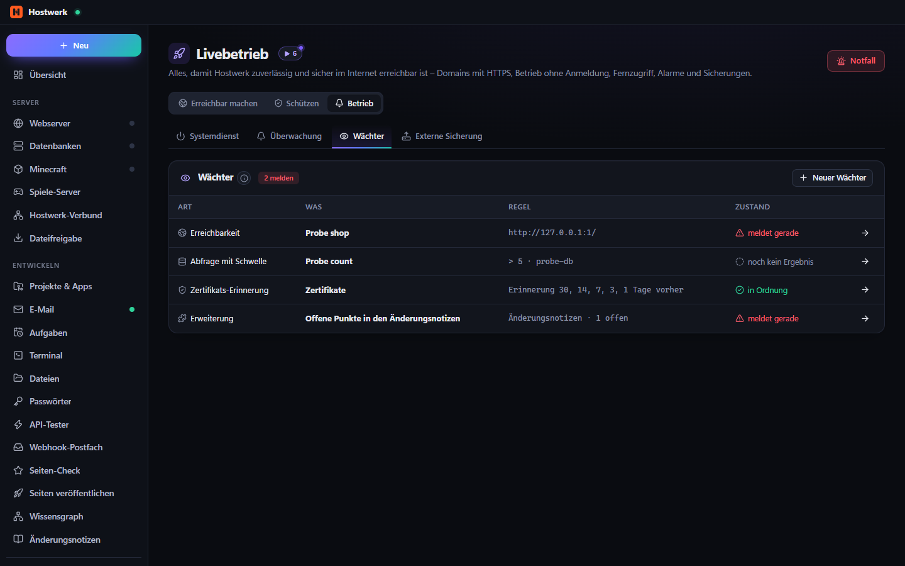

**Zugriffsprotokoll** – auch, was abgelehnt wurde

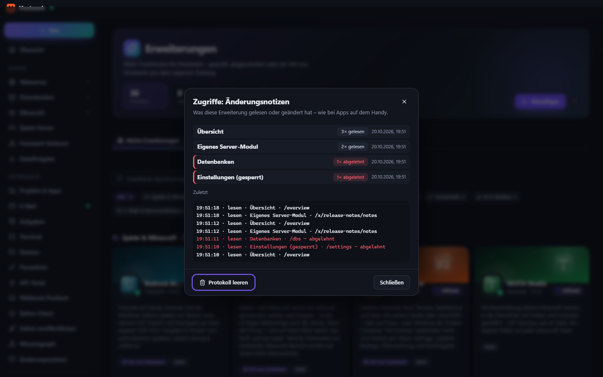

---

## Einbaupunkte – für Entwickler

Alles steht im `manifest.json` (Schema: [`sdk/manifest.schema.json`](../sdk/manifest.schema.json)). Prüfen vor dem Teilen: `node check.js <ordner> --strict` (aus [`sdk/`](../sdk/)).

### Platz in der Seitenleiste

```json
"page": { "title": { "de": "Änderungsnotizen", "en": "Change notes" }, "icon": "book", "file": "page/index.html",
          "nav": { "group": "develop", "order": 60 } }
```

`group`: `server` (unter „Server“), `develop` (unter „Entwickeln“) oder `extensions` (Standard). Der Nutzer kann den Platz in *Einstellungen → Erweiterungen* ändern oder die Seite ausblenden.

### Einstellungen

```json
"settingsTab": "general",
"settings": [
  { "key": "author", "type": "text", "label": { "de": "Dein Kürzel", "en": "Your initials" }, "default": "AB" },
  { "key": "remind", "type": "switch", "label": { "de": "Offene Punkte melden", "en": "Report open items" }, "default": true }
]
```

Das Formular zeichnet Hostwerk selbst (`text`, `number`, `switch`, `select`). `settingsTab`: `general`, `start`, `notifications`, `advanced` oder `extensions` (Standard). Werte liest die Seite mit `Hostwerk.settings.get()`, der Server-Code mit `await host.settings()`.

### Reiter in Hostwerks Bereichen und auf Detailseiten

```json
"contributes": { "tabs": [
  { "id": "notes", "title": { "de": "Änderungsnotizen", "en": "Change notes" }, "icon": "book", "on": "area:system", "file": "page/system-tab.html" },
  { "id": "notes", "title": { "de": "Notizen", "en": "Notes" }, "on": "minecraft", "file": "page/server-tab.html" }
] }
```

Hauptbereiche: `area:system`, `area:backups`, `area:ai`, `area:dbs`, `area:minecraft`, `area:web`, `area:projects`, `area:mail`, `area:live`. Detailseiten: `minecraft`, `web`, `db`, `app`, `game` – dort bekommt der Reiter den Ort als `Hostwerk.context` (`{ kind, id }`).

### Kachel im „Neu“-Menü, Übersicht, Aktionen

```json
"contributes": {
  "new": [{ "id": "note", "title": { "de": "Änderungsnotiz", "en": "Change note" }, "description": { "de": "Kurz festhalten, was du geändert hast", "en": "Write down what you changed" }, "icon": "book" }],
  "actions": [{ "id": "note-here", "title": { "de": "Notiz zu diesem Dienst", "en": "Note for this service" }, "on": ["palette", "web", "db", "minecraft"] }]
},
"widget": { "title": { "de": "Letzte Änderungen", "en": "Recent changes" }, "file": "widget/index.html", "size": "third" }
```

Die Kachel und die Aktionen öffnen die Seite der Erweiterung; dort kommt die Aktion als `Hostwerk.on('action', a => …)` an.

### Eigener Server-Code (abgeschottet)

```js
// server/index.js – läuft in einem eigenen Prozess
exports.activate = async (host) => {
  host.router.get('/notes', async (req, res) => res.json(await load()));          // → /api/x/<id>/notes
  host.publicRouter.post('/hook', (req, res) => res.json({ ok: true }));          // → /api/x/<id>/pub/hook (ohne Anmeldung)
  const o = await host.get('/overview');                                          // nur mit read:services, geschwärzt
  host.watcher({ id: 'open', label: 'Offene Punkte', state: 'alert', detail: '1 offen' });
  host.provide('change-notes', { latest: () => load().slice(0, 5) });
  host.emit('changed', { n: 1 });                                                 // → Hostwerk.on('backend', …) auf der eigenen Seite
};
```

| `host.…` | Wozu |
|---|---|
| `router`, `publicRouter` | Routen (get/post/put/patch/delete/use, `req.params/query/body`, `res.json/send/status`) |
| `api(method, path, body)`, `get(path)` | Hostwerk fragen – Rechte wie die Seite; Änderungen mit Rückfrage nur über die Seite |
| `storage.get/set/remove/all` | eigener kleiner Speicher (Recht `storage`) |
| `dataDir` | eigener Ordner für größere Daten |
| `settings()` | Werte aus `settings` |
| `watcher({ id, label, state, detail, href })` | Wächter in der gemeinsamen Liste (`ok` · `alert` · `off`) |
| `provide(name, obj)`, `use(name)` | Dienste für andere Erweiterungen anbieten bzw. nutzen |
| `toast(text, kind)`, `emit(event, data)` | Hinweis in Hostwerk, Ereignis an die eigene Seite |
| `t(text, vars)`, `lang()` | Übersetzung aus `locales/de.json` |
| `on('shutdown', fn)` | aufräumen |

Die eigene Seite spricht mit dem Server-Code über `Hostwerk.backend('GET', '/notes')` – ohne zusätzliches Recht.

### Native Oberfläche (nur offizielle Pakete)

Offizielle Pakete dürfen eigene React-Module (`ui`) mitbringen und an festen Stellen einhängen: `nav`, `pages`, `slots` mit `settings.sections`, `dashboard.tiles`, `new.items`, `<bereich>.tabs` (z. B. `system.tabs`), `live.tabs`, `mail.tabs`, `titlebar`. Andere Pakete nutzen die Seite im Rahmen – sie sieht dank Hostwerks Design-Baukasten (`/ext-sdk.css`) genauso aus.

---

## Synergien, Dienste und Vorlagen

### Synergien anzeigen

Unter *Erweiterungen → Ideen & Synergien* zeigt Hostwerk, was zusammenpasst – aus drei Quellen:

1. **Kuratiert** im Hostwerk-Katalog ([`catalog/synergies.json`](../catalog/synergies.json)) – Paare und **Rezepte** für einen Zweck („Webseiten für Kunden“, „Spiele-Server für Freunde“, „Sicher gesichert“ …). „Fehlende installieren“ holt alles auf einmal.
2. **Aus den Erweiterungen selbst**:
   ```json
   "synergies": [{ "with": "service-notes", "title": { "de": "Notizen am Dienst und im Verlauf", "en": "Notes on the service and in the history" } }]
   ```
3. **Automatisch über Dienste**: Bietet eine Erweiterung einen Dienst an (`"provides": ["change-notes"]` + `host.provide`) und nutzt eine andere ihn (`"uses": ["change-notes"]` + `host.use`), erscheint das Paar von selbst.

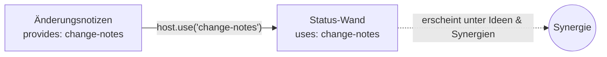

Antworten zwischen Erweiterungen werden ebenfalls geschwärzt – ein Dienst kann keine Geheimnisse weiterreichen.

### Vorlagen

- **[hostwerk-ext-template](https://github.com/Passimoritz/hostwerk-ext-template)** – Vorlage zum Kopieren (GitHub: „Use this template“): Seite, Kachel, Übersetzungen, Prüfung in der CI, Release per Tag.
- **[hostwerk-ext-language-template](https://github.com/Passimoritz/hostwerk-ext-language-template)** – Vorlage für ein Sprachpaket.
- In Hostwerk: *Erweiterungen → Für Entwickler → Eigene bauen* legt ein Gerüst an; *Aus Beschreibung (KI)* baut eine erste Fassung.

**Ideen für Vorlagen, die mit anderen zusammenspielen**

| Idee | Nutzt | Einbaupunkte |
|---|---|---|
| Wartungs-Checkliste je Dienst | `read:services` | Reiter auf Detailseiten, Wächter für Überfälliges |
| Kosten-Wand für Online-Dienste | `read:live`, eigener Speicher | Übersicht-Kachel, `area:system`-Reiter |
| Deploy-Protokoll | `provides: deploy-log` | „Neu“-Menü („Deploy festhalten“), Synergie mit Änderungsnotizen |
| Spieler-Ereignisse an Discord | `read:minecraft`, `network` (Discord-Webhook) | Einstellungen in „Benachrichtigungen“, Wächter |
| Backup-Bericht als Kachel | `read:system`, `read:databases` | Übersicht-Kachel, `area:backups`-Reiter |

### Einreichen

*Erweiterungen → Details → Einreichen* öffnet ein vorausgefülltes Formular im öffentlichen Repository. Die automatische Prüfung (`check.js --strict`) nimmt Erweiterungen ohne Programm sofort auf (eigener Server-Code läuft ja abgeschottet); Pakete, die ein Programm starten, werden zusätzlich von Hand angesehen. Alle 5 Tage prüft Hostwerk, ob Katalog-Erweiterungen noch zum aktuellen SDK passen.

---

## Häufige Fragen

**Kann eine Erweiterung meine Passwörter lesen?** Nein. Der Passwort-Bereich steht auf der Sperrliste – auch eine Erweiterung mit allen Rechten kommt nicht heran. Nur der offizielle Passwort-Manager selbst (ein Paket aus dem Hostwerk-Katalog) verwaltet die Tresore.

**Und wenn eine Erweiterung versucht, Hostwerks API direkt über 127.0.0.1 aufzurufen?** Der abgeschottete Prozess darf keine Verbindungen ins eigene Netz aufbauen – auch nicht über Namen, die auf 127.0.0.1 zeigen. Seiten im Rahmen haben keinen Zugang zu Hostwerks Anmeldung.

**Was ist mit Erweiterungen, die Programme starten?** Programme (z. B. Meilisearch, MinIO) laufen wie jede installierte Software mit deinen Rechten. Außerhalb des Hostwerk-Katalogs fragt Hostwerk vorher ausdrücklich und zeigt den Programmnamen.

**Ich entwickle selbst – geht das ohne Abschottung?** Im Entwickler-Modus kannst du für **eigenen Code aus einem Ordner** die Abschottung abschalten (Details → „Abschottung abschalten“). Für Pakete aus anderen Quellen geht das nicht.

**Wo sehe ich, was eine Erweiterung getan hat?** *Erweiterungen → Details → Zugriffe* – mit Bereich, Zeit, lesen/ändern und Abgelehntem.
