# Extensions in Hostwerk – what they may do, where they show up, how they work together

*From Hostwerk 2.11 · Extension SDK 2.8 · [Deutsche Fassung](erweiterungen.md)*

Extensions bring new features to Hostwerk – from the API tester to game servers to cloud backup. They fit in like built-in areas: their own place in the sidebar, settings inside Hostwerk's settings, tabs in existing areas, tiles in the “New” menu and on the dashboard. One thing never changes: **an extension only gets what you allow – and some things never.**

- [At a glance](#at-a-glance)
- [What each permission allows](#what-each-permission-allows)
- [How Hostwerk protects you](#how-hostwerk-protects-you)
- [What it looks like in Hostwerk](#what-it-looks-like-in-hostwerk)
- [Integration points – for developers](#integration-points--for-developers)
- [Synergies, services and templates](#synergies-services-and-templates)
- [FAQ](#faq)

---

## At a glance

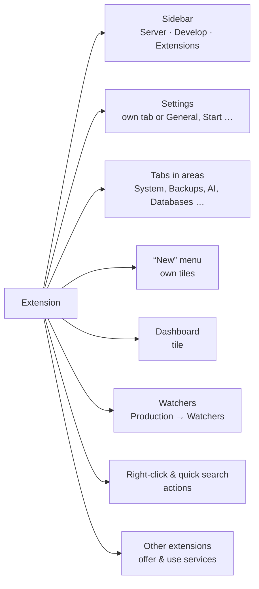

| Trust level | From | How it runs |
|---|---|---|
| **Official** | Hostwerk catalog, pinned by checksum | as part of Hostwerk (including the features that used to be built in, like passwords or game servers) |
| **Community / link / file** | community catalog, own link, ZIP | **sandboxed**: page in a frame, own server code in a separate process |
| **Your own code** | folder in developer mode | sandboxed – you can turn the sandbox off on purpose for your own code |

Extensions that start **their own program** (e.g. a database or a search service) are not sandboxed – programs run with your rights. Outside the Hostwerk catalog, Hostwerk therefore asks explicitly before installing such a package.

---

## What each permission allows

Every extension lists what it needs in its package (`manifest.json` → `permissions`). You see the list **before installing**, in the details of each extension and in the access log.

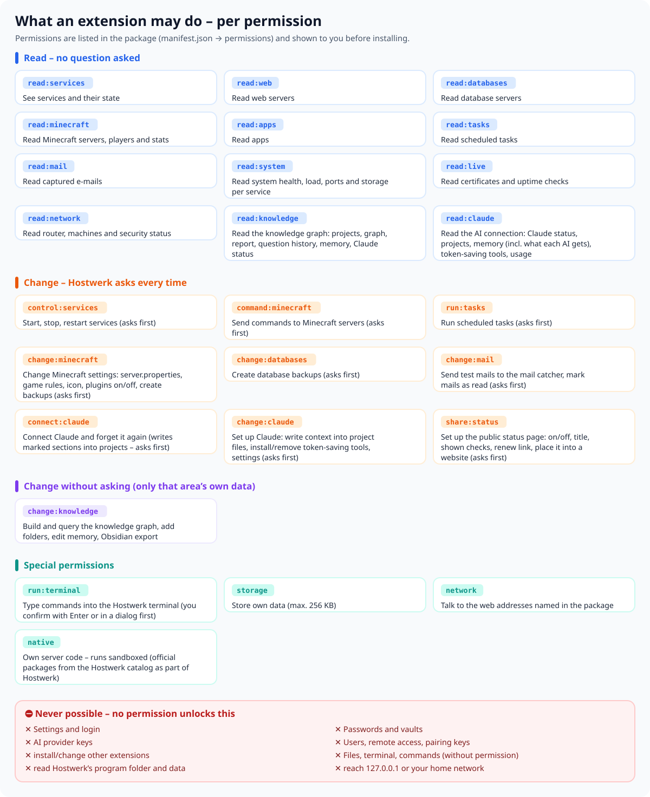

**Good to know**

- **Read** works without asking, but only in the listed areas. Secrets (passwords, tokens, keys, credentials in addresses) arrive **blacked out**: `••••••`.
- **Change** asks you every time: “Change notes wants to change something – allow?” Nothing happens without your yes.
- **`storage`** is a small store of its own (256 KB) – only for the extension itself.
- **`network`** only allows the internet addresses named in the package (`network`). Your home network and 127.0.0.1 stay blocked anyway.
- **`native`** means the extension brings its own server code. It runs sandboxed – only packages from the Hostwerk catalog run as part of Hostwerk.

---

## How Hostwerk protects you

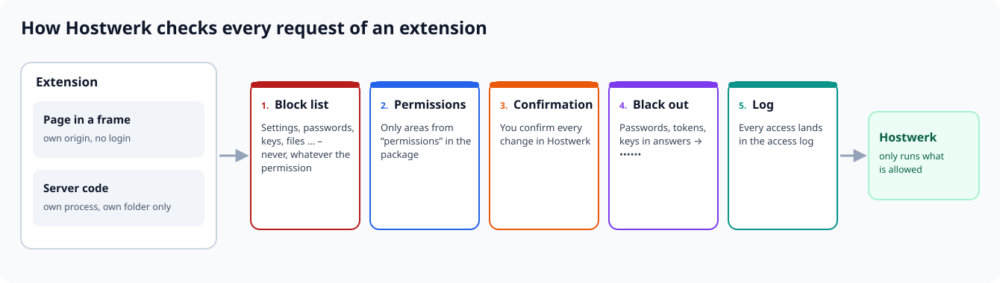

### Pages in a frame

An extension's page runs in a sandboxed frame with its own origin. It sees neither Hostwerk's login nor cookies and can only ask Hostwerk through the SDK (`/ext-sdk.js`). Every request goes to **one** place in the server (`/api/extmarket/<id>/call`) that checks the block list, permissions and confirmation, blacks out secrets and logs everything.

### Own server code – sandboxed

If an extension brings its own server code (`backend`), Hostwerk starts it in a **separate process** with Node's permission model:

| May | May not |
|---|---|
| read its own package folder | read Hostwerk's settings, vaults, keys or program folder |
| write to its own data folder | write anywhere else |
| offer routes under `/api/x/<id>/…` (public: `/api/x/<id>/pub/…`) | take over or intercept Hostwerk's own routes |
| ask Hostwerk through `host.api()` – with the same permissions as the page | reach 127.0.0.1, the home network or named pipes (so not Hostwerk's API past the checks either) |
| go to the internet addresses from `network` (with the `network` permission) | start programs, workers, native modules, `eval` |
| report watchers, offer and use services | see Hostwerk's environment variables (keys could be there) |

Requests to the server code arrive **without** cookies, tokens or pairing keys. If the process crashes, Hostwerk restarts it twice and then shows the error.

### Never possible

**No** permission unlocks these areas: settings and login, users and remote access, passwords and vaults, AI provider keys, other extensions (install, change), files and terminal without their own permission, self-maintenance, MCP, profiles and moving.

### Access log

Under *Extensions → Details → Access log* Hostwerk lists what each extension read or changed and when – and what was denied. If an extension keeps trying to reach blocked areas, Hostwerk tells you (at most once a day).

---

## What it looks like in Hostwerk

The pictures show the example extension **“Change notes”** (from another source, so sandboxed) next to Hostwerk's own extensions.

**Own page – in the sidebar where it belongs** (here under “Develop”). “Extensions” has its own sub-items: My extensions, Discover, Ideas & synergies, For developers.

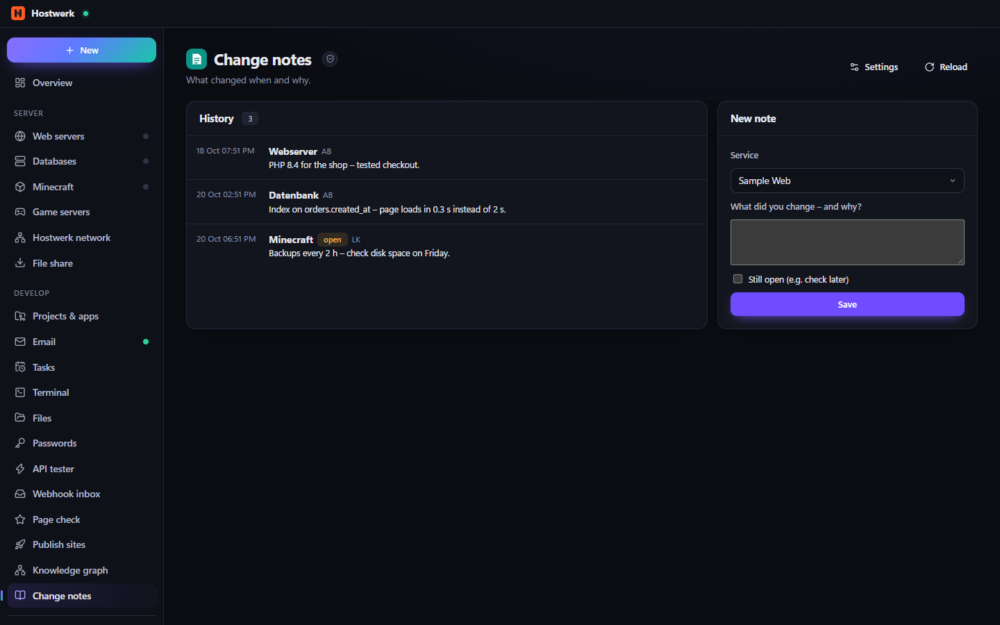

**Details: what it may do, how it runs, what is never allowed**

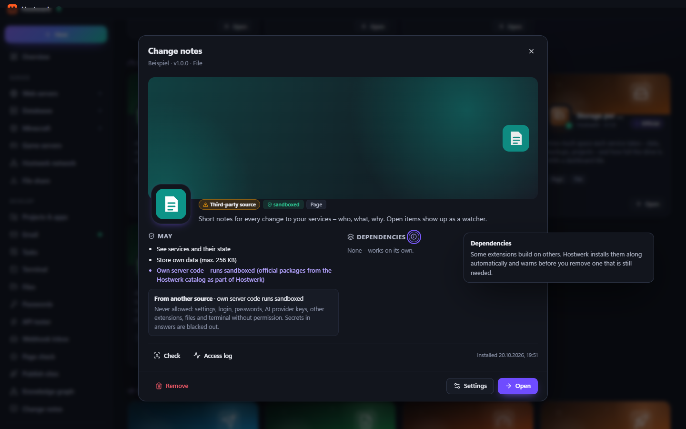

**A tab in a Hostwerk area** – here “Change notes” under *System*

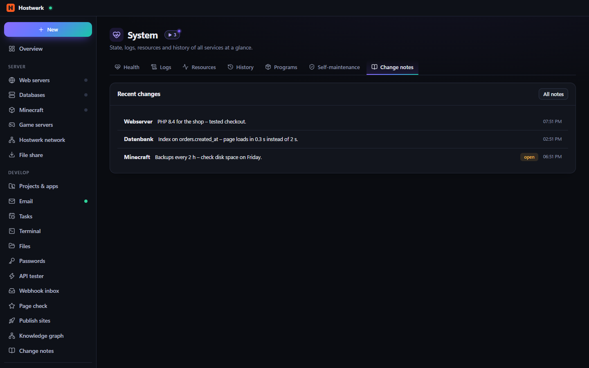

**A tile in the “New” menu**

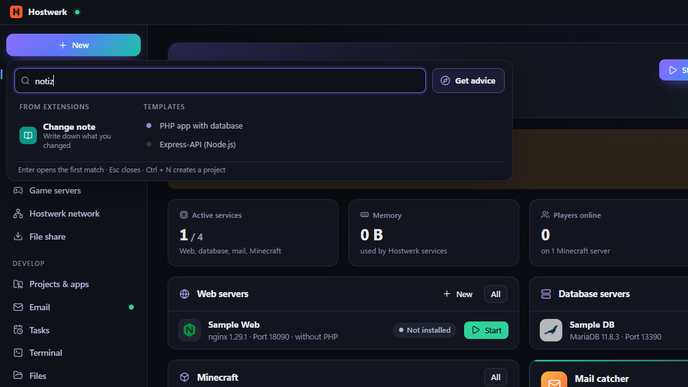

**Settings inside Hostwerk's settings** – in their own tab “Extensions” (with the sidebar place) or, if the extension says so, in an existing tab such as “General”

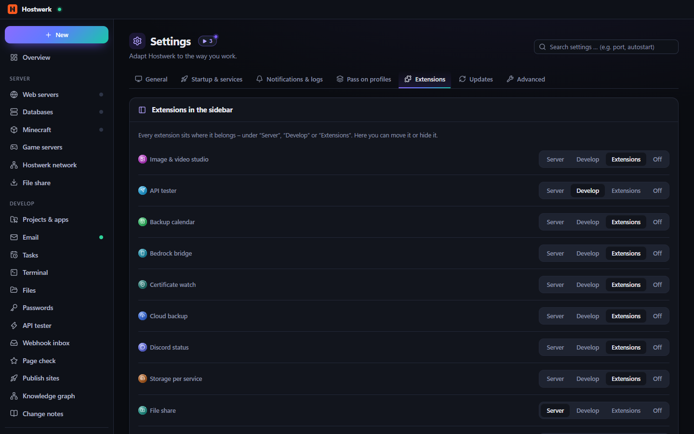

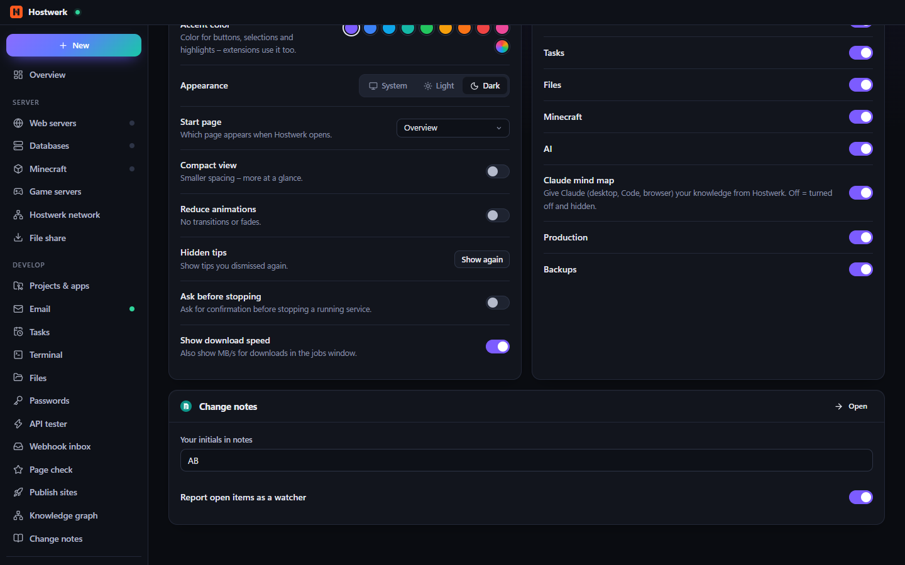

**Ideas & synergies** – recipes for a purpose and pairs that do more together

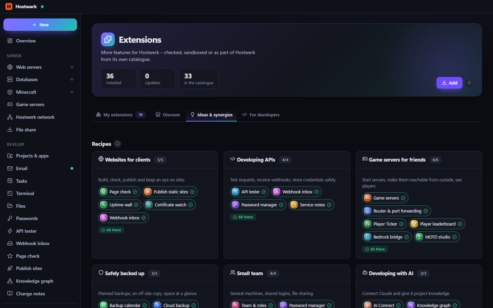

**Watchers** – extensions report into Hostwerk's shared list (Production → Watchers)

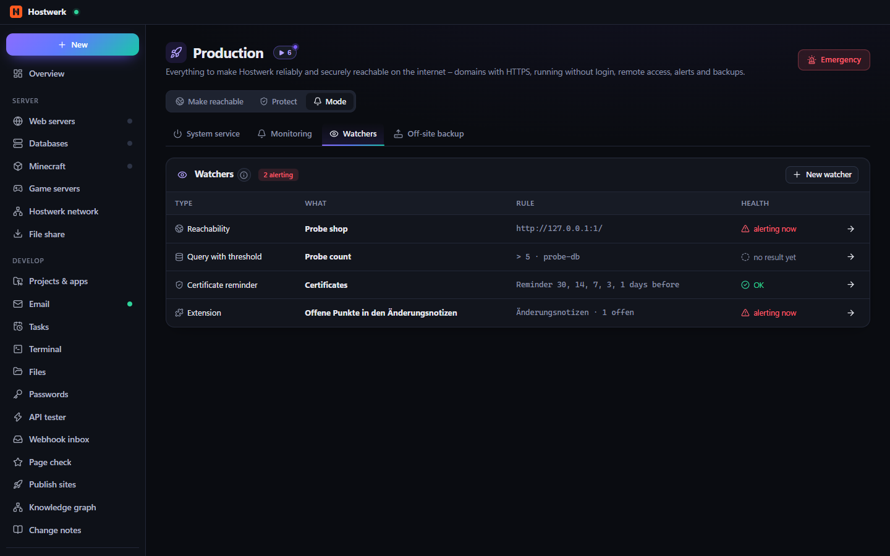

**Access log** – including what was denied

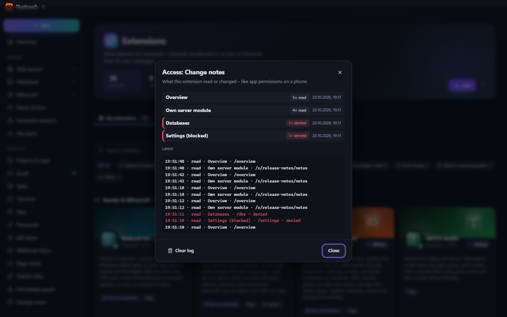

---

## Integration points – for developers

Everything lives in `manifest.json` (schema: [`sdk/manifest.schema.json`](../sdk/manifest.schema.json)). Check before sharing: `node check.js <folder> --strict` (from [`sdk/`](../sdk/)).

### Place in the sidebar

```json
"page": { "title": { "de": "Änderungsnotizen", "en": "Change notes" }, "icon": "book", "file": "page/index.html",
          "nav": { "group": "develop", "order": 60 } }
```

`group`: `server` (under “Server”), `develop` (under “Develop”) or `extensions` (default). Users can move or hide it in *Settings → Extensions*.

### Settings

```json
"settingsTab": "general",
"settings": [
  { "key": "author", "type": "text", "label": { "de": "Dein Kürzel", "en": "Your initials" }, "default": "AB" },
  { "key": "remind", "type": "switch", "label": { "de": "Offene Punkte melden", "en": "Report open items" }, "default": true }
]
```

Hostwerk draws the form itself (`text`, `number`, `switch`, `select`). `settingsTab`: `general`, `start`, `notifications`, `advanced` or `extensions` (default). The page reads values with `Hostwerk.settings.get()`, the server code with `await host.settings()`.

### Tabs in Hostwerk's areas and on detail pages

```json
"contributes": { "tabs": [
  { "id": "notes", "title": { "de": "Änderungsnotizen", "en": "Change notes" }, "icon": "book", "on": "area:system", "file": "page/system-tab.html" },
  { "id": "notes", "title": { "de": "Notizen", "en": "Notes" }, "on": "minecraft", "file": "page/server-tab.html" }
] }
```

Main areas: `area:system`, `area:backups`, `area:ai`, `area:dbs`, `area:minecraft`, `area:web`, `area:projects`, `area:mail`, `area:live`. Detail pages: `minecraft`, `web`, `db`, `app`, `game` – there the tab gets the place as `Hostwerk.context` (`{ kind, id }`).

### Tile in the “New” menu, dashboard, actions

```json
"contributes": {
  "new": [{ "id": "note", "title": { "de": "Änderungsnotiz", "en": "Change note" }, "description": { "de": "Kurz festhalten, was du geändert hast", "en": "Write down what you changed" }, "icon": "book" }],
  "actions": [{ "id": "note-here", "title": { "de": "Notiz zu diesem Dienst", "en": "Note for this service" }, "on": ["palette", "web", "db", "minecraft"] }]
},
"widget": { "title": { "de": "Letzte Änderungen", "en": "Recent changes" }, "file": "widget/index.html", "size": "third" }
```

The tile and the actions open the extension page; the action arrives there as `Hostwerk.on('action', a => …)`.

### Own server code (sandboxed)

```js
// server/index.js – runs in its own process
exports.activate = async (host) => {
  host.router.get('/notes', async (req, res) => res.json(await load()));          // → /api/x/<id>/notes
  host.publicRouter.post('/hook', (req, res) => res.json({ ok: true }));          // → /api/x/<id>/pub/hook (no login)
  const o = await host.get('/overview');                                          // only with read:services, blacked out
  host.watcher({ id: 'open', label: 'Open items', state: 'alert', detail: '1 open' });
  host.provide('change-notes', { latest: () => load().slice(0, 5) });
  host.emit('changed', { n: 1 });                                                 // → Hostwerk.on('backend', …) on its own page
};
```

| `host.…` | What for |
|---|---|
| `router`, `publicRouter` | routes (get/post/put/patch/delete/use, `req.params/query/body`, `res.json/send/status`) |
| `api(method, path, body)`, `get(path)` | ask Hostwerk – permissions like the page; changes that need confirmation only through the page |
| `storage.get/set/remove/all` | small store of its own (permission `storage`) |
| `dataDir` | own folder for larger data |
| `settings()` | values from `settings` |
| `watcher({ id, label, state, detail, href })` | watcher in the shared list (`ok` · `alert` · `off`) |
| `provide(name, obj)`, `use(name)` | offer or use services for/of other extensions |
| `toast(text, kind)`, `emit(event, data)` | note in Hostwerk, event to its own page |
| `t(text, vars)`, `lang()` | translation from `locales/de.json` |
| `on('shutdown', fn)` | clean up |

The page talks to its server code with `Hostwerk.backend('GET', '/notes')` – no extra permission needed.

### Native interface (official packages only)

Official packages may bring their own React modules (`ui`) and plug into fixed places: `nav`, `pages`, `slots` with `settings.sections`, `dashboard.tiles`, `new.items`, `<area>.tabs` (e.g. `system.tabs`), `live.tabs`, `mail.tabs`, `titlebar`. Other packages use the page in a frame – thanks to Hostwerk's design kit (`/ext-sdk.css`) it looks just the same.

---

## Synergies, services and templates

### Showing synergies

Under *Extensions → Ideas & synergies* Hostwerk shows what fits together – from three sources:

1. **Curated** in the Hostwerk catalog ([`catalog/synergies.json`](../catalog/synergies.json)) – pairs and **recipes** for a purpose (“Websites for clients”, “Game servers for friends”, “Safely backed up” …). “Install missing” gets everything at once.
2. **From the extensions themselves**:
   ```json
   "synergies": [{ "with": "service-notes", "title": { "de": "Notizen am Dienst und im Verlauf", "en": "Notes on the service and in the history" } }]
   ```
3. **Automatically through services**: if one extension offers a service (`"provides": ["change-notes"]` + `host.provide`) and another uses it (`"uses": ["change-notes"]` + `host.use`), the pair shows up by itself.

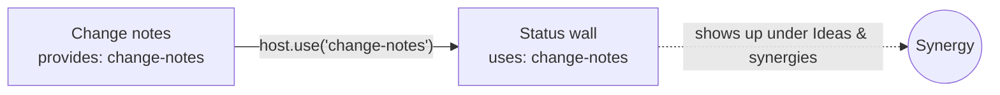

Answers between extensions are blacked out too – a service cannot pass secrets on.

### Templates

- **[hostwerk-ext-template](https://github.com/Passimoritz/hostwerk-ext-template)** – template to copy (GitHub: “Use this template”): page, tile, translations, check in CI, release by tag.
- **[hostwerk-ext-language-template](https://github.com/Passimoritz/hostwerk-ext-language-template)** – template for a language pack.
- In Hostwerk: *Extensions → For developers → Build your own* creates a skeleton; *From a description (AI)* builds a first version.

**Template ideas that work with others**

| Idea | Uses | Integration points |
|---|---|---|
| Maintenance checklist per service | `read:services` | tabs on detail pages, watcher for overdue items |
| Cost wall for online services | `read:live`, own storage | dashboard tile, `area:system` tab |
| Deploy log | `provides: deploy-log` | “New” menu (“Record a deploy”), synergy with change notes |
| Player events to Discord | `read:minecraft`, `network` (Discord webhook) | settings under “Notifications”, watcher |
| Backup report as a tile | `read:system`, `read:databases` | dashboard tile, `area:backups` tab |

### Submitting

*Extensions → Details → Submit* opens a prefilled form in the public repository. The automatic check (`check.js --strict`) adds extensions without a program right away (own server code runs sandboxed anyway); packages that start a program are also looked at by a person. Every 5 days Hostwerk checks whether catalog extensions still fit the current SDK.

---

## FAQ

**Can an extension read my passwords?** No. The password area is on the block list – even an extension with every permission cannot get there. Only the official password manager itself (a package from the Hostwerk catalog) manages the vaults.

**What if an extension tries to call Hostwerk's API directly through 127.0.0.1?** The sandboxed process may not connect to the local network – not even through names that point to 127.0.0.1. Pages in a frame have no access to Hostwerk's login.

**What about extensions that start programs?** Programs (e.g. Meilisearch, MinIO) run with your rights like any installed software. Outside the Hostwerk catalog, Hostwerk asks explicitly first and shows the program name.

**I develop extensions myself – can I go without the sandbox?** In developer mode you can turn off the sandbox for **your own code from a folder** (Details → “Turn off sandbox”). For packages from other sources this is not possible.

**Where do I see what an extension did?** *Extensions → Details → Access log* – with area, time, read/change and what was denied.
