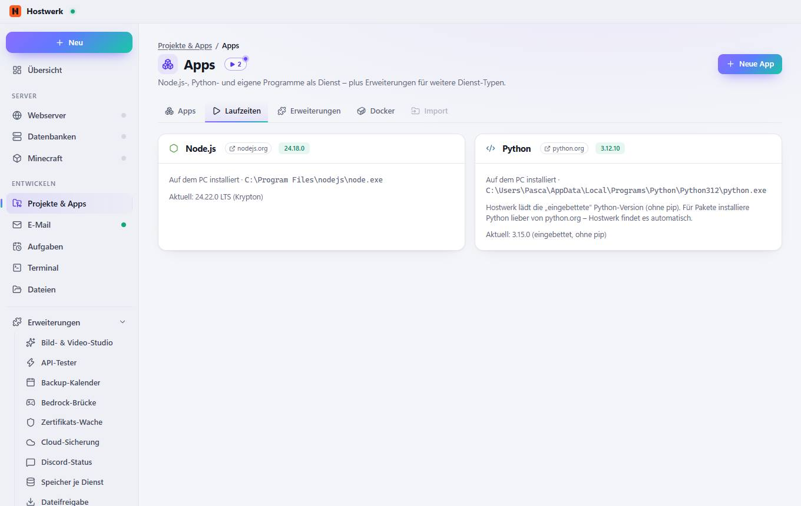
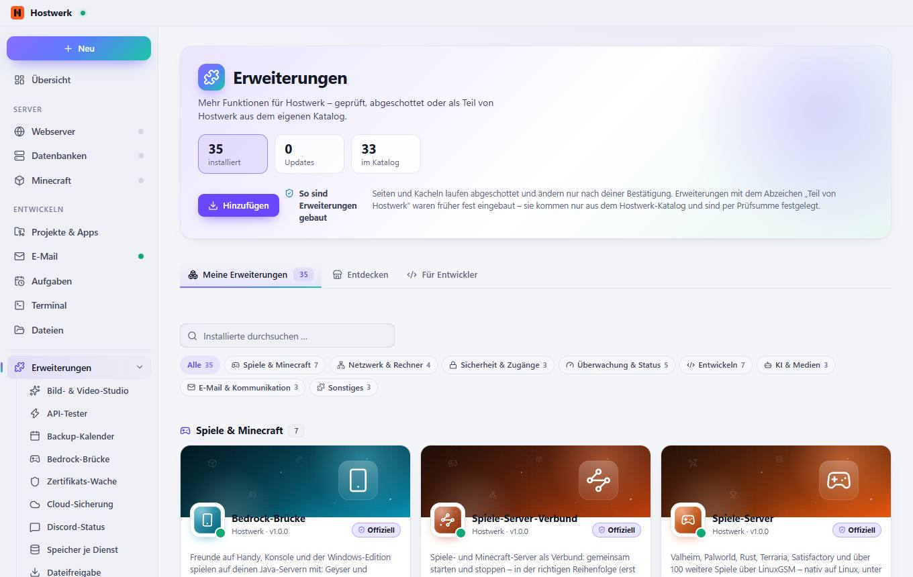
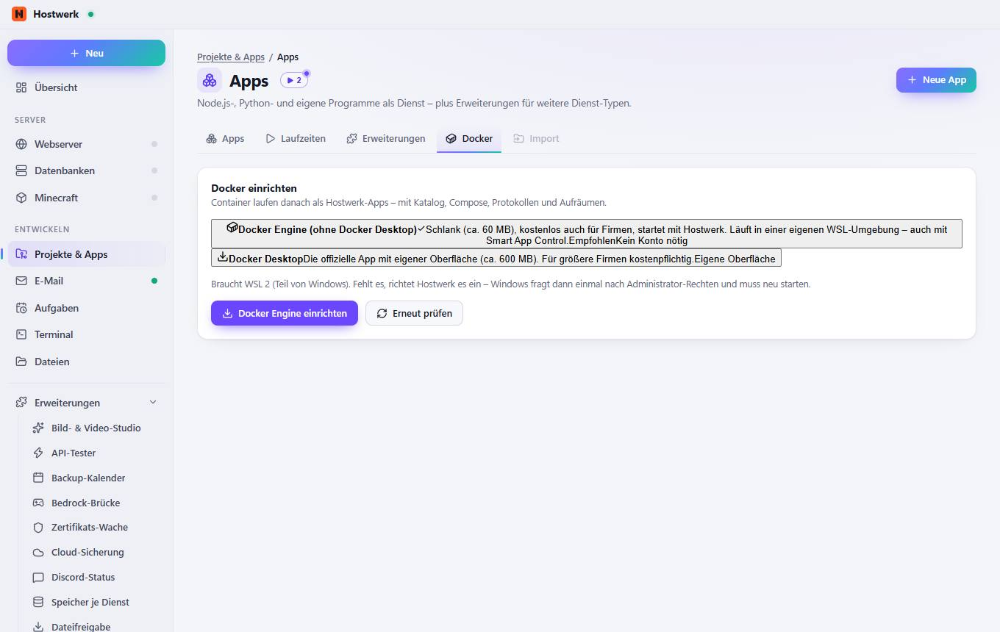
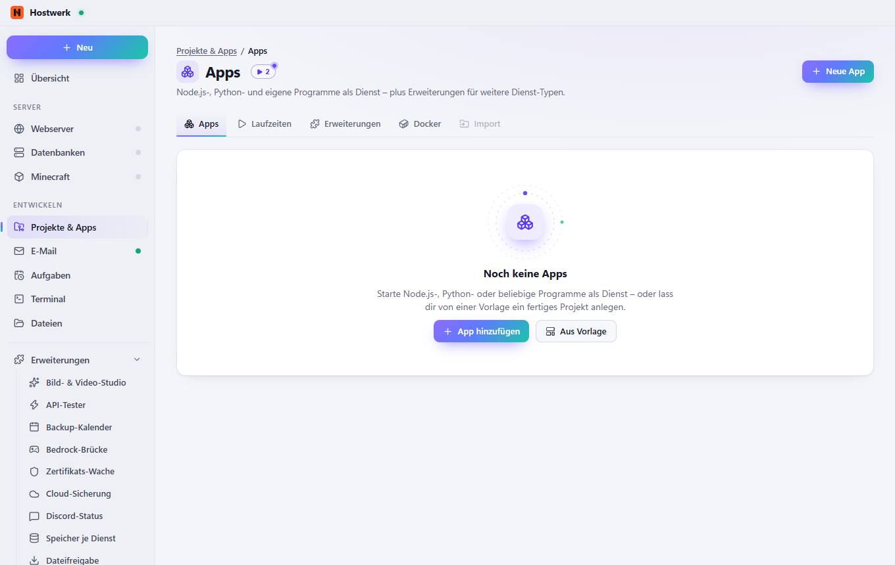

# Apps

[← Zurück zur Übersicht](README.md)

Node.js-, Python- und eigene Programme als Dienst – plus Erweiterungen für weitere Dienst-Typen.

### Was du hier tun kannst

- Neue App
- App hinzufügen
- Aus Vorlage

## Reiter

### Laufzeiten

**Bereiche auf dieser Seite:** Node.js · Python

**Was du hier tun kannst:** Neue App · nodejs.org · python.org

### Erweiterungen

**Bereiche auf dieser Seite:** Spiele & Minecraft 7 · Netzwerk & Rechner 4 · Sicherheit & Zugänge 3 · Überwachung & Status 5 · Entwickeln 7 · KI & Medien 3 · E-Mail & Kommunikation 3 · Sonstiges 3

**Was du hier tun kannst:** 35 installiert · 0 Updates · 33 im Katalog · Hinzufügen · Alle 35 · Spiele & Minecraft 7 · Netzwerk & Rechner 4 · Sicherheit & Zugänge 3 · Überwachung & Status 5 · Entwickeln 7 · KI & Medien 3 · E-Mail & Kommunikation 3 · Sonstiges 3 · Bedrock-Brücke – Details · Öffnen · Spiele-Server-Verbund – Details · Spiele-Server – Details · MOTD-Studio – Details · Spieler-Bestenliste – Details · Spieler-Ticker – Details · Bauwerke in 3D – Details · Dateifreigabe (SFTP) – Details · Hostwerk-Verbund – Details · Port-Übersicht – Details · Router & Portfreigaben – Details · Zertifikats-Wache – Details · Passwort-Manager – Details · Team & Rollen – Details · Backup-Kalender – Details · Server-Steckbrief – Details · Status-Wand – Details · Speicher je Dienst – Details · Uptime-Wand – Details · API-Tester – Details · Seiten-Check – Details · Leistungs-Messung – Details · Seiten veröffentlichen – Details · Schnell-Aufgaben – Details · Webhook-Postfach – Details · Meine Erweiterung – Details

### Docker

**Was du hier tun kannst:** Neue App · Docker DesktopDie offizielle App mit eigener Oberfläche (ca. 600 MB). Für größere Firmen kostenpflichtig.Eigene Oberfläche · Docker Engine einrichten · Erneut prüfen

### Import

**Was du hier tun kannst:** Neue App · App hinzufügen · Aus Vorlage

Erzeugt am 2026-10-20 · Hostwerk 2.10.0
