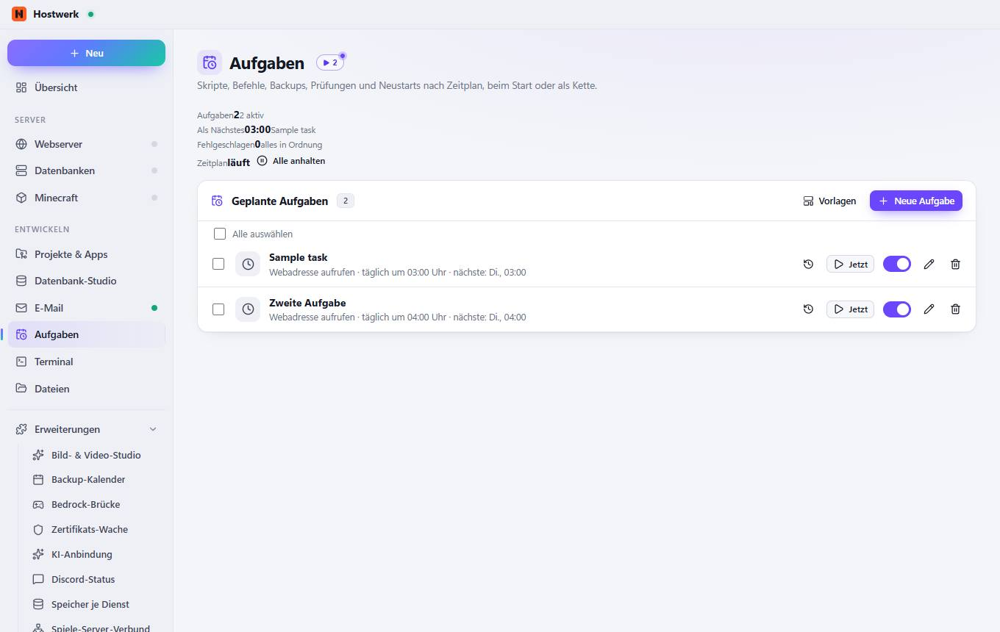

# Aufgaben

[← Zurück zur Übersicht](README.md)

Skripte, Befehle, Backups, Prüfungen und Neustarts nach Zeitplan, beim Start oder als Kette.

### Bereiche auf dieser Seite

- Geplante Aufgaben

### Was du hier tun kannst

- Alle anhalten
- Vorlagen
- Neue Aufgabe
- Verlauf
- Jetzt
- Bearbeiten
- Löschen

Erzeugt am 2026-10-19 · Hostwerk 2.9.0
