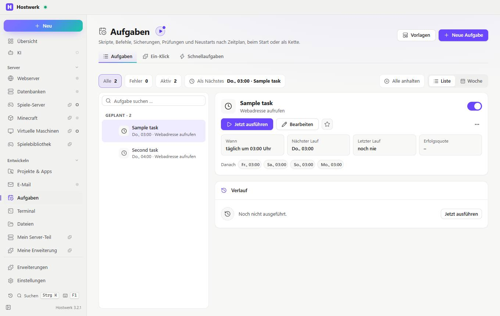
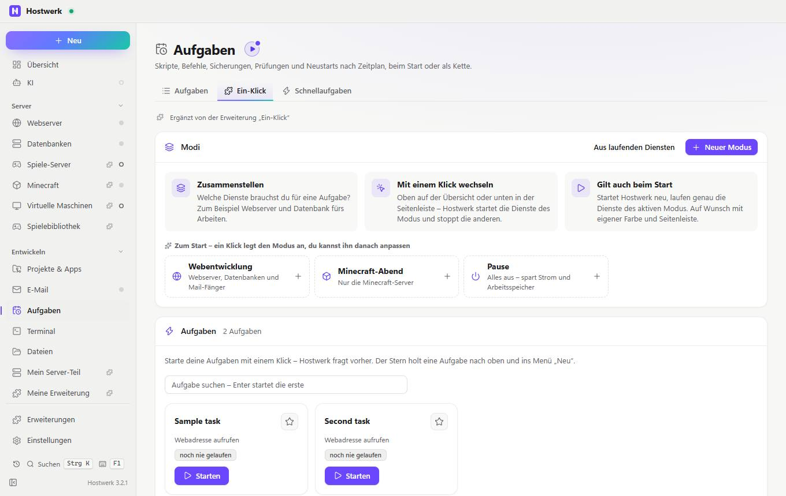
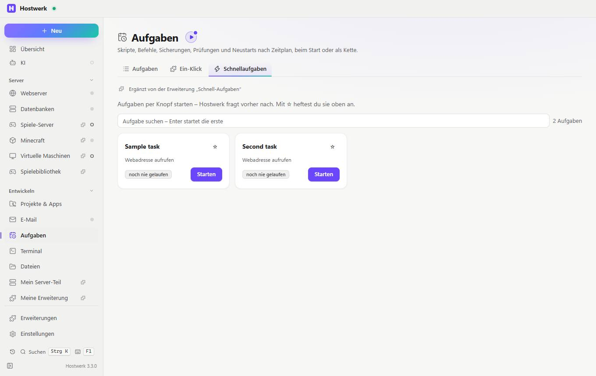

# Aufgaben

[← Zurück zur Übersicht](README.md)

Skripte, Befehle, Sicherungen, Prüfungen und Neustarts nach Zeitplan, beim Start oder als Kette.

### Bereiche auf dieser Seite

- Verlauf

### Was du hier tun kannst

- 2 Videos
- Vorlagen
- Neue Aufgabe
- Alle 2
- Fehler 0
- Aktiv 2
- Alle anhalten
- Sample task Do., 03:00 · Webadresse aufrufen
- Second task Do., 04:00 · Webadresse aufrufen
- Jetzt ausführen
- Bearbeiten
- Als Favorit markieren (steht dann in Listen oben)
- Weitere Aktionen für Sample task

## Reiter

### Ein-Klick

**Bereiche auf dieser Seite:** Modi · Aufgaben

**Was du hier tun kannst:** 2 Videos · Von der Erweiterung „Ein-Klick“ – Infos · Aus laufenden Diensten · Neuer Modus · Webentwicklung Webserver, Datenbanken und Mail-Fänger · Minecraft-Abend Nur die Minecraft-Server · Pause Alles aus – spart Strom und Arbeitsspeicher · Als Favorit markieren (steht dann in Listen oben) · Starten

### Schnellaufgaben

**Was du hier tun kannst:** 2 Videos · Von der Erweiterung „Schnell-Aufgaben“ – Infos

Erzeugt am 2026-11-18 · Hostwerk 3.2.1
