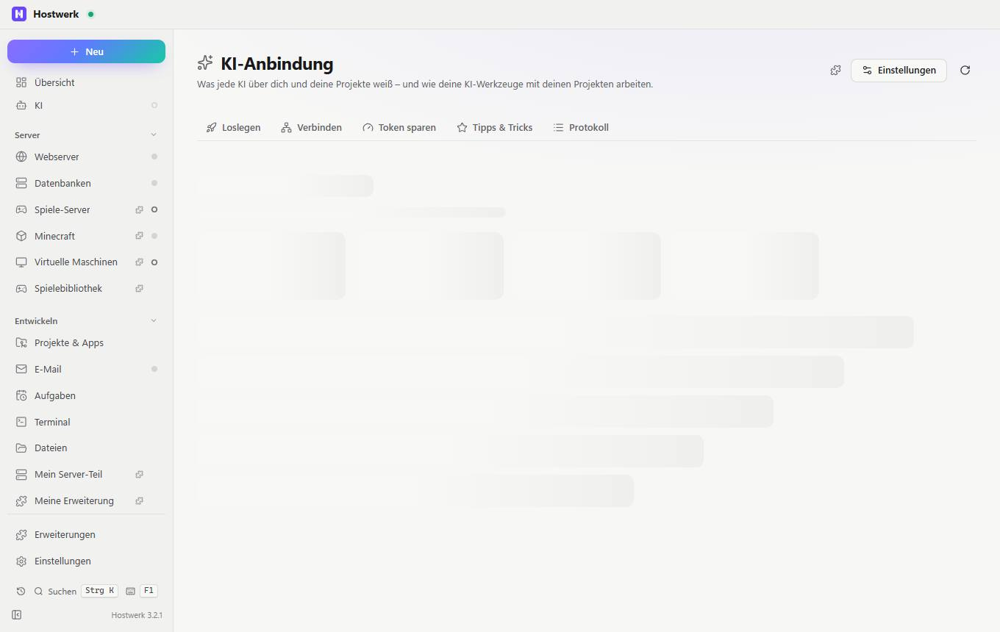
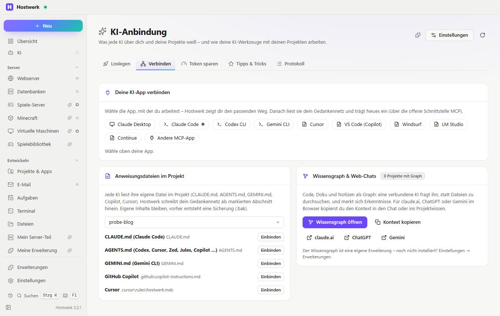
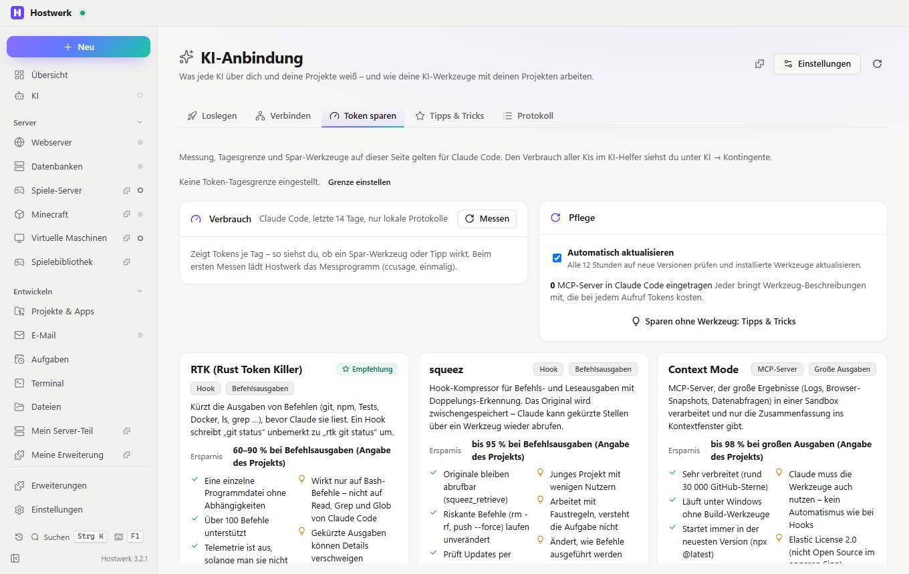
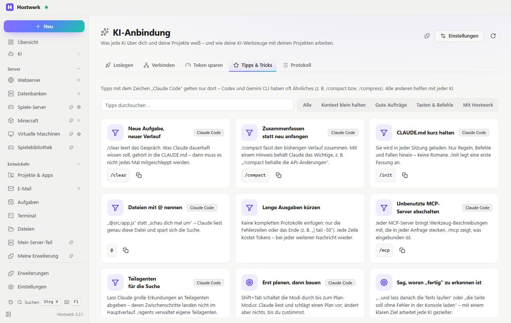
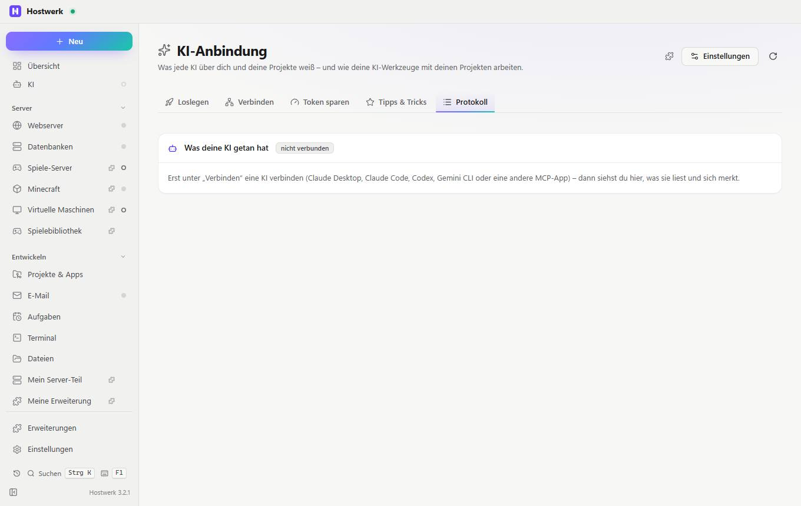

# KI-Anbindung

[← Zurück zur Übersicht](README.md)

Was jede KI über dich und deine Projekte weiß – und wie deine KI-Werkzeuge mit deinen Projekten arbeiten.

### Was du hier tun kannst

- Von der Erweiterung „KI-Anbindung“ – Infos
- Einstellungen
- Neu laden

## Reiter

### Verbinden

**Was du hier tun kannst:** Von der Erweiterung „KI-Anbindung“ – Infos · Einstellungen · Neu laden

### Token sparen

**Was du hier tun kannst:** Von der Erweiterung „KI-Anbindung“ – Infos · Einstellungen · Neu laden

### Tipps & Tricks

**Was du hier tun kannst:** Von der Erweiterung „KI-Anbindung“ – Infos · Einstellungen · Neu laden

### Protokoll

**Was du hier tun kannst:** Von der Erweiterung „KI-Anbindung“ – Infos · Einstellungen · Neu laden

Erzeugt am 2026-11-18 · Hostwerk 3.2.1
