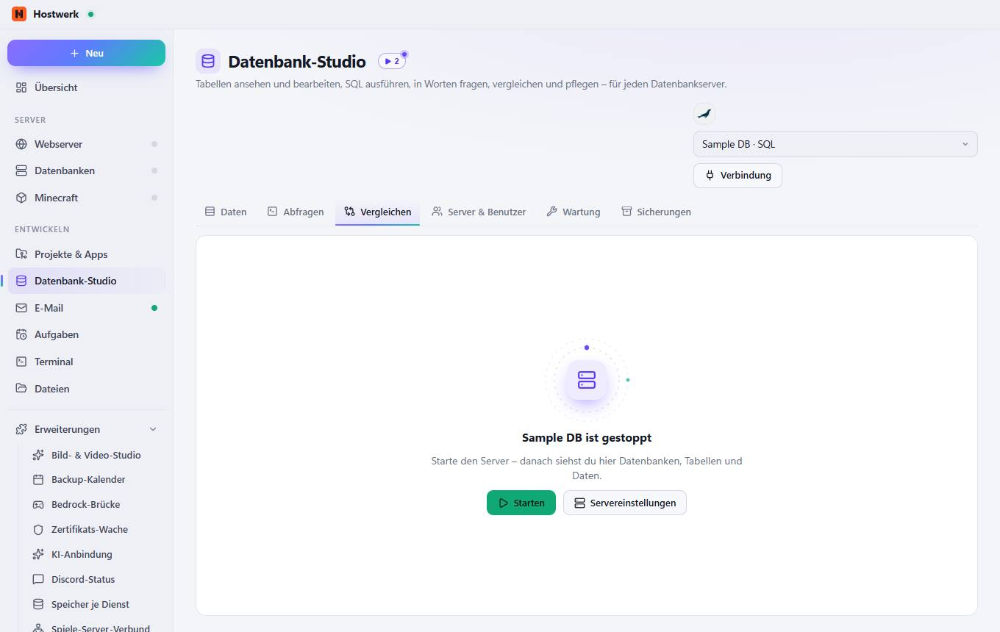
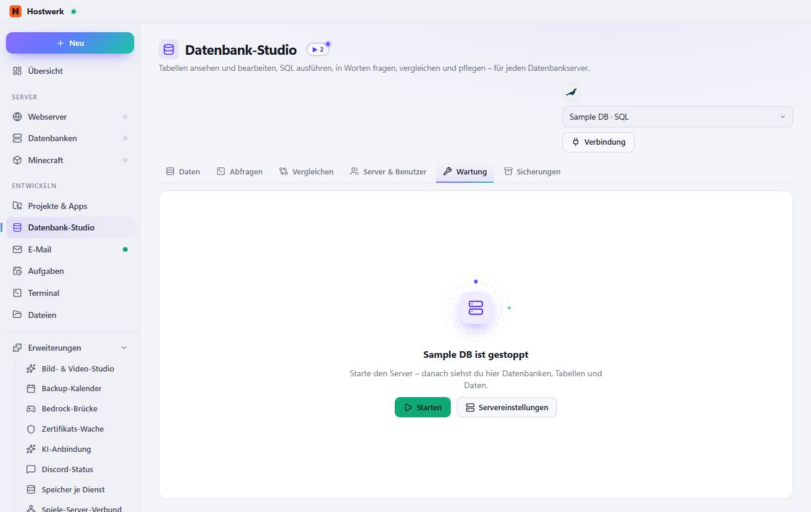
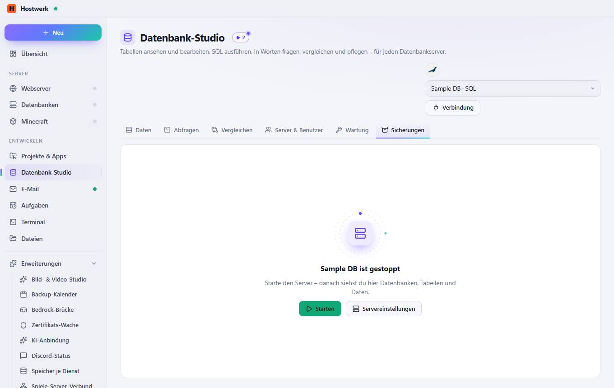

# Datenbank-Studio

[← Zurück zur Übersicht](README.md)

Tabellen ansehen und bearbeiten, SQL ausführen, in Worten fragen, vergleichen und pflegen – für jeden Datenbankserver.

### Was du hier tun kannst

- Verbindung
- Starten
- Servereinstellungen

## Reiter

### Abfragen

**Was du hier tun kannst:** Verbindung · Starten · Servereinstellungen

### Vergleichen

**Was du hier tun kannst:** Verbindung · Starten · Servereinstellungen

### Server & Benutzer

**Was du hier tun kannst:** Verbindung · Starten · Servereinstellungen

### Wartung

**Was du hier tun kannst:** Verbindung · Starten · Servereinstellungen

### Sicherungen

**Was du hier tun kannst:** Verbindung · Starten · Servereinstellungen

Erzeugt am 2026-10-19 · Hostwerk 2.9.0
