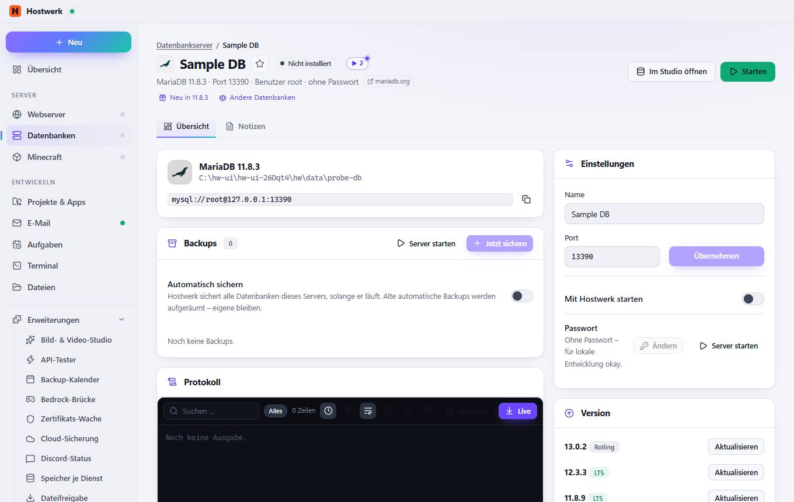
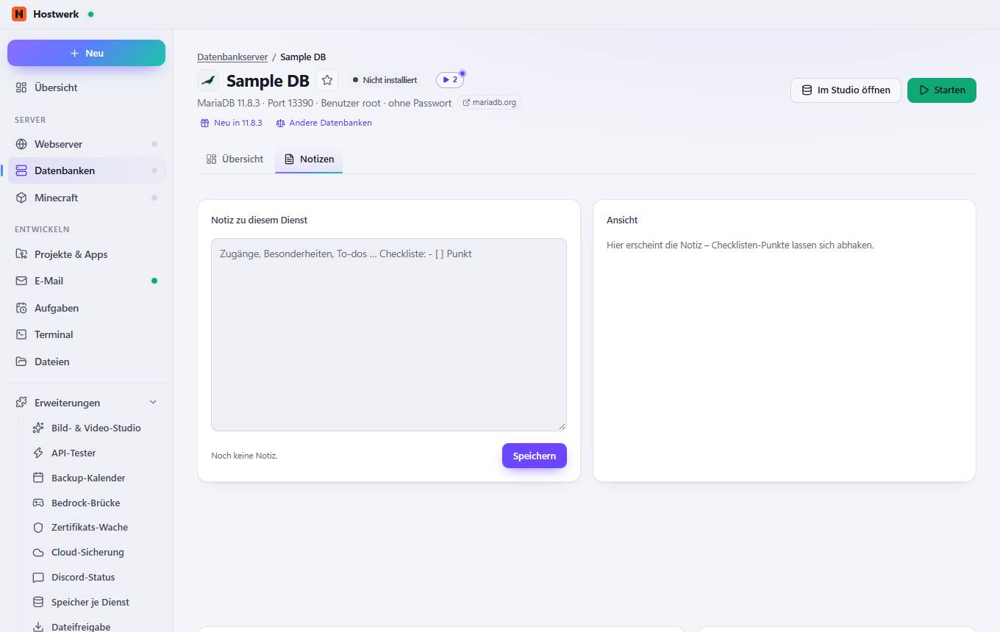

# Sample DB → Übersicht

[← Zurück zur Übersicht](README.md)

MariaDB 11.8.3 · Port 13390 · Benutzer root · ohne Passwort mariadb.org

### Bereiche auf dieser Seite

- Backups
- Protokoll
- Einstellungen
- Version
- Entfernen

### Was du hier tun kannst

- Bild ändern
- Als Favorit markieren (steht dann in Listen oben)
- mariadb.org
- Neu in 11.8.3
- Andere Datenbanken
- Im Studio öffnen
- Starten
- Kopieren
- Server starten
- Jetzt sichern
- Alles
- Uhrzeit anzeigen
- Größere Schrift
- Lange Zeilen umbrechen
- Als Textdatei speichern
- Leeren
- Anhalten
- Live
- Übernehmen
- Ändern
- Aktualisieren
- Server entfernen …

### Eingaben

- Automatisch sichern
- Name
- Port
- Mit Hostwerk starten
- Passwort

## Reiter

### Notizen

**Bereiche auf dieser Seite:** Backups · Protokoll · Einstellungen · Version · Entfernen

**Was du hier tun kannst:** Bild ändern · Als Favorit markieren (steht dann in Listen oben) · mariadb.org · Neu in 11.8.3 · Andere Datenbanken · Im Studio öffnen · Starten · Kopieren · Server starten · Jetzt sichern · Alles · Uhrzeit anzeigen · Größere Schrift · Lange Zeilen umbrechen · Als Textdatei speichern · Leeren · Anhalten · Live · Übernehmen · Ändern · Aktualisieren · Server entfernen …

Erzeugt am 2026-10-20 · Hostwerk 2.10.0
