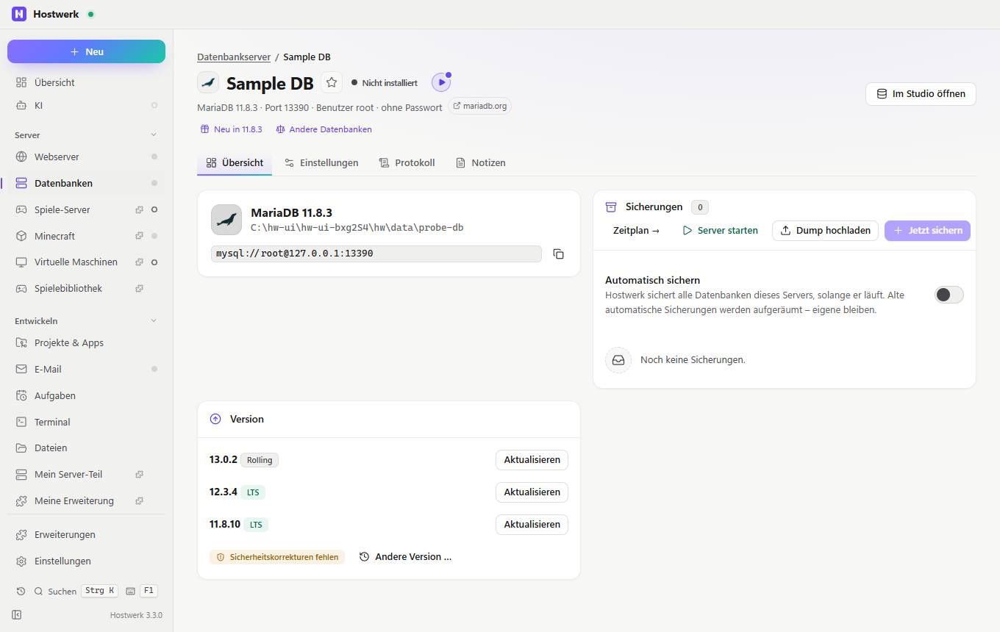
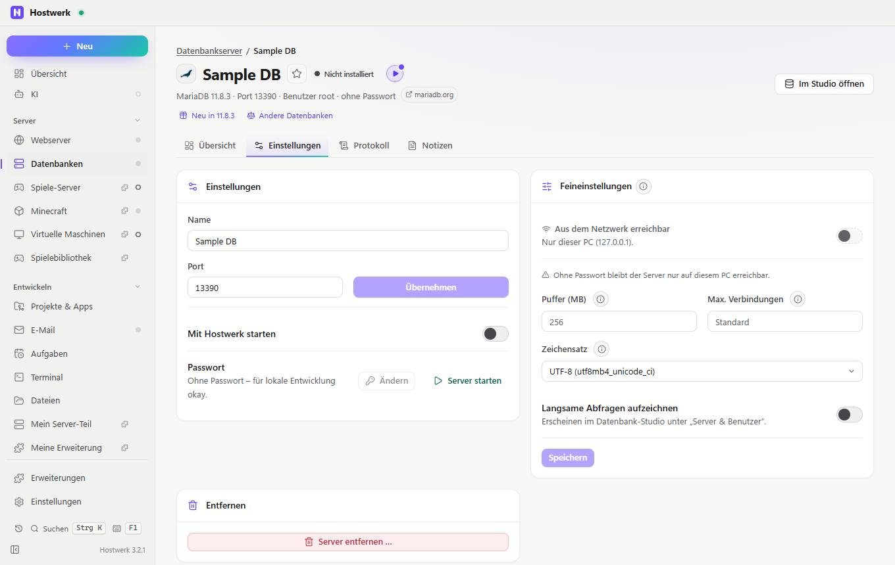
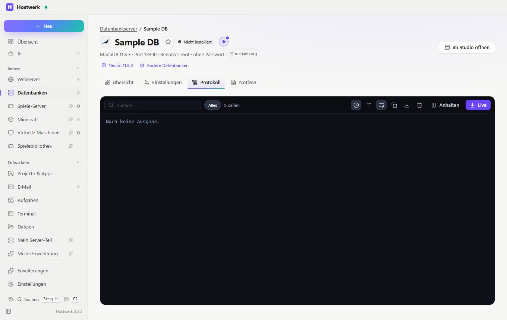
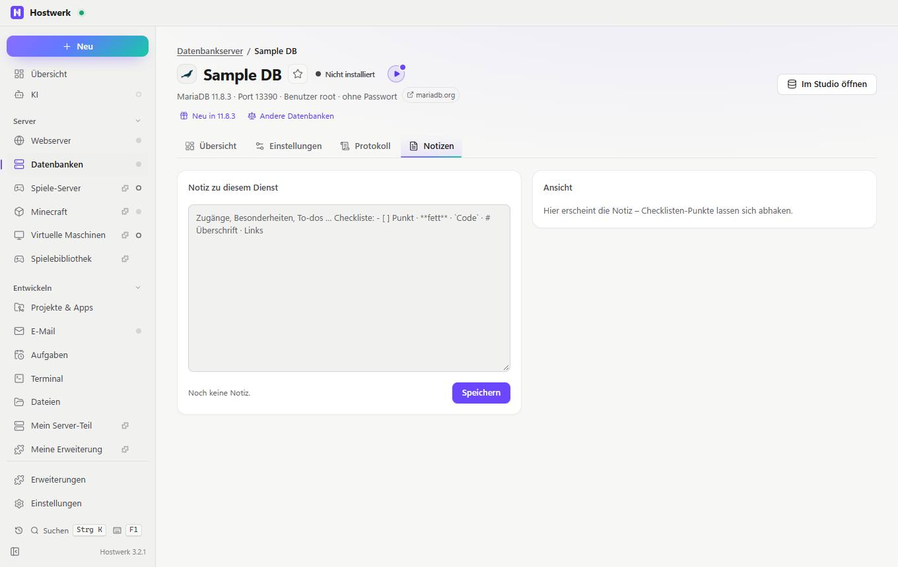

# Sample DB → Übersicht

[← Zurück zur Übersicht](README.md)

MariaDB 11.8.3 · Port 13390 · Benutzer root · ohne Passwort mariadb.org

### Bereiche auf dieser Seite

- Sicherungen
- Version

### Was du hier tun kannst

- Bild ändern
- Als Favorit markieren (steht dann in Listen oben)
- 2 Videos
- mariadb.org
- Neu in 11.8.3
- Andere Datenbanken
- Im Studio öffnen
- Kopieren
- Zeitplan →
- Server starten
- Dump hochladen
- Jetzt sichern
- Aktualisieren
- Andere Version …

### Eingaben

- Automatisch sichern

## Reiter

### Einstellungen

> Hostwerk schreibt daraus die Konfiguration des Servers. Änderungen wirken nach einem Neustart – läuft der Server, startet Hostwerk ihn beim Speichern neu.
> innodb_buffer_pool_size: Arbeitsspeicher für Tabellen und Indizes. Je größer, desto seltener muss die Platte ran. Standard in Hostwerk: 256 MB.
> Wie viele Programme gleichzeitig verbunden sein dürfen. Leer = Standard der Datenbank (meist 100 bzw. 151).
> Gilt für neue Datenbanken und Tabellen ohne eigene Angabe. utf8mb4 kann alle Zeichen samt Emojis.

**Bereiche auf dieser Seite:** Einstellungen · Feineinstellungen · Entfernen

**Was du hier tun kannst:** Bild ändern · Als Favorit markieren (steht dann in Listen oben) · 2 Videos · mariadb.org · Neu in 11.8.3 · Andere Datenbanken · Im Studio öffnen · Übernehmen · Ändern · Server starten · Speichern · Server entfernen …

### Protokoll

**Was du hier tun kannst:** Bild ändern · Als Favorit markieren (steht dann in Listen oben) · 2 Videos · mariadb.org · Neu in 11.8.3 · Andere Datenbanken · Im Studio öffnen · Alles · Uhrzeit anzeigen · Größere Schrift · Lange Zeilen umbrechen · Kopieren · Als Textdatei speichern · Leeren · Anhalten · Live

### Notizen

**Was du hier tun kannst:** Bild ändern · Als Favorit markieren (steht dann in Listen oben) · 2 Videos · mariadb.org · Neu in 11.8.3 · Andere Datenbanken · Im Studio öffnen

Erzeugt am 2026-11-18 · Hostwerk 3.2.1
