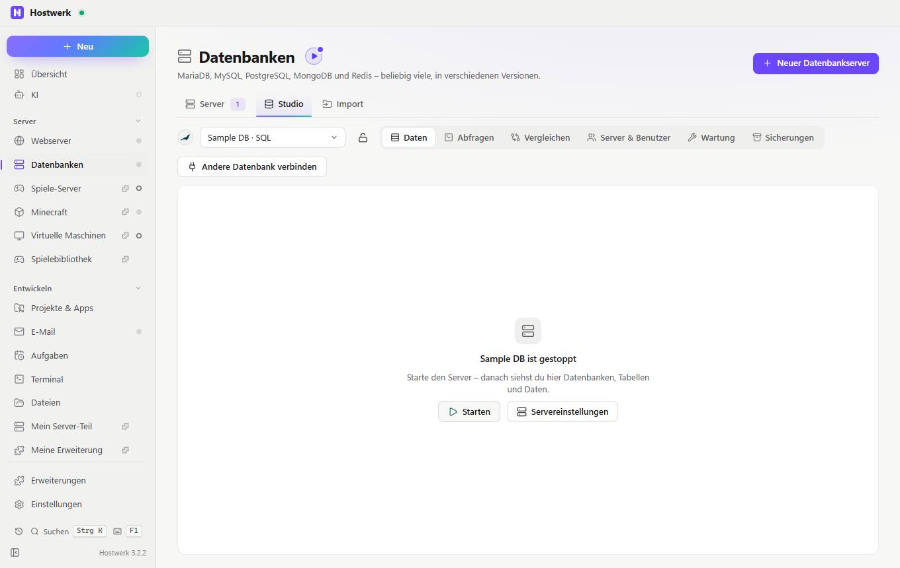
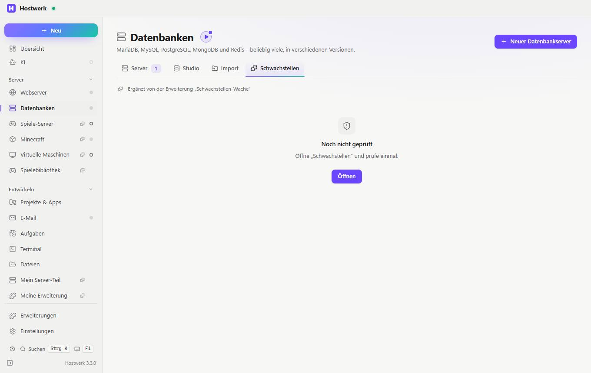

# Datenbanken

[← Zurück zur Übersicht](README.md)

MariaDB, MySQL, PostgreSQL, MongoDB und Redis – beliebig viele, in verschiedenen Versionen.

### Was du hier tun kannst

- 2 Videos
- Neuer Datenbankserver
- Bild ändern
- Starten
- Im Studio öffnen

## Reiter

### Studio

**Was du hier tun kannst:** 2 Videos · Neuer Datenbankserver · Schreibschutz einschalten · Andere Datenbank verbinden · Starten · Servereinstellungen

### Import

> Import – vorhandene Dienste übernehmen Vorhandene MySQL-, MariaDB-, PostgreSQL-, MongoDB- oder Redis-Server übernehmen – am bisherigen Ort oder als Kopie mit allen Daten, getestet und mit Rückweg. Dieselbe Suche gibt es für alle Arten unter System → Fremde Dienste.

**Bereiche auf dieser Seite:** Vorhandene Datenbanken auf diesem PC · PostgreSQL 17.12

**Was du hier tun kannst:** 2 Videos · Neuer Datenbankserver · Erneut suchen · In Hostwerk übernehmen …

### Schwachstellen

**Was du hier tun kannst:** 2 Videos · Neuer Datenbankserver · Von der Erweiterung „Schwachstellen-Wache“ – Infos · Öffnen

Erzeugt am 2026-11-20 · Hostwerk 3.3.0
