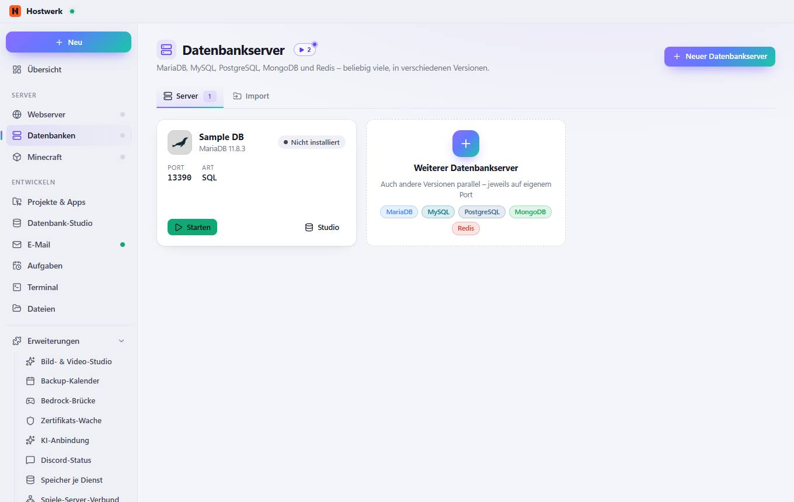
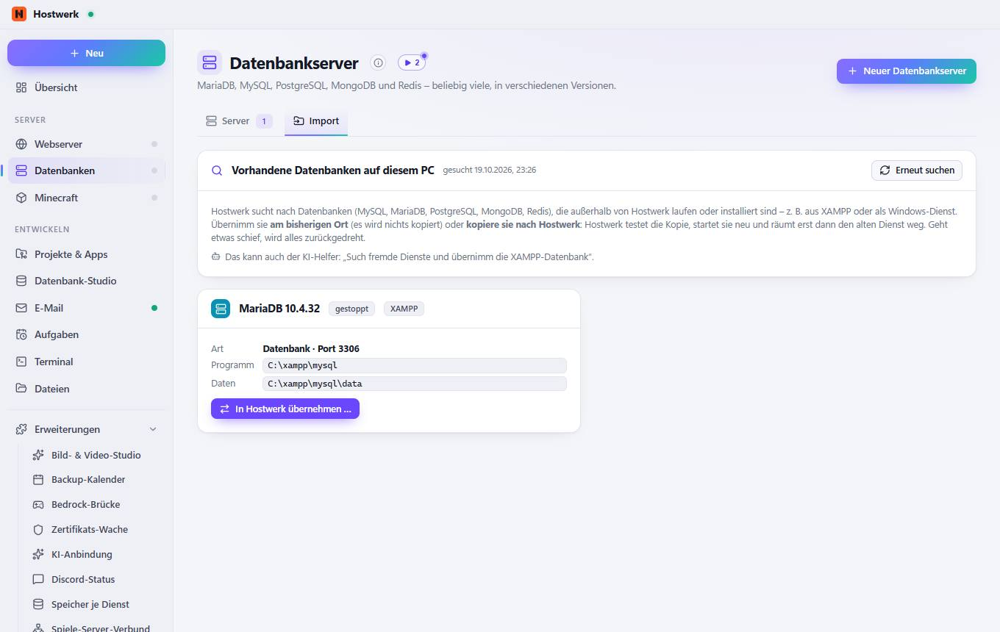

# Datenbankserver

[← Zurück zur Übersicht](README.md)

MariaDB, MySQL, PostgreSQL, MongoDB und Redis – beliebig viele, in verschiedenen Versionen.

### Was du hier tun kannst

- Neuer Datenbankserver
- Bild ändern
- Starten
- Studio

## Reiter

### Import

> Import – vorhandene Dienste übernehmen Vorhandene MySQL-, MariaDB-, PostgreSQL-, MongoDB- oder Redis-Server übernehmen – am bisherigen Ort oder als Kopie mit allen Daten, getestet und mit Rückweg. Dieselbe Suche gibt es für alle Arten unter System → Fremde Dienste.

**Bereiche auf dieser Seite:** Vorhandene Datenbanken auf diesem PC · MariaDB 10.4.32

**Was du hier tun kannst:** Neuer Datenbankserver · Erneut suchen · In Hostwerk übernehmen …

Erzeugt am 2026-10-19 · Hostwerk 2.9.0
