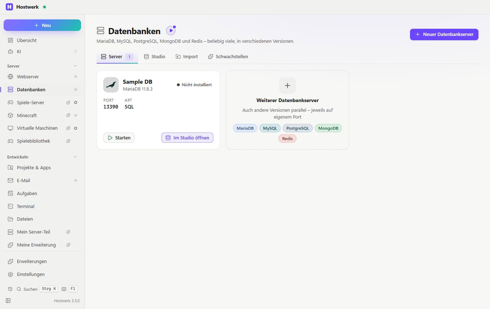
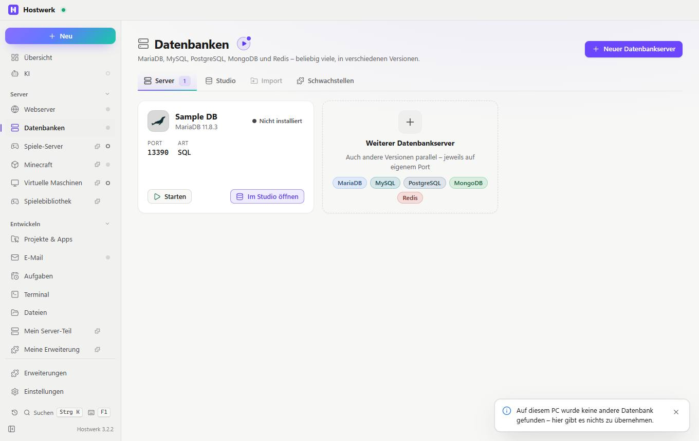

# Datenbanken

[← Zurück zur Übersicht](README.md)

MariaDB, MySQL, PostgreSQL, MongoDB und Redis – beliebig viele, in verschiedenen Versionen.

### Was du hier tun kannst

- 2 Videos
- Neuer Datenbankserver
- Bild ändern
- Starten
- Im Studio öffnen

## Reiter

### Studio

**Was du hier tun kannst:** 2 Videos · Neuer Datenbankserver · Schreibschutz einschalten · Andere Datenbank verbinden · Starten · Servereinstellungen

### Import

**Was du hier tun kannst:** 2 Videos · Neuer Datenbankserver · Bild ändern · Starten · Im Studio öffnen

Erzeugt am 2026-11-20 · Hostwerk 3.2.2
