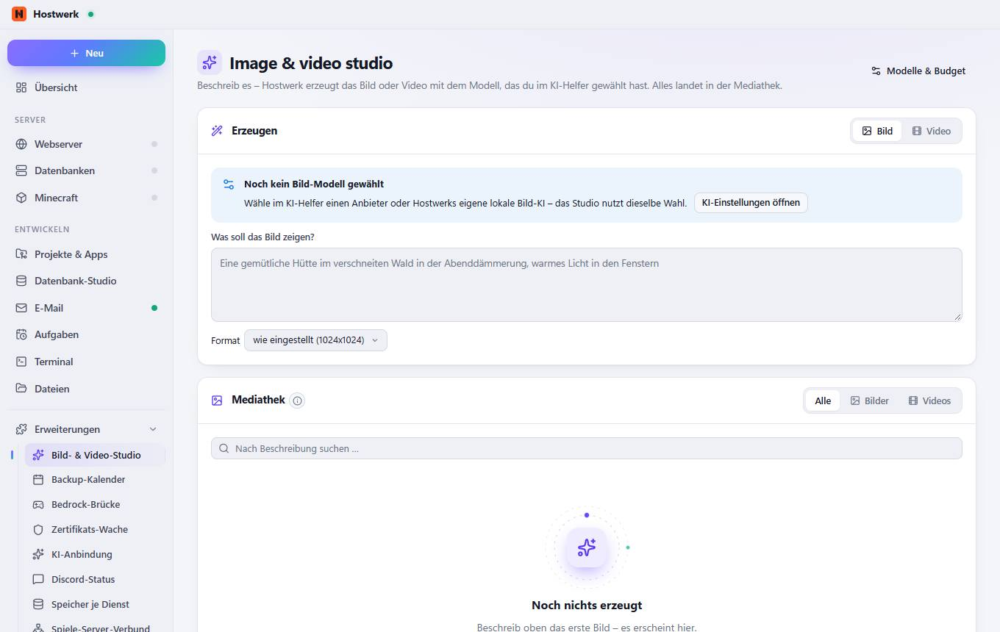

# Image & video studio

[← Zurück zur Übersicht](README.md)

Beschreib es – Hostwerk erzeugt das Bild oder Video mit dem Modell, das du im KI-Helfer gewählt hast. Alles landet in der Mediathek.

### Gut zu wissen

- Bilder und Videos aus dem Studio und aus dem KI-Chat. Nutze eins als Ausgangspunkt für das nächste oder nenne seine ID im Chat.

### Bereiche auf dieser Seite

- Erzeugen
- Mediathek

### Was du hier tun kannst

- Modelle & Budget
- KI-Einstellungen öffnen

### Eingaben

- Was soll das Bild zeigen?

Erzeugt am 2026-10-19 · Hostwerk 2.9.0
