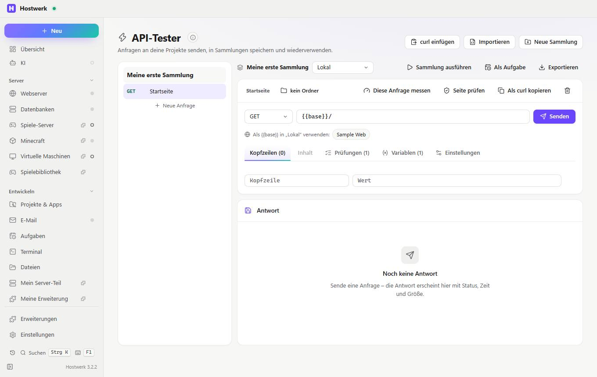
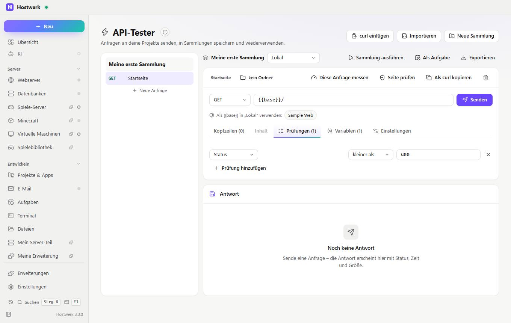
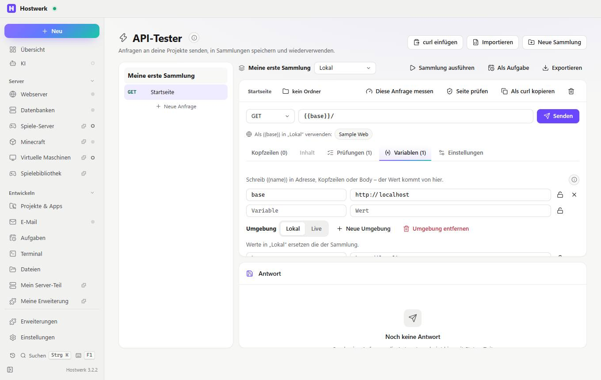
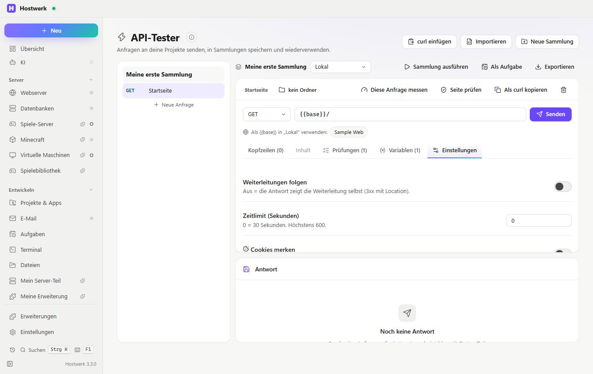

# API-Tester → Kopfzeilen (0)

[← Zurück zur Übersicht](README.md)

Anfragen an deine Projekte senden, in Sammlungen speichern und wiederverwenden.

### Gut zu wissen

- Umgebungen Switch between local, staging and live in one go: the values of the chosen environment replace the variables of the collection – {{base}} points to the right server.

### Bereiche auf dieser Seite

- Antwort

### Was du hier tun kannst

- curl einfügen
- Importieren
- Neue Sammlung
- Meine erste Sammlung
- GET Startseite
- Neue Anfrage
- Sammlung ausführen
- Als Aufgabe
- Exportieren
- Startseite
- kein Ordner
- Diese Anfrage messen
- Seite prüfen
- Als curl kopieren
- Anfrage entfernen
- Senden
- Sample Web

## Reiter

### Inhalt

> Umgebungen Switch between local, staging and live in one go: the values of the chosen environment replace the variables of the collection – {{base}} points to the right server.

**Bereiche auf dieser Seite:** Antwort

**Was du hier tun kannst:** curl einfügen · Importieren · Neue Sammlung · Meine erste Sammlung · GET Startseite · Neue Anfrage · Sammlung ausführen · Als Aufgabe · Exportieren · Startseite · kein Ordner · Diese Anfrage messen · Seite prüfen · Als curl kopieren · Anfrage entfernen · Senden · Sample Web

### Prüfungen (1)

> Umgebungen Switch between local, staging and live in one go: the values of the chosen environment replace the variables of the collection – {{base}} points to the right server.

**Bereiche auf dieser Seite:** Antwort

**Was du hier tun kannst:** curl einfügen · Importieren · Neue Sammlung · Meine erste Sammlung · GET Startseite · Neue Anfrage · Sammlung ausführen · Als Aufgabe · Exportieren · Startseite · kein Ordner · Diese Anfrage messen · Seite prüfen · Als curl kopieren · Anfrage entfernen · Senden · Sample Web · Entfernen · Prüfung hinzufügen

### Variablen (1)

> Umgebungen Switch between local, staging and live in one go: the values of the chosen environment replace the variables of the collection – {{base}} points to the right server.
> Variablen Sie gehören zur Sammlung, so nutzt jede Anfrage darin dieselben Werte. Geheime Werte (Schloss) werden auf diesem PC versiegelt gespeichert und nur verdeckt gezeigt – der Verlauf behält sie nie.

**Bereiche auf dieser Seite:** Antwort

**Was du hier tun kannst:** curl einfügen · Importieren · Neue Sammlung · Meine erste Sammlung · GET Startseite · Neue Anfrage · Sammlung ausführen · Als Aufgabe · Exportieren · Startseite · kein Ordner · Diese Anfrage messen · Seite prüfen · Als curl kopieren · Anfrage entfernen · Senden · Sample Web · Als geheim markieren · Entfernen · Neue Umgebung · Umgebung entfernen · Sammlung entfernen

### Einstellungen

> Umgebungen Switch between local, staging and live in one go: the values of the chosen environment replace the variables of the collection – {{base}} points to the right server.

**Bereiche auf dieser Seite:** Antwort

**Was du hier tun kannst:** curl einfügen · Importieren · Neue Sammlung · Meine erste Sammlung · GET Startseite · Neue Anfrage · Sammlung ausführen · Als Aufgabe · Exportieren · Startseite · kein Ordner · Diese Anfrage messen · Seite prüfen · Als curl kopieren · Anfrage entfernen · Senden · Sample Web

Erzeugt am 2026-11-18 · Hostwerk 3.2.1
