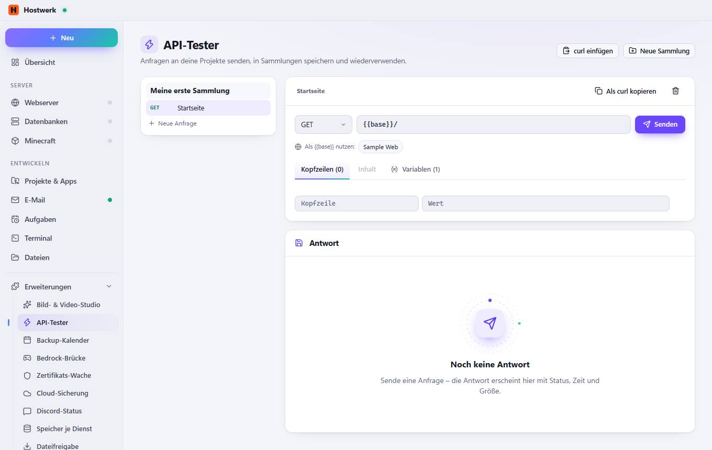
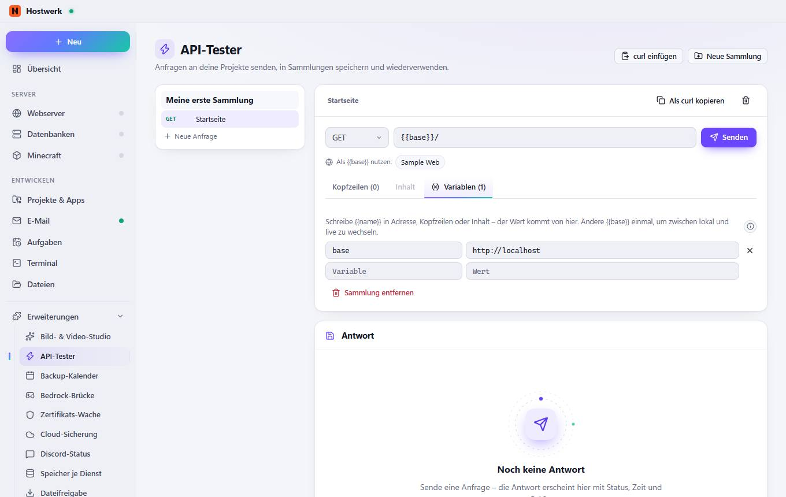

# API-Tester → Kopfzeilen (0)

[← Zurück zur Übersicht](README.md)

Anfragen an deine Projekte senden, in Sammlungen speichern und wiederverwenden.

### Bereiche auf dieser Seite

- Antwort

### Was du hier tun kannst

- curl einfügen
- Neue Sammlung
- Meine erste Sammlung
- GET Startseite
- Neue Anfrage
- Startseite
- Als curl kopieren
- Anfrage entfernen
- Senden
- Sample Web

## Reiter

### Inhalt

**Bereiche auf dieser Seite:** Antwort

**Was du hier tun kannst:** curl einfügen · Neue Sammlung · Meine erste Sammlung · GET Startseite · Neue Anfrage · Startseite · Als curl kopieren · Anfrage entfernen · Senden · Sample Web

### Variablen (1)

> Variablen Sie gehören zur Sammlung – alle Anfragen darin nutzen dieselben Werte.

**Bereiche auf dieser Seite:** Antwort

**Was du hier tun kannst:** curl einfügen · Neue Sammlung · Meine erste Sammlung · GET Startseite · Neue Anfrage · Startseite · Als curl kopieren · Anfrage entfernen · Senden · Sample Web · Entfernen · Sammlung entfernen

Erzeugt am 2026-10-20 · Hostwerk 2.10.0
