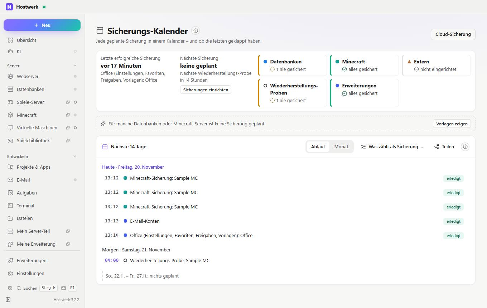

# Sicherungs-Kalender

[← Zurück zur Übersicht](README.md)

Jede geplante Sicherung in einem Kalender – und ob die letzten geklappt haben.

### Gut zu wissen

- Sicherungs-Kalender Alle geplanten Sicherungen – Aufgaben, nächtliche Sicherungen, externe Sicherung und Wiederherstellungs-Proben – und ob die letzten geklappt haben. Fehlschläge stehen oben.
- Kalender teilen Exportieren speichert die nächsten Wochen als .ics-Datei. Mit dem Abo-Link bleiben Outlook, Google, Apple oder Thunderbird aktuell („Kalender abonnieren“ / „Aus URL hinzufügen“). Er funktioniert auf diesem PC – von draußen nur über Hostwerks Fernzugriff. Wer den Link hat, sieht die Namen deiner Sicherungs-Aufgaben.

### Bereiche auf dieser Seite

- Status
- Nächste 14 Tage

### Was du hier tun kannst

- Cloud-Sicherung
- Sicherungen einrichten
- Datenbanken 1 nie gesichert
- Minecraft alles gesichert
- Extern nicht eingerichtet
- Wiederherstellungs-Proben 1 nie gesichert
- Erweiterungen alles gesichert
- Vorlagen zeigen
- Was zählt als Sicherung …
- Teilen

Erzeugt am 2026-11-18 · Hostwerk 3.2.1
