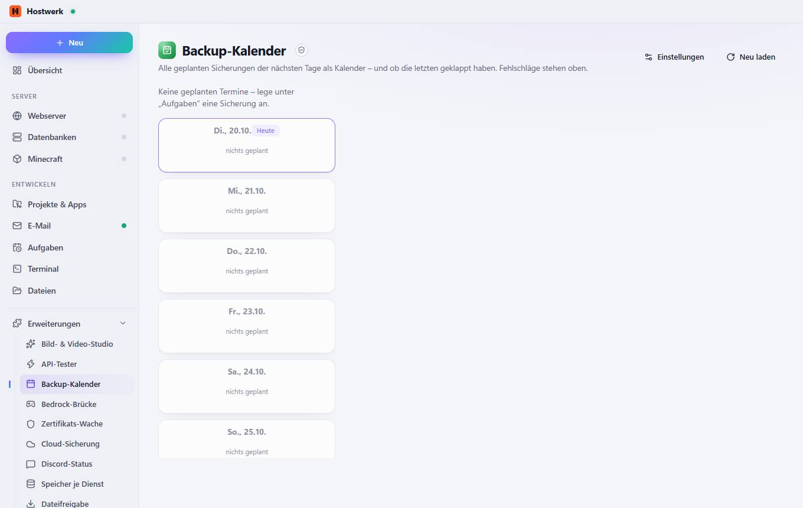

# Backup-Kalender

[← Zurück zur Übersicht](README.md)

Alle geplanten Sicherungen der nächsten Tage als Kalender – und ob die letzten geklappt haben. Fehlschläge stehen oben.

### Gut zu wissen

- Abgeschottete Erweiterung von Hostwerk · v1.2.0 · nur lesen Aufgaben lesen

### Was du hier tun kannst

- Einstellungen
- Neu laden

Erzeugt am 2026-10-20 · Hostwerk 2.10.0
