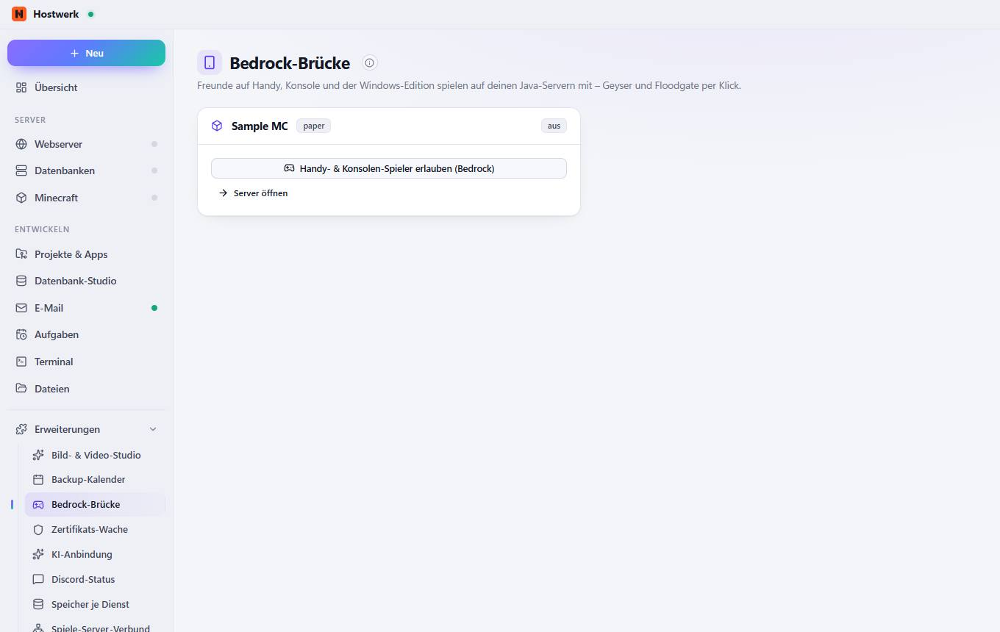

# Bedrock-Brücke

[← Zurück zur Übersicht](README.md)

Freunde auf Handy, Konsole und der Windows-Edition spielen auf deinen Java-Servern mit – Geyser und Floodgate per Klick.

### Gut zu wissen

- So funktioniert es Geyser übersetzt zwischen Bedrock und Java, Floodgate lässt Bedrock-Spieler ohne Java-Konto herein. Hostwerk wählt einen freien UDP-Port (19132, 19133 …), richtet alles ein und hält beides aktuell: Neue Builds werden im Hintergrund geladen und beim nächsten Neustart eingespielt – oder sofort, wenn niemand online ist.

### Bereiche auf dieser Seite

- Sample MC

### Was du hier tun kannst

- Handy- & Konsolen-Spieler erlauben (Bedrock)
- Server öffnen

Erzeugt am 2026-10-19 · Hostwerk 2.9.0
