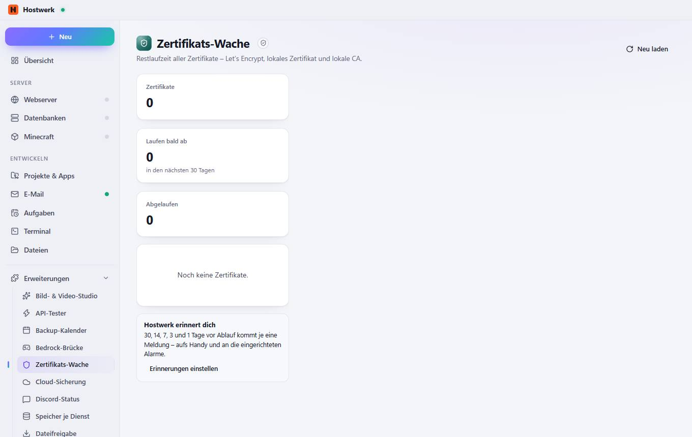

# Zertifikats-Wache

[← Zurück zur Übersicht](README.md)

Restlaufzeit aller Zertifikate – Let’s Encrypt, lokales Zertifikat und lokale CA.

### Gut zu wissen

- Abgeschottete Erweiterung von Hostwerk · v1.2.0 · nur lesen Zertifikate und Erreichbarkeit (Überwachung) lesen

### Was du hier tun kannst

- Neu laden

Erzeugt am 2026-10-20 · Hostwerk 2.10.0
