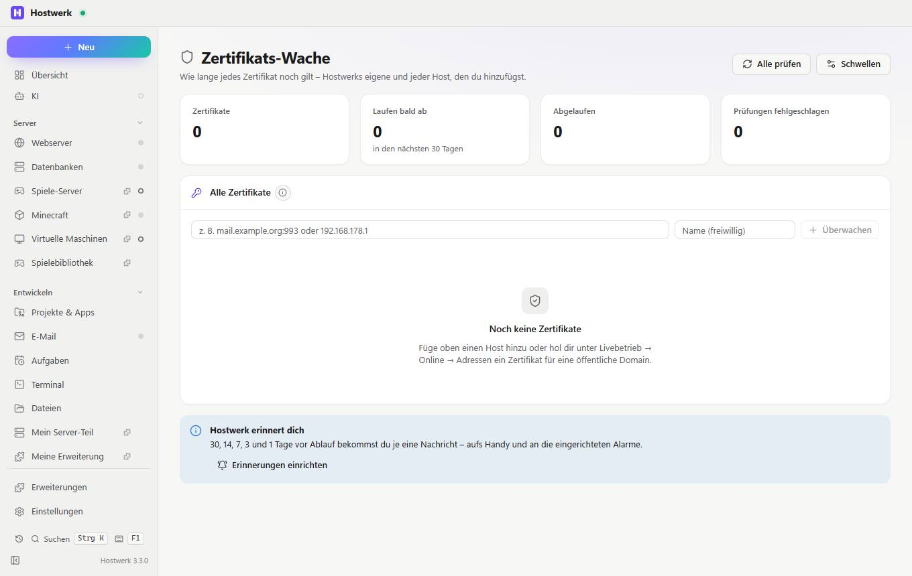

# Zertifikats-Wache

[← Zurück zur Übersicht](README.md)

Wie lange jedes Zertifikat noch gilt – Hostwerks eigene und jeder Host, den du hinzufügst.

### Gut zu wissen

- Beliebiger Host und Port Hostwerk baut eine TLS-Verbindung auf und liest das Zertifikat – Webseiten (443), Mail (465, 993, 995 und 25/587 mit STARTTLS), Router oder NAS. Sonst wird nichts gesendet.

### Bereiche auf dieser Seite

- Alle Zertifikate

### Was du hier tun kannst

- Alle prüfen
- Schwellen
- Überwachen
- Erinnerungen einrichten

Erzeugt am 2026-11-18 · Hostwerk 3.2.1
