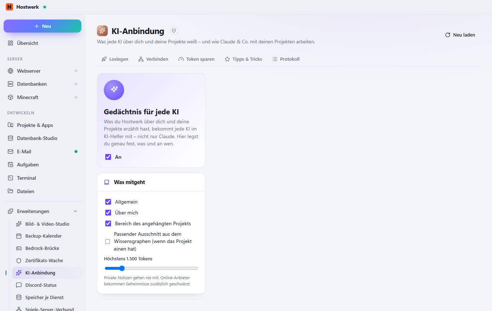
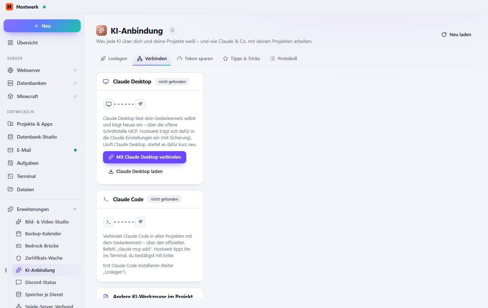
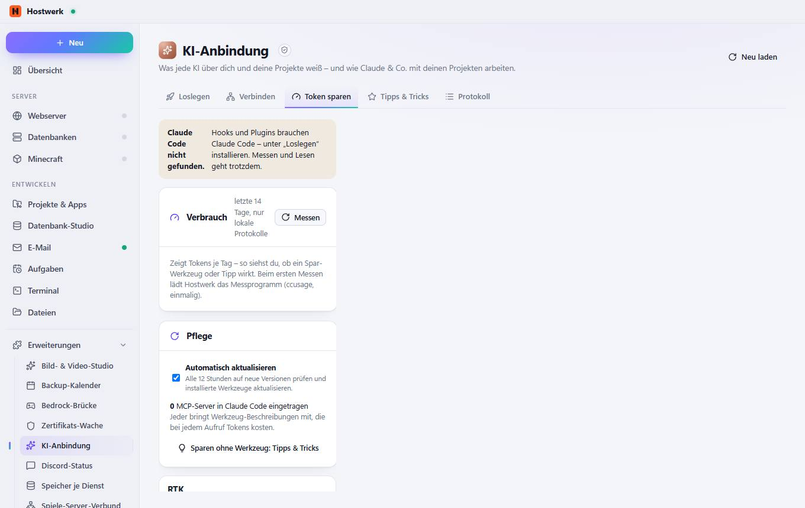
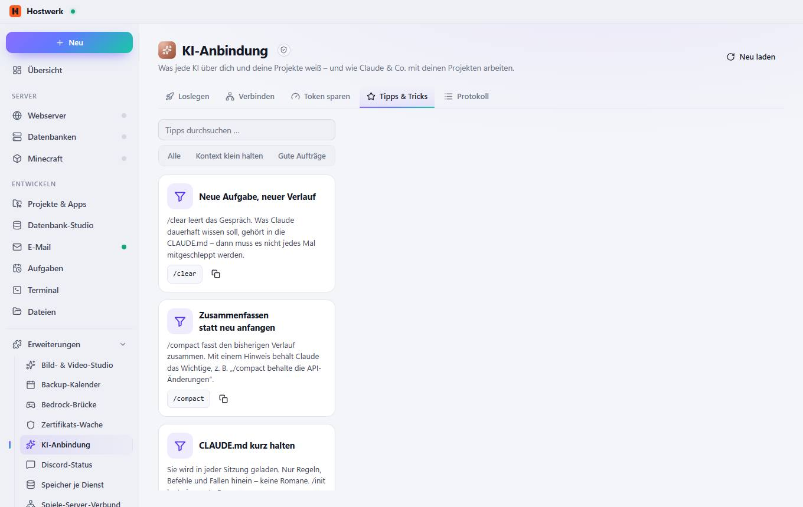
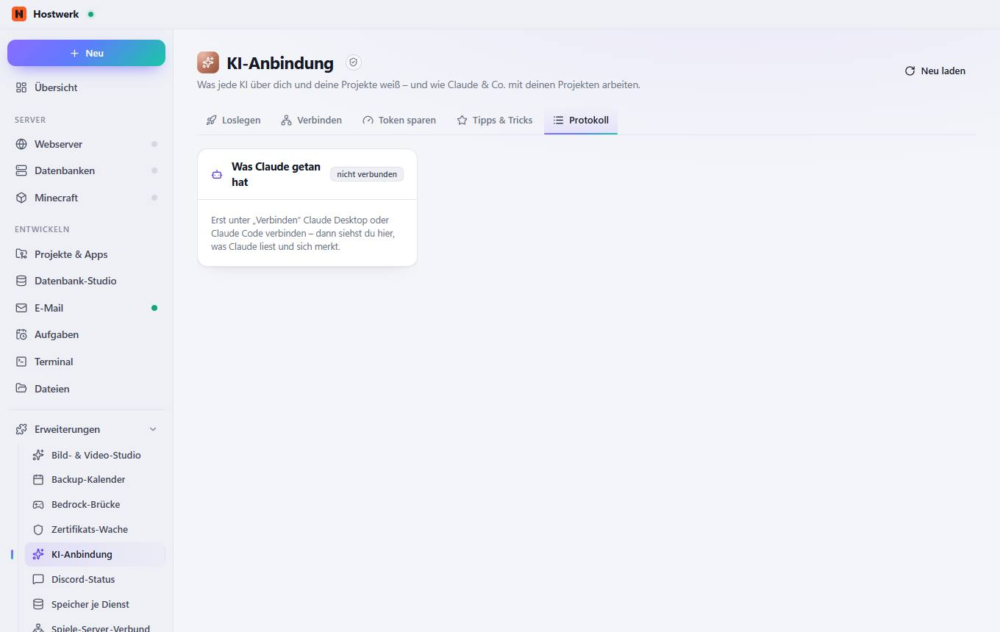

# KI-Anbindung

[← Zurück zur Übersicht](README.md)

Was jede KI über dich und deine Projekte weiß – und wie Claude & Co. mit deinen Projekten arbeiten.

### Gut zu wissen

- Abgeschottete Erweiterung von Hostwerk · v1.2.0 · darf nach Rückfrage ändern Claude-Status, Projekte, Gedächtnis-Kontext, Spar-Werkzeuge und Verbrauch lesen Claude einrichten: Kontext in Projekt-Dateien, Spar-Werkzeuge (mit Rückfrage) Befehle ins Terminal tippen (du bestätigst) Wissensgraph lesen (Projekte, Graph, Bericht, Gedächtnis, Claude-Status) Claude einbinden und wieder vergessen (mit Rückfrage) Eigene Daten speichern (max. 256 KB)

### Was du hier tun kannst

- Neu laden

## Reiter

### Verbinden

> Abgeschottete Erweiterung von Hostwerk · v1.2.0 · darf nach Rückfrage ändern Claude-Status, Projekte, Gedächtnis-Kontext, Spar-Werkzeuge und Verbrauch lesen Claude einrichten: Kontext in Projekt-Dateien, Spar-Werkzeuge (mit Rückfrage) Befehle ins Terminal tippen (du bestätigst) Wissensgraph lesen (Projekte, Graph, Bericht, Gedächtnis, Claude-Status) Claude einbinden und wieder vergessen (mit Rückfrage) Eigene Daten speichern (max. 256 KB)

**Was du hier tun kannst:** Neu laden

### Token sparen

> Abgeschottete Erweiterung von Hostwerk · v1.2.0 · darf nach Rückfrage ändern Claude-Status, Projekte, Gedächtnis-Kontext, Spar-Werkzeuge und Verbrauch lesen Claude einrichten: Kontext in Projekt-Dateien, Spar-Werkzeuge (mit Rückfrage) Befehle ins Terminal tippen (du bestätigst) Wissensgraph lesen (Projekte, Graph, Bericht, Gedächtnis, Claude-Status) Claude einbinden und wieder vergessen (mit Rückfrage) Eigene Daten speichern (max. 256 KB)

**Was du hier tun kannst:** Neu laden

### Tipps & Tricks

> Abgeschottete Erweiterung von Hostwerk · v1.2.0 · darf nach Rückfrage ändern Claude-Status, Projekte, Gedächtnis-Kontext, Spar-Werkzeuge und Verbrauch lesen Claude einrichten: Kontext in Projekt-Dateien, Spar-Werkzeuge (mit Rückfrage) Befehle ins Terminal tippen (du bestätigst) Wissensgraph lesen (Projekte, Graph, Bericht, Gedächtnis, Claude-Status) Claude einbinden und wieder vergessen (mit Rückfrage) Eigene Daten speichern (max. 256 KB)

**Was du hier tun kannst:** Neu laden

### Protokoll

> Abgeschottete Erweiterung von Hostwerk · v1.2.0 · darf nach Rückfrage ändern Claude-Status, Projekte, Gedächtnis-Kontext, Spar-Werkzeuge und Verbrauch lesen Claude einrichten: Kontext in Projekt-Dateien, Spar-Werkzeuge (mit Rückfrage) Befehle ins Terminal tippen (du bestätigst) Wissensgraph lesen (Projekte, Graph, Bericht, Gedächtnis, Claude-Status) Claude einbinden und wieder vergessen (mit Rückfrage) Eigene Daten speichern (max. 256 KB)

**Was du hier tun kannst:** Neu laden

Erzeugt am 2026-10-19 · Hostwerk 2.9.0
