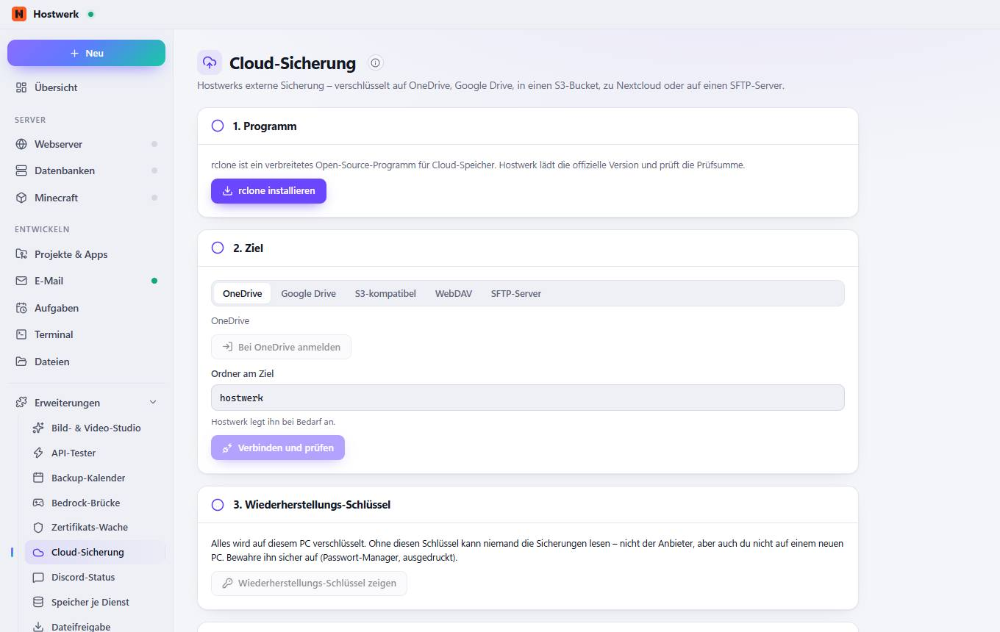

# Cloud-Sicherung

[← Zurück zur Übersicht](README.md)

Hostwerks externe Sicherung – verschlüsselt auf OneDrive, Google Drive, in einen S3-Bucket, zu Nextcloud oder auf einen SFTP-Server.

### Gut zu wissen

- So funktioniert's Hostwerk macht die Sicherungen (Datenbanken, Minecraft-Welten, Webseiten) weiter nach seinem Zeitplan. Diese Erweiterung bringt nur das Cloud-Ziel: rclone lädt sie hoch, verschlüsselt auf diesem PC – der Anbieter sieht nie den Inhalt.

### Bereiche auf dieser Seite

- 1. Programm
- 2. Ziel
- 3. Wiederherstellungs-Schlüssel
- 4. Für die externe Sicherung nutzen

### Was du hier tun kannst

- rclone installieren
- Bei OneDrive anmelden
- Verbinden und prüfen
- Wiederherstellungs-Schlüssel zeigen
- Cloud für die externe Sicherung nutzen

### Eingaben

- Ordner am Ziel

Erzeugt am 2026-10-20 · Hostwerk 2.10.0
