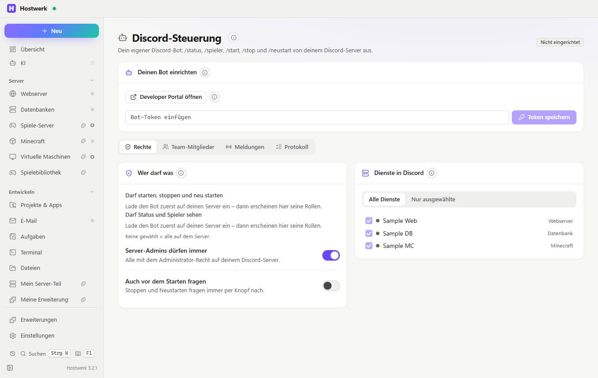

# Discord-Steuerung

[← Zurück zur Übersicht](README.md)

Dein eigener Discord-Bot: /status, /spieler, /start, /stop und /neustart von deinem Discord-Server aus.

### Gut zu wissen

- Befehle /status – welche Dienste laufen · /spieler – wer online ist · /start, /stop, /neustart <dienst> – Stoppen und Neustarten mit Bestätigungsknopf. In englischem Discord heißen sie /players und /restart.
- Dein eigener Bot Der Bot gehört dir: Hostwerk meldet sich mit deinem Token an. Der Token bleibt verschlüsselt auf diesem PC und geht nur an Discord.
- So bekommst du den Token Öffne das Discord Developer Portal und leg eine „New Application“ an – ihren Namen sehen später alle in Discord, zum Beispiel „Hostwerk“. Klick unter „Bot“ auf „Reset Token“ und kopier den Token. Besondere Intents brauchst du nicht. Füge den Token hier ein.
- Rechte Alle auf deinem Discord-Server dürfen /status und /spieler benutzen. Starten, Stoppen und Neustarten dürfen nur die hier gewählten Rollen, Server-Admins (wenn erlaubt) und verknüpfte Team-Mitglieder – genau für die Dienste, die ihnen in „Team & Rollen“ freigegeben sind.
- Freigegebene Dienste Nur diese erscheinen bei /status und lassen sich aus Discord starten oder stoppen. Alle anderen bleiben dort unsichtbar – auch für Admins.

### Bereiche auf dieser Seite

- Deinen Bot einrichten
- Wer darf was
- Dienste in Discord

### Was du hier tun kannst

- Developer Portal öffnen
- Token speichern

### Eingaben

- Darf starten, stoppen und neu starten
- Darf Status und Spieler sehen
- Server-Admins dürfen immer
- Auch vor dem Starten fragen

Erzeugt am 2026-11-18 · Hostwerk 3.2.1
