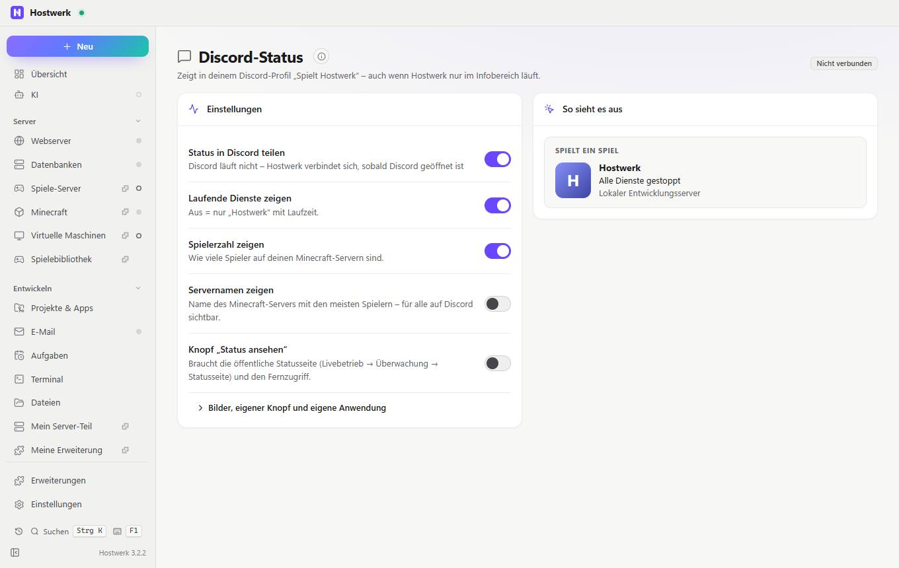

# Discord-Status

[← Zurück zur Übersicht](README.md)

Zeigt in deinem Discord-Profil „Spielt Hostwerk“ – auch wenn Hostwerk nur im Infobereich läuft.

### Gut zu wissen

- Was wird geteilt? Nur Dienstarten (z. B. Webserver · Datenbank) und wie viele laufen. Nie Projekt- oder Ordnernamen – einen Servernamen nur, wenn du ihn einschaltest.

### Bereiche auf dieser Seite

- Einstellungen
- So sieht es aus

### Was du hier tun kannst

- Bilder, eigener Knopf und eigene Anwendung

### Eingaben

- Status in Discord teilen
- Laufende Dienste zeigen
- Spielerzahl zeigen
- Servernamen zeigen
- Knopf „Status ansehen“

Erzeugt am 2026-11-20 · Hostwerk 3.3.0
