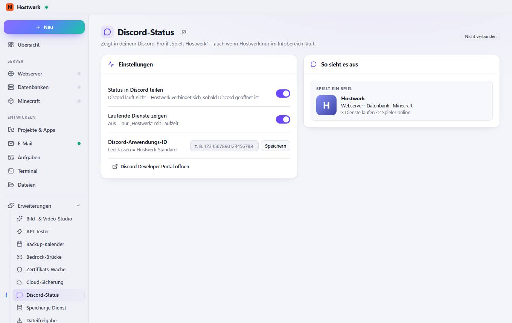

# Discord-Status

[← Zurück zur Übersicht](README.md)

Zeigt in deinem Discord-Profil „Spielt Hostwerk“ – auch wenn Hostwerk nur im Infobereich läuft.

### Gut zu wissen

- Was wird geteilt? Nur Dienstarten (z. B. Webserver · Datenbank) und wie viele laufen. Nie Projekt-, Server- oder Ordnernamen.

### Bereiche auf dieser Seite

- Einstellungen
- So sieht es aus

### Was du hier tun kannst

- Speichern
- Discord Developer Portal öffnen

### Eingaben

- Status in Discord teilen
- Laufende Dienste zeigen
- Discord-Anwendungs-ID

Erzeugt am 2026-10-20 · Hostwerk 2.10.0
