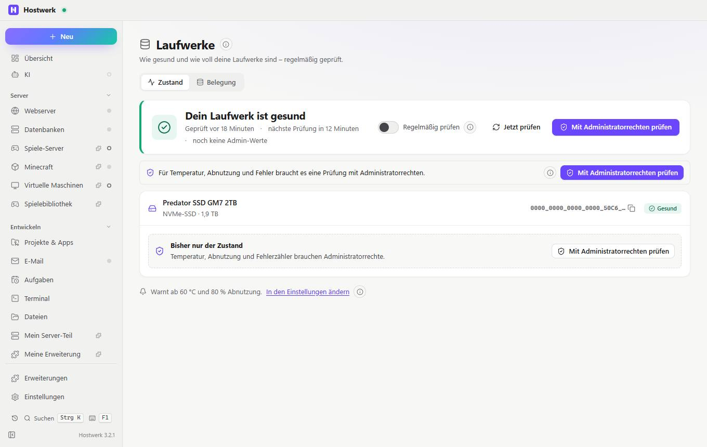

# Laufwerke

[← Zurück zur Übersicht](README.md)

Wie gesund und wie voll deine Laufwerke sind – regelmäßig geprüft.

### Gut zu wissen

- Laufwerke Hostwerk liest die S.M.A.R.T.-Werte jedes Laufwerks – Temperatur, Abnutzung, Fehler – und meldet sich, wenn etwas schlechter wird, und zeigt, wie voll das Laufwerk ist und wer den Platz belegt. An den Laufwerken wird nie etwas verändert.
- Regelmäßig mit Administratorrechten prüfen Hostwerk richtet eine Windows-Aufgabe ein, die die Werte stündlich mit Administratorrechten liest. Windows fragt dafür einmal nach. Die Aufgabe liest nur und entfernt sich selbst, wenn du die Erweiterung deinstallierst.
- Warum Administratorrechte? Ohne Administratorrechte zeigt Windows nur, ob ein Laufwerk gesund ist. Temperatur, Abnutzung und Fehlerzähler liest eine einzige Prüfung – Windows fragt dafür einmal nach. Hostwerk selbst läuft weiter ohne Administratorrechte.
- Benachrichtigungen Warnungen gehen an Hostwerks Benachrichtigungen (Push, Discord, ntfy, Mail) und stehen unter Livebetrieb → Überwachung → Wächter.

### Bereiche auf dieser Seite

- Predator SSD GM7 2TB

### Was du hier tun kannst

- Jetzt prüfen
- Mit Administratorrechten prüfen
- 0000_0000_0000_0000_50C6_8E52_7150_2160

Erzeugt am 2026-11-18 · Hostwerk 3.2.1
