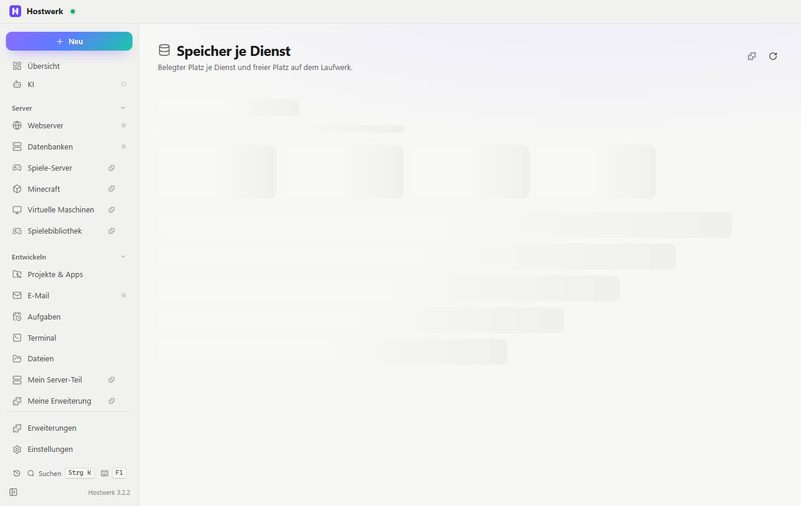

# Speicher je Dienst

[← Zurück zur Übersicht](README.md)

Belegter Platz je Dienst und freier Platz auf dem Laufwerk.

### Was du hier tun kannst

- Von der Erweiterung „Speicher je Dienst“ – Infos
- Neu laden

Erzeugt am 2026-11-20 · Hostwerk 3.2.2
