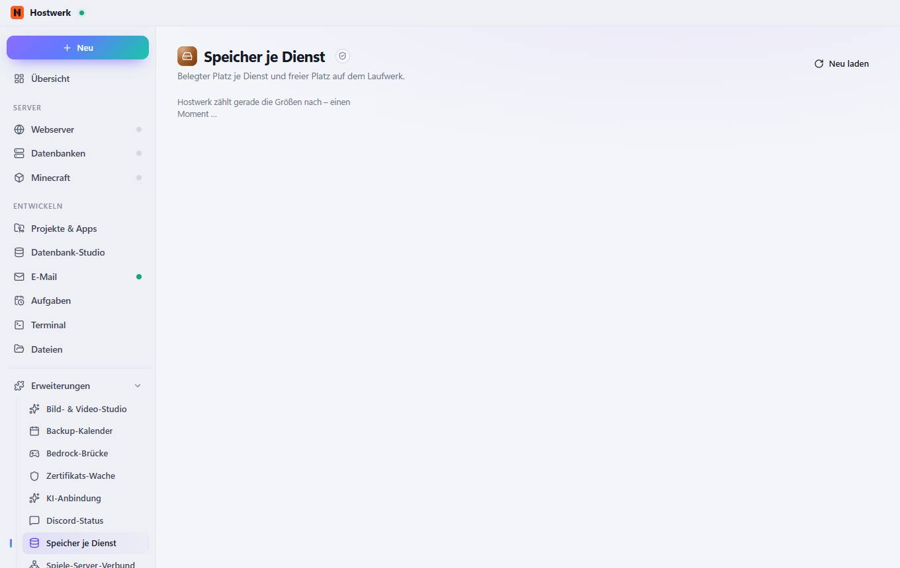

# Speicher je Dienst

[← Zurück zur Übersicht](README.md)

Belegter Platz je Dienst und freier Platz auf dem Laufwerk.

### Gut zu wissen

- Abgeschottete Erweiterung von Hostwerk · v1.1.0 · nur lesen Systemzustand, Auslastung und Ports lesen

### Was du hier tun kannst

- Neu laden

Erzeugt am 2026-10-19 · Hostwerk 2.9.0
