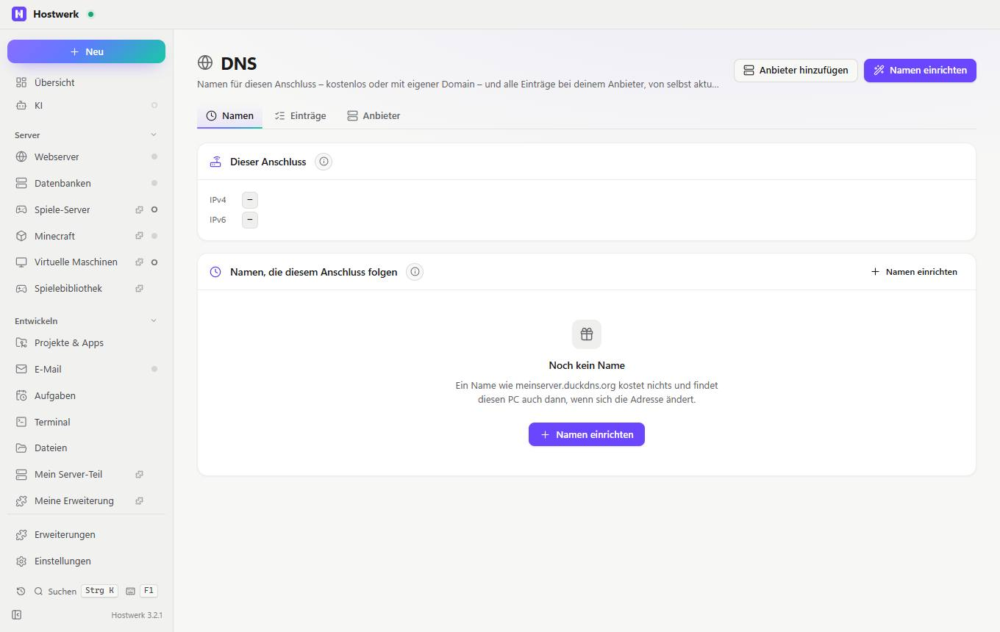
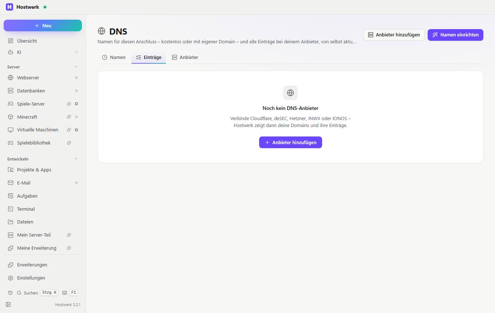
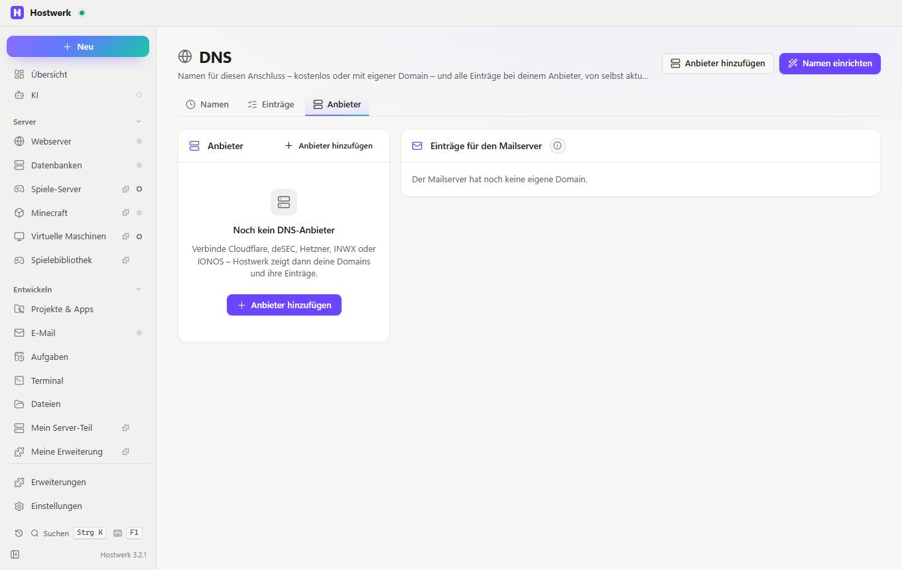

# DNS → Namen

[← Zurück zur Übersicht](README.md)

Namen für diesen Anschluss – kostenlos oder mit eigener Domain – und alle Einträge bei deinem Anbieter, von selbst aktuell gehalten.

### Gut zu wissen

- Dieser Anschluss Die Adresse, die das Internet sieht. Hostwerk fragt mehrere Dienste (ohne Konto) und traut einer Adresse erst, wenn zwei dasselbe sagen. Für IPv6 nimmt es die feste Adresse dieses PCs, nicht die wechselnde Datenschutz-Adresse.
- Wartungsfrei Alle 5 Minuten prüft Hostwerk die Adresse und ändert einen Namen nur, wenn sie sich geändert hat. Alle 6 Stunden prüft es, ob die Welt wirklich diesen Anschluss sieht. Probleme kommen als eine Benachrichtigung; ist ein Anbieter gestört, versucht Hostwerk es mit wachsenden Pausen wieder.

### Bereiche auf dieser Seite

- Dieser Anschluss
- Namen, die diesem Anschluss folgen

### Was du hier tun kannst

- Anbieter hinzufügen
- Namen einrichten

## Reiter

### Einträge

**Was du hier tun kannst:** Anbieter hinzufügen · Namen einrichten

### Anbieter

> Einträge für den Mailserver MX, SPF, DKIM und DMARC aus der Erweiterung „Mailserver“. Was beim Anbieter fehlt, setzt ein Klick; vorhandene SPF-/DMARC-Einträge werden ersetzt, alles andere bleibt unberührt.

**Bereiche auf dieser Seite:** Anbieter · Einträge für den Mailserver

**Was du hier tun kannst:** Anbieter hinzufügen · Namen einrichten

Erzeugt am 2026-11-18 · Hostwerk 3.2.1
