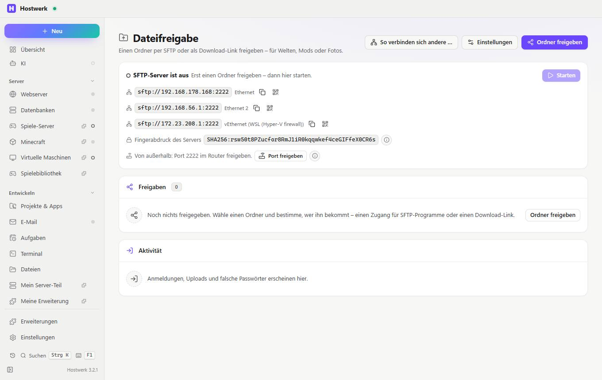

# Dateifreigabe

[← Zurück zur Übersicht](README.md)

Einen Ordner per SFTP oder als Download-Link freigeben – für Welten, Mods oder Fotos.

### Gut zu wissen

- Fingerabdruck Beim ersten Verbinden zeigt das SFTP-Programm diesen Fingerabdruck. Stimmt er überein, geht die Verbindung wirklich zu diesem PC.
- Router Windows fragt eventuell einmal, ob Hostwerk Verbindungen annehmen darf – für private Netzwerke erlauben.

### Bereiche auf dieser Seite

- Freigaben
- Aktivität

### Was du hier tun kannst

- So verbinden sich andere …
- Einstellungen
- Ordner freigeben
- Starten
- Kopieren
- Als QR-Code zeigen
- Port freigeben

Erzeugt am 2026-11-20 · Hostwerk 3.2.2
