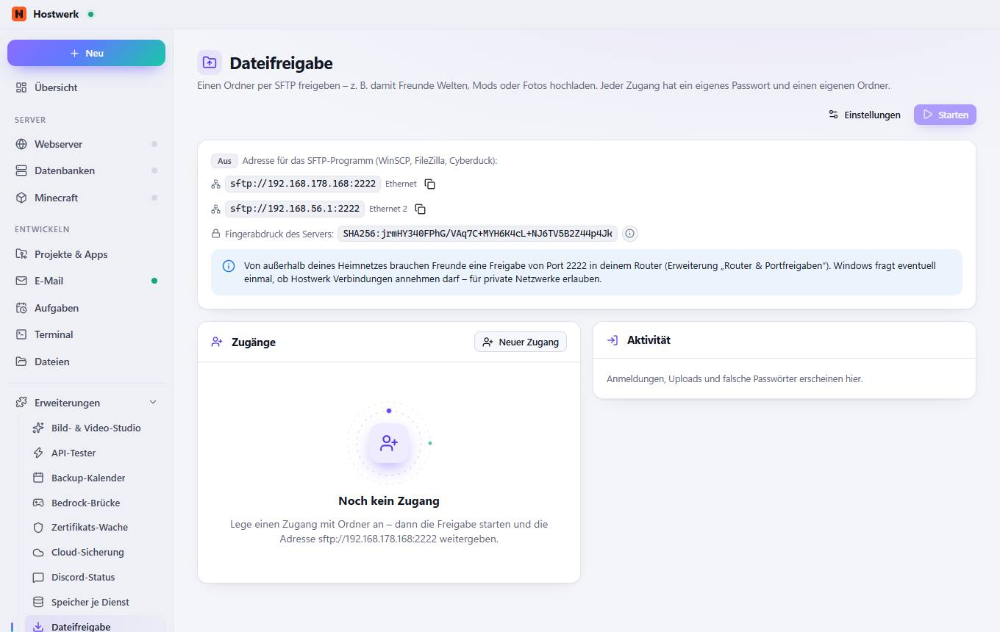

# Dateifreigabe

[← Zurück zur Übersicht](README.md)

Einen Ordner per SFTP freigeben – z. B. damit Freunde Welten, Mods oder Fotos hochladen. Jeder Zugang hat ein eigenes Passwort und einen eigenen Ordner.

### Gut zu wissen

- Fingerabdruck Beim ersten Verbinden zeigt das SFTP-Programm diesen Fingerabdruck. Stimmt er überein, geht die Verbindung wirklich zu diesem PC.

### Bereiche auf dieser Seite

- Zugänge
- Aktivität

### Was du hier tun kannst

- Einstellungen
- Starten
- Kopieren
- Neuer Zugang

Erzeugt am 2026-10-20 · Hostwerk 2.10.0
