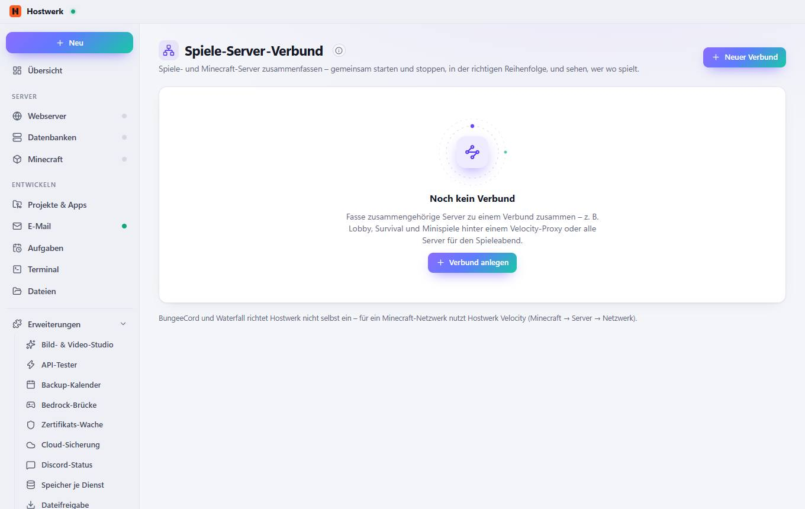

# Spiele-Server-Verbund

[← Zurück zur Übersicht](README.md)

Spiele- und Minecraft-Server zusammenfassen – gemeinsam starten und stoppen, in der richtigen Reihenfolge, und sehen, wer wo spielt.

### Gut zu wissen

- So funktioniert die Reihenfolge Beim Starten kommen erst alle Server hoch und der Proxy (Velocity) zuletzt – mit der gewählten Pause dazwischen. Beim Stoppen umgekehrt: zuerst der Proxy, damit niemand auf einem Server landet, der gerade herunterfährt.

### Was du hier tun kannst

- Neuer Verbund
- Verbund anlegen

Erzeugt am 2026-10-20 · Hostwerk 2.10.0
