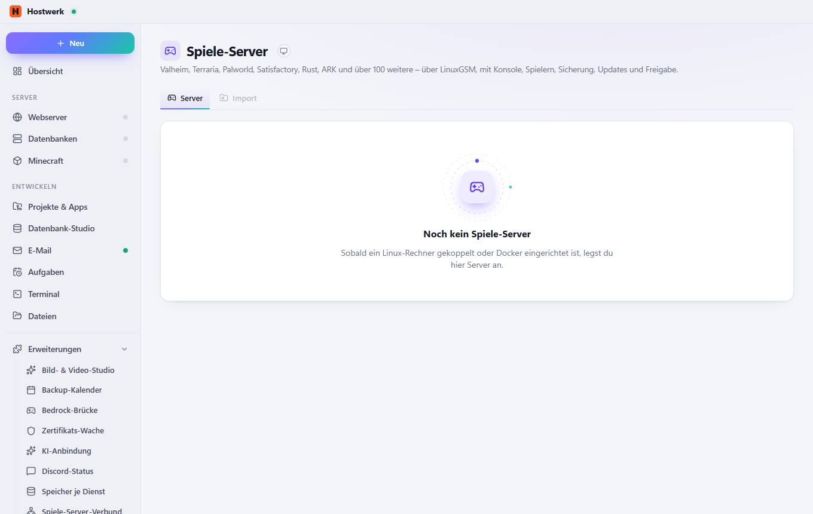

# Spiele-Server → Server

[← Zurück zur Übersicht](README.md)

Valheim, Terraria, Palworld, Satisfactory, Rust, ARK und über 100 weitere – über LinuxGSM, mit Konsole, Spielern, Sicherung, Updates und Freigabe.

### Gut zu wissen

- Nur auf Linux – oder mit Docker LinuxGSM (linuxgsm.com) läuft nur auf Linux. Drei Wege: Eigener Server (VPS) – mit der Erweiterung Hostwerk-Verbund einrichten; dort steht diese Seite dann bereit (Rechner oben wechseln). Linux-PC im Heimnetz – Hostwerk für Linux installieren und koppeln. Docker hier – unter Projekte & Apps → Docker die Hostwerk-Docker-Engine einrichten; danach laufen Spiele-Server als Container auf diesem PC. Minecraft-Server laufen weiterhin direkt hier unter Windows.

## Reiter

### Import

> Nur auf Linux – oder mit Docker LinuxGSM (linuxgsm.com) läuft nur auf Linux. Drei Wege: Eigener Server (VPS) – mit der Erweiterung Hostwerk-Verbund einrichten; dort steht diese Seite dann bereit (Rechner oben wechseln). Linux-PC im Heimnetz – Hostwerk für Linux installieren und koppeln. Docker hier – unter Projekte & Apps → Docker die Hostwerk-Docker-Engine einrichten; danach laufen Spiele-Server als Container auf diesem PC. Minecraft-Server laufen weiterhin direkt hier unter Windows.

Erzeugt am 2026-10-19 · Hostwerk 2.9.0
