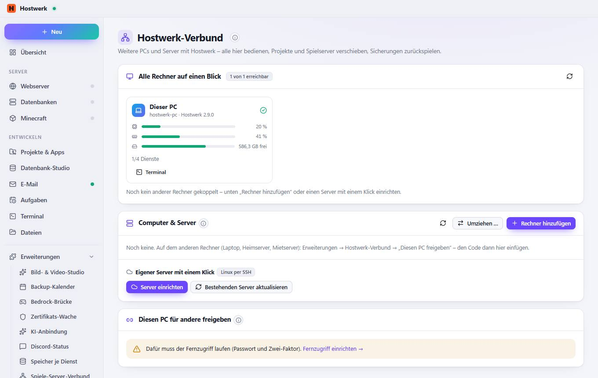

# Hostwerk-Verbund

[← Zurück zur Übersicht](README.md)

Weitere PCs und Server mit Hostwerk – alle hier bedienen, Projekte und Spielserver verschieben, Sicherungen zurückspielen.

### Gut zu wissen

- So funktioniert es Auf dem anderen Rechner Hostwerk installieren (Windows oder Linux; ein Mietserver geht mit „Eigener Server mit einem Klick“), dort den Fernzugriff einschalten und den Kopplungscode hier eintragen. Danach wechselst du oben in der Rechnerleiste zwischen den Geräten – Dienste, Dateien, Terminal und KI laufen dann auf dem gewählten Rechner. Linux-Server im Rechenzentrum · Windows- oder Linux-PCs im Heimnetz · Handy: unter Livebetrieb → Fernzugriff
- Mietserver (z. B. bei Hetzner, Netcup, IONOS) oder Heimserver mit Ubuntu, Debian oder Fedora: Hostwerk richtet sich dort selbst ein – Node.js, Hostwerk ohne Fenster als Dienst, Fernzugriff mit Zwei-Faktor, Firewall – und erscheint danach hier als Rechner. Deine SSH-Zugangsdaten werden nur für die Einrichtung benutzt, nicht gespeichert.
- Ein anderer Hostwerk-PC kann diesen Rechner dann bedienen – über den Fernzugriff (HTTPS) mit einem eigenen Schlüssel, den du jederzeit widerrufen kannst. Der Schlüssel ist nur einmal sichtbar.

### Bereiche auf dieser Seite

- Alle Rechner auf einen Blick
- Computer & Server
- Diesen PC für andere freigeben

### Was du hier tun kannst

- Neu laden
- Terminal
- Neu prüfen
- Umziehen …
- Rechner hinzufügen
- Server einrichten
- Bestehenden Server aktualisieren

Erzeugt am 2026-10-19 · Hostwerk 2.9.0
