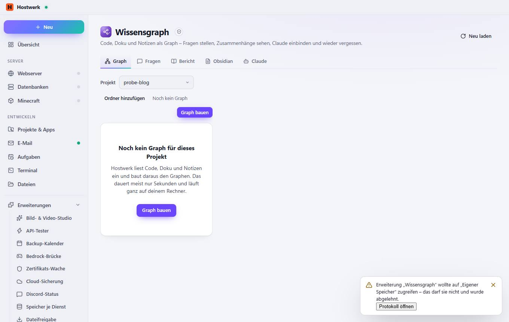
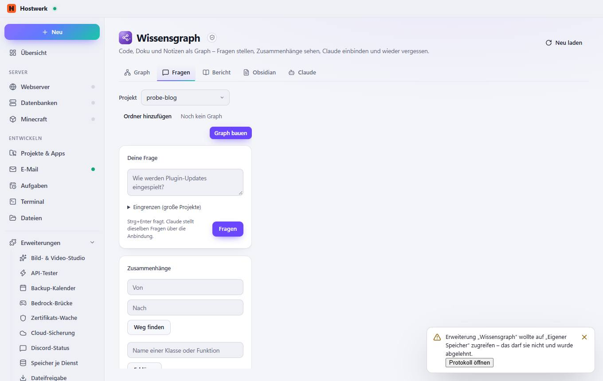
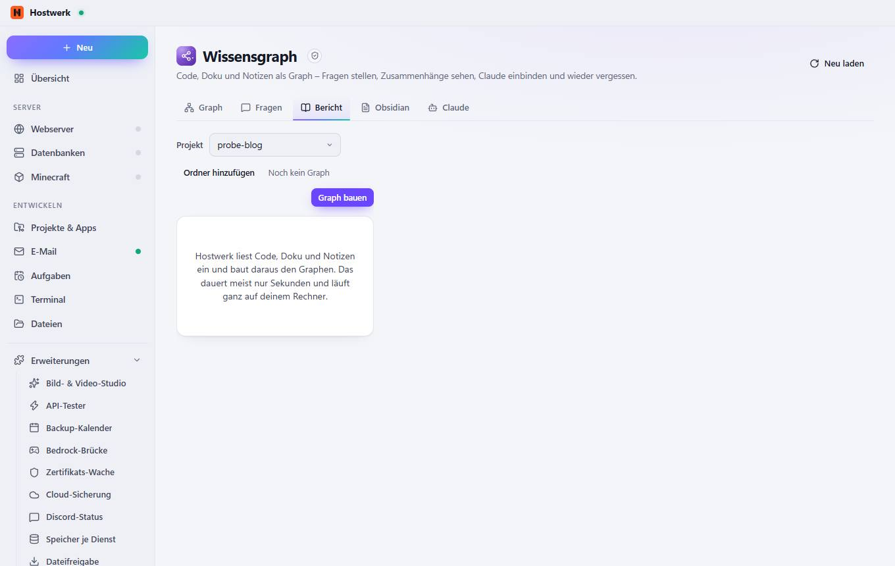
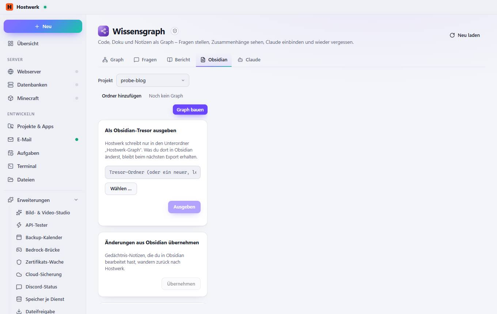
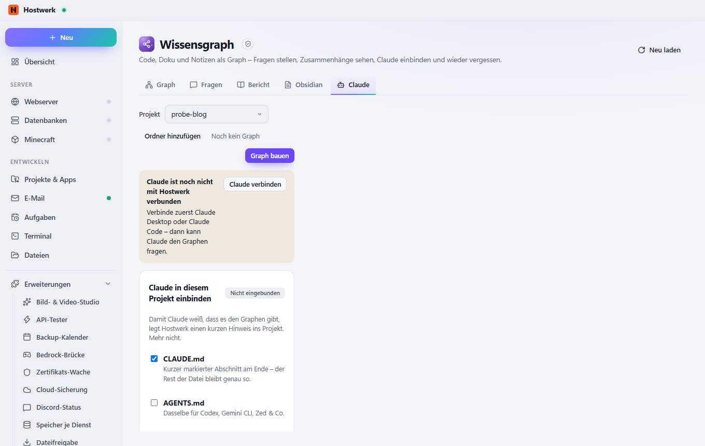

# Wissensgraph → Graph

[← Zurück zur Übersicht](README.md)

Code, Doku und Notizen als Graph – Fragen stellen, Zusammenhänge sehen, Claude einbinden und wieder vergessen.

### Gut zu wissen

- Abgeschottete Erweiterung von Hostwerk · v1.4.0 · darf nach Rückfrage ändern Wissensgraph lesen (Projekte, Graph, Bericht, Gedächtnis, Claude-Status) Wissensgraph bauen und abfragen, Gedächtnis pflegen, Obsidian-Export Claude einbinden und wieder vergessen (mit Rückfrage)

### Was du hier tun kannst

- Neu laden

## Reiter

### Fragen

> Abgeschottete Erweiterung von Hostwerk · v1.4.0 · darf nach Rückfrage ändern Wissensgraph lesen (Projekte, Graph, Bericht, Gedächtnis, Claude-Status) Wissensgraph bauen und abfragen, Gedächtnis pflegen, Obsidian-Export Claude einbinden und wieder vergessen (mit Rückfrage)

**Was du hier tun kannst:** Neu laden

### Bericht

> Abgeschottete Erweiterung von Hostwerk · v1.4.0 · darf nach Rückfrage ändern Wissensgraph lesen (Projekte, Graph, Bericht, Gedächtnis, Claude-Status) Wissensgraph bauen und abfragen, Gedächtnis pflegen, Obsidian-Export Claude einbinden und wieder vergessen (mit Rückfrage)

**Was du hier tun kannst:** Neu laden

### Obsidian

> Abgeschottete Erweiterung von Hostwerk · v1.4.0 · darf nach Rückfrage ändern Wissensgraph lesen (Projekte, Graph, Bericht, Gedächtnis, Claude-Status) Wissensgraph bauen und abfragen, Gedächtnis pflegen, Obsidian-Export Claude einbinden und wieder vergessen (mit Rückfrage)

**Was du hier tun kannst:** Neu laden

### Claude

> Abgeschottete Erweiterung von Hostwerk · v1.4.0 · darf nach Rückfrage ändern Wissensgraph lesen (Projekte, Graph, Bericht, Gedächtnis, Claude-Status) Wissensgraph bauen und abfragen, Gedächtnis pflegen, Obsidian-Export Claude einbinden und wieder vergessen (mit Rückfrage)

**Was du hier tun kannst:** Neu laden

Erzeugt am 2026-10-20 · Hostwerk 2.10.0
