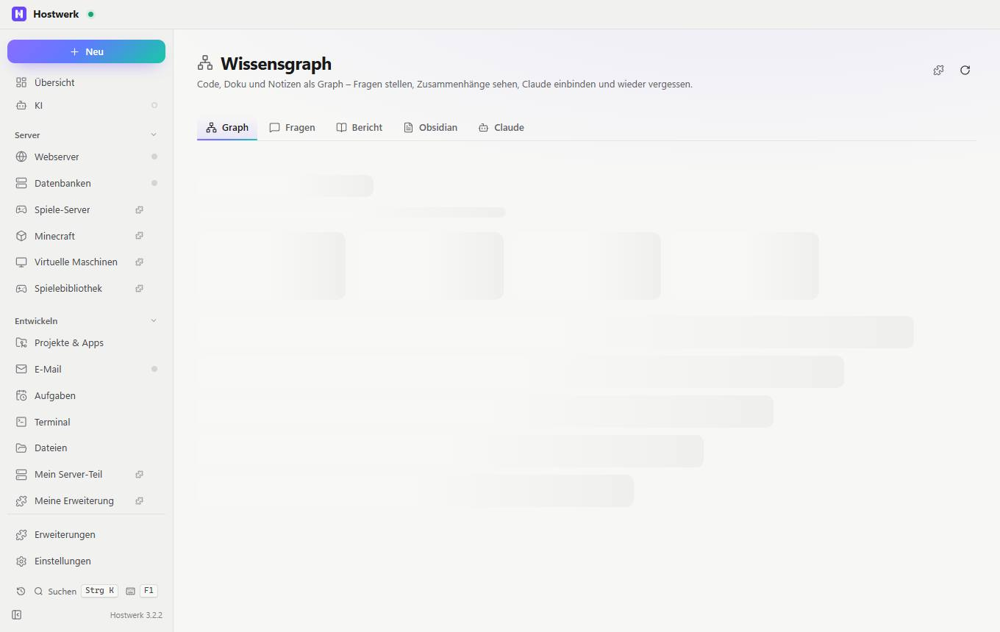
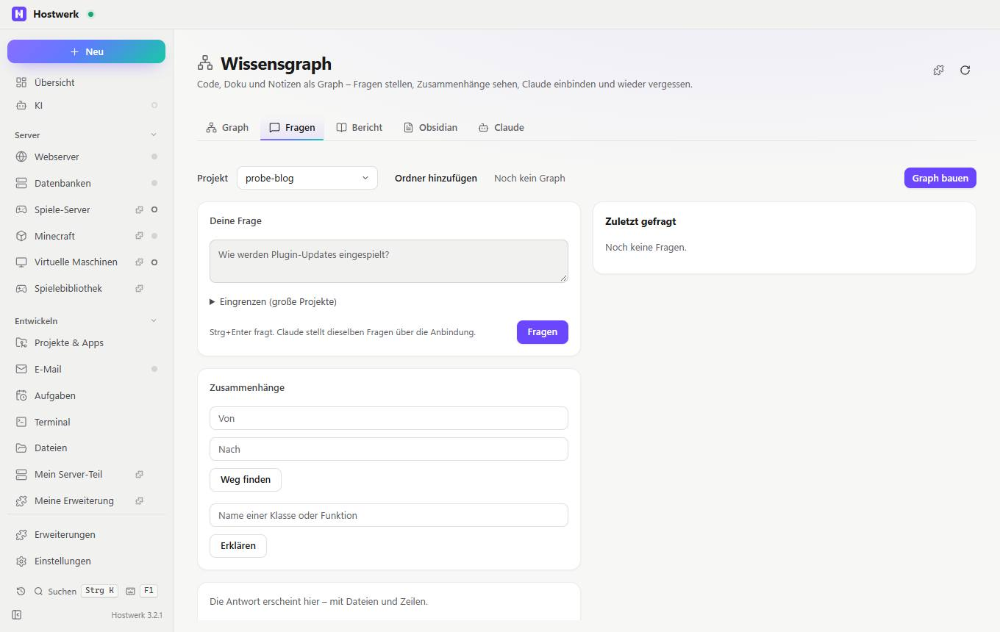
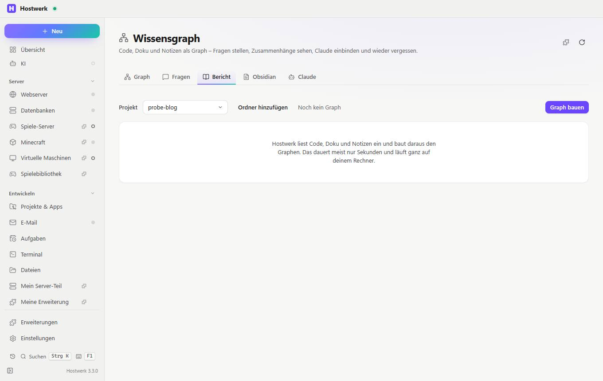
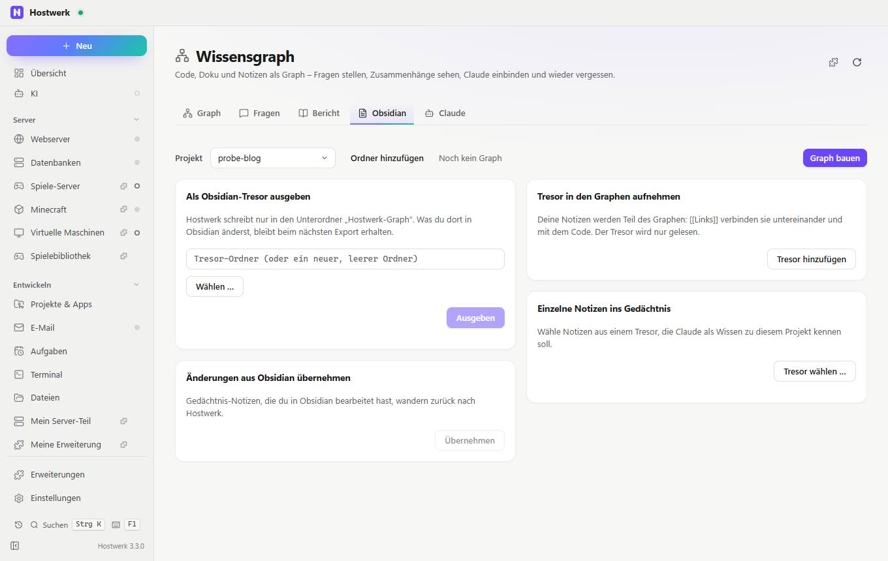
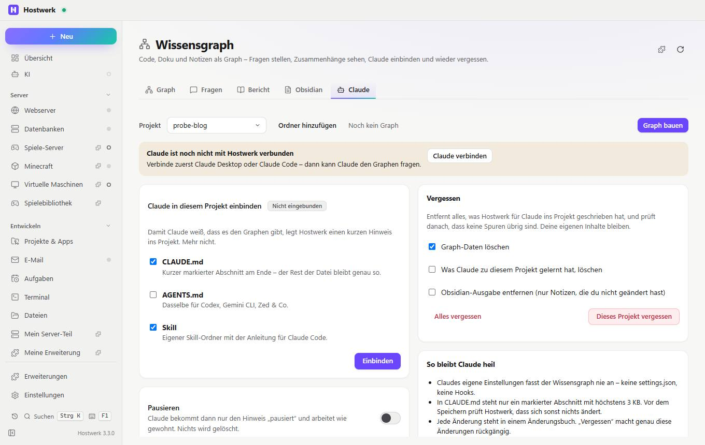

# Wissensgraph → Graph

[← Zurück zur Übersicht](README.md)

Code, Doku und Notizen als Graph – Fragen stellen, Zusammenhänge sehen, Claude einbinden und wieder vergessen.

### Was du hier tun kannst

- Von der Erweiterung „Wissensgraph“ – Infos
- Neu laden

## Reiter

### Fragen

**Was du hier tun kannst:** Von der Erweiterung „Wissensgraph“ – Infos · Neu laden

### Bericht

**Was du hier tun kannst:** Von der Erweiterung „Wissensgraph“ – Infos · Neu laden

### Obsidian

**Was du hier tun kannst:** Von der Erweiterung „Wissensgraph“ – Infos · Neu laden

### Claude

**Was du hier tun kannst:** Von der Erweiterung „Wissensgraph“ – Infos · Neu laden

Erzeugt am 2026-11-20 · Hostwerk 3.2.2
