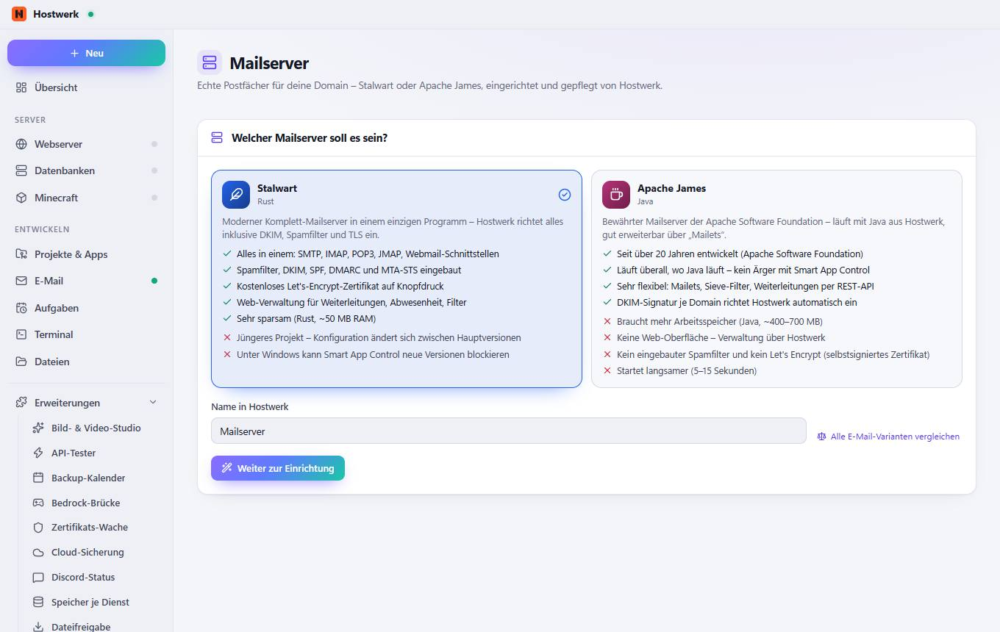

# Mailserver

[← Zurück zur Übersicht](README.md)

Echte Postfächer für deine Domain – Stalwart oder Apache James, eingerichtet und gepflegt von Hostwerk.

### Bereiche auf dieser Seite

- Welcher Mailserver soll es sein?

### Was du hier tun kannst

- Alle E-Mail-Varianten vergleichen
- Weiter zur Einrichtung

### Eingaben

- Name in Hostwerk

Erzeugt am 2026-10-20 · Hostwerk 2.10.0
