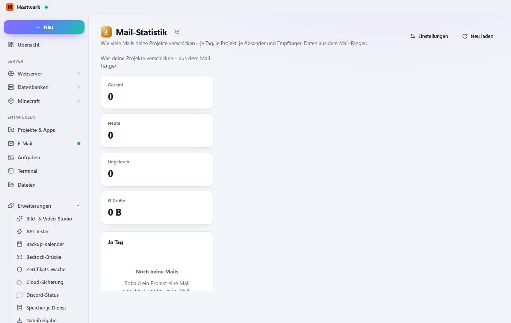

# Mail-Statistik

[← Zurück zur Übersicht](README.md)

Wie viele Mails deine Projekte verschicken – je Tag, je Projekt, je Absender und Empfänger. Daten aus dem Mail-Fänger.

### Gut zu wissen

- Abgeschottete Erweiterung von Hostwerk · v1.2.0 · nur lesen Abgefangene E-Mails lesen

### Was du hier tun kannst

- Einstellungen
- Neu laden

Erzeugt am 2026-10-20 · Hostwerk 2.10.0
