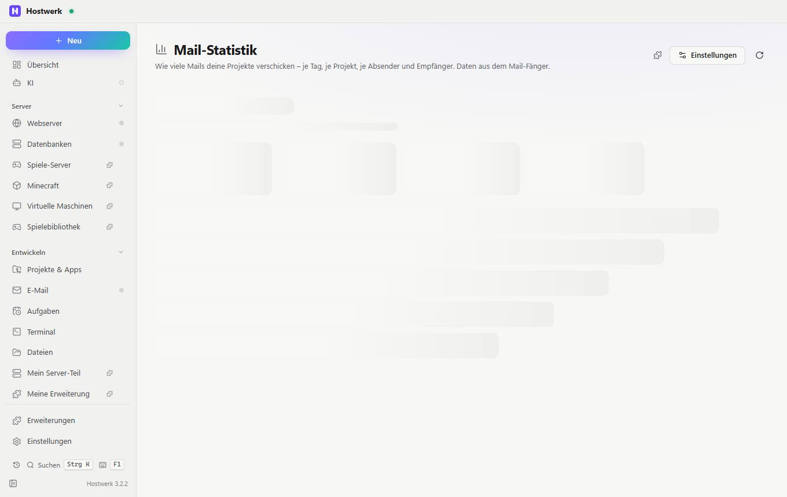

# Mail-Statistik

[← Zurück zur Übersicht](README.md)

Wie viele Mails deine Projekte verschicken – je Tag, je Projekt, je Absender und Empfänger. Daten aus dem Mail-Fänger.

### Was du hier tun kannst

- Von der Erweiterung „Mail-Statistik“ – Infos
- Einstellungen
- Neu laden

Erzeugt am 2026-11-18 · Hostwerk 3.2.1
