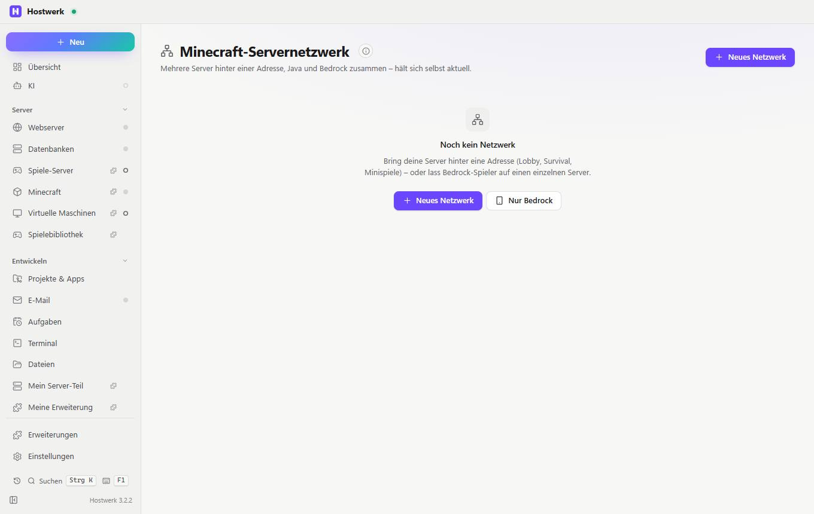

# Minecraft-Servernetzwerk

[← Zurück zur Übersicht](README.md)

Mehrere Server hinter einer Adresse, Java und Bedrock zusammen – hält sich selbst aktuell.

### Gut zu wissen

- Wie alles zusammenhängt A proxy (Velocity) is the one address players connect to; it sends them to your servers and lets them switch with /server. Geyser on the proxy translates for Bedrock players (phone, console, Windows), Floodgate lets them in without a Java account. ViaVersion lets other Minecraft versions in. A Bedrock Dedicated Server is something else: Mojang’s own server with a separate Bedrock-only world.

### Was du hier tun kannst

- Neues Netzwerk
- Nur Bedrock

Erzeugt am 2026-11-20 · Hostwerk 3.2.2
