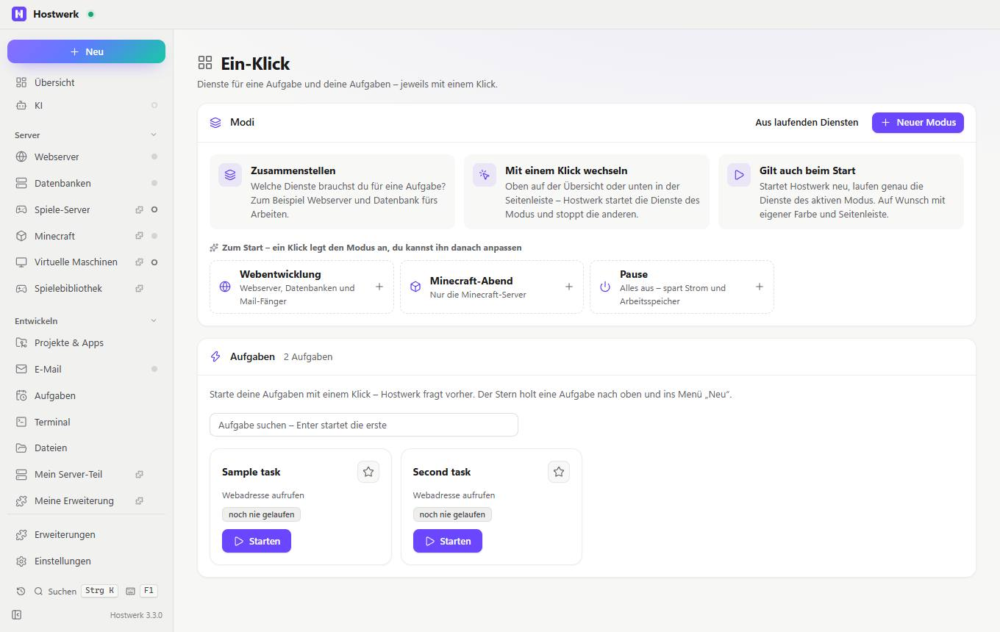

# Ein-Klick

[← Zurück zur Übersicht](README.md)

Dienste für eine Aufgabe und deine Aufgaben – jeweils mit einem Klick.

### Bereiche auf dieser Seite

- Modi
- Aufgaben

### Was du hier tun kannst

- Aus laufenden Diensten
- Neuer Modus
- Webentwicklung Webserver, Datenbanken und Mail-Fänger
- Minecraft-Abend Nur die Minecraft-Server
- Pause Alles aus – spart Strom und Arbeitsspeicher
- Als Favorit markieren (steht dann in Listen oben)
- Starten

Erzeugt am 2026-11-20 · Hostwerk 3.3.0
