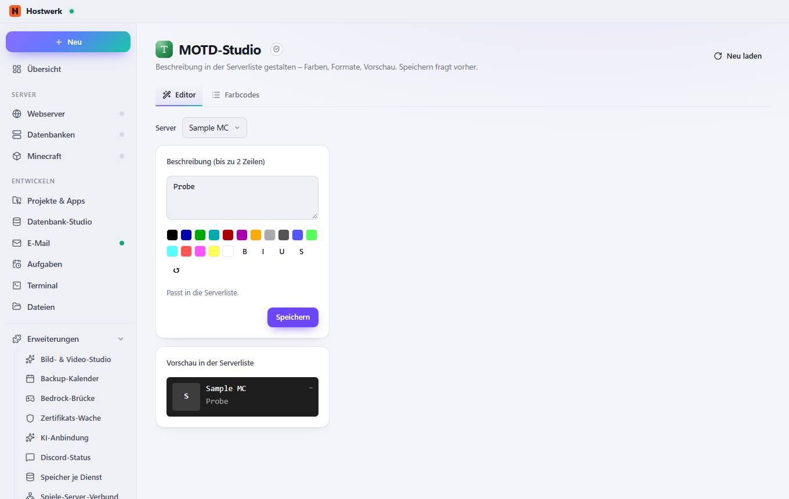
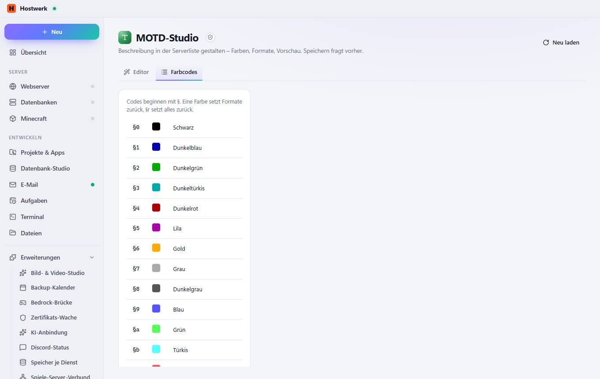

# MOTD-Studio → Editor

[← Zurück zur Übersicht](README.md)

Beschreibung in der Serverliste gestalten – Farben, Formate, Vorschau. Speichern fragt vorher.

### Gut zu wissen

- Abgeschottete Erweiterung von Hostwerk · v1.1.0 · darf nach Rückfrage ändern Minecraft-Server, Spieler und Statistiken lesen Minecraft-Einstellungen ändern (mit Rückfrage)

### Was du hier tun kannst

- Neu laden

## Reiter

### Farbcodes

> Abgeschottete Erweiterung von Hostwerk · v1.1.0 · darf nach Rückfrage ändern Minecraft-Server, Spieler und Statistiken lesen Minecraft-Einstellungen ändern (mit Rückfrage)

**Was du hier tun kannst:** Neu laden

Erzeugt am 2026-10-19 · Hostwerk 2.9.0
