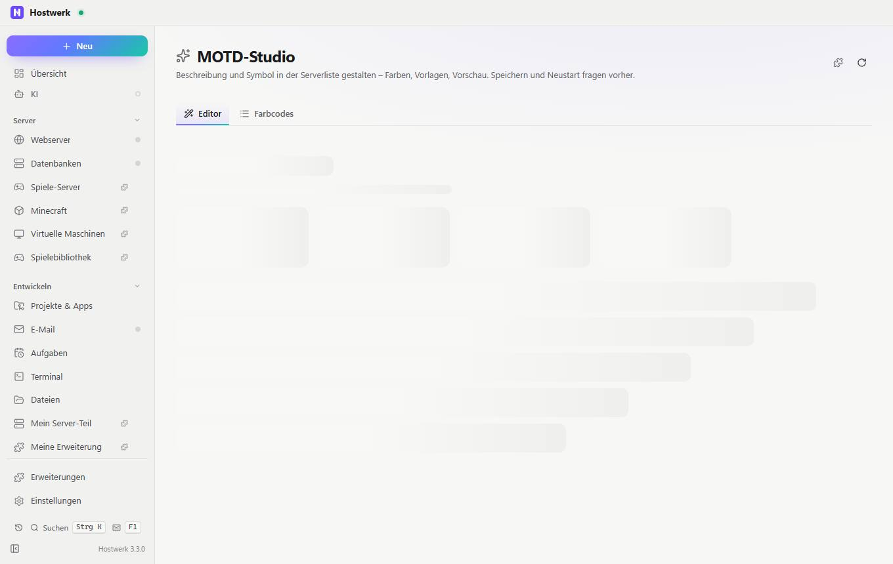
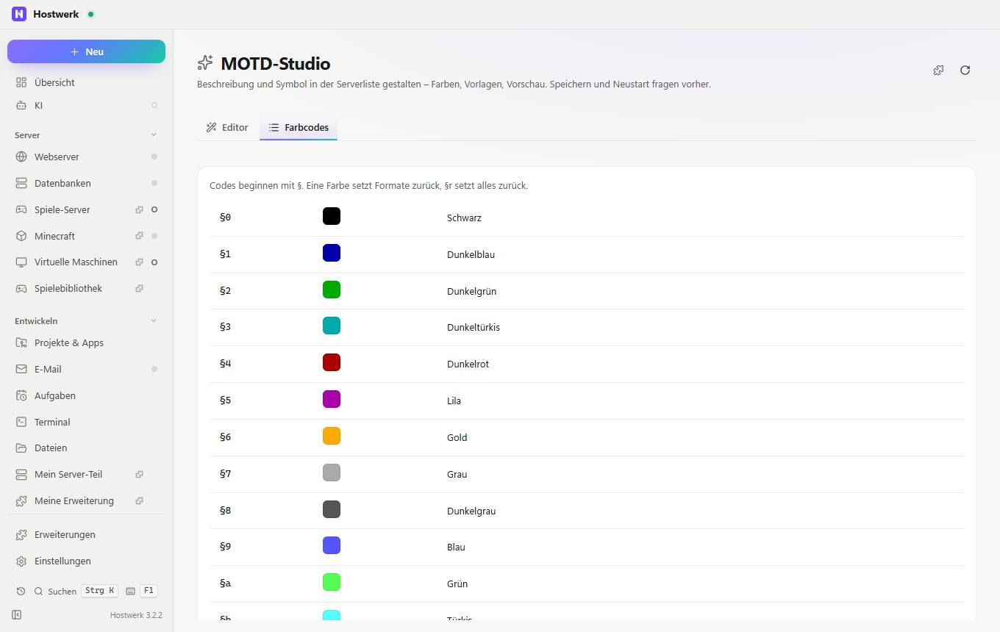

# MOTD-Studio → Editor

[← Zurück zur Übersicht](README.md)

Beschreibung und Symbol in der Serverliste gestalten – Farben, Vorlagen, Vorschau. Speichern und Neustart fragen vorher.

### Was du hier tun kannst

- Von der Erweiterung „MOTD-Studio“ – Infos
- Neu laden

## Reiter

### Farbcodes

**Was du hier tun kannst:** Von der Erweiterung „MOTD-Studio“ – Infos · Neu laden

Erzeugt am 2026-11-20 · Hostwerk 3.3.0
