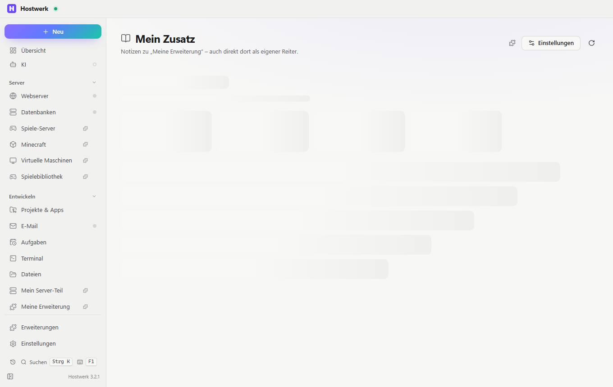

# Mein Zusatz

[← Zurück zur Übersicht](README.md)

Notizen zu „Meine Erweiterung“ – auch direkt dort als eigener Reiter.

### Was du hier tun kannst

- Von der Erweiterung „Mein Zusatz“ – Infos
- Einstellungen
- Neu laden

Erzeugt am 2026-11-18 · Hostwerk 3.2.1
