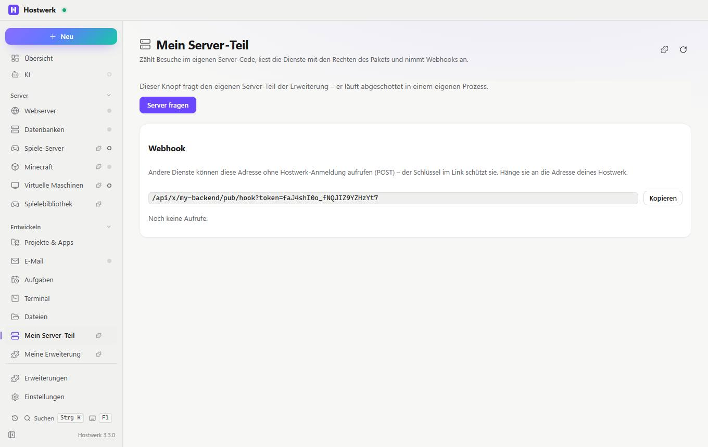

# Mein Server-Teil

[← Zurück zur Übersicht](README.md)

Zählt Besuche im eigenen Server-Code, liest die Dienste mit den Rechten des Pakets und nimmt Webhooks an.

### Was du hier tun kannst

- Von der Erweiterung „Mein Server-Teil“ – Infos
- Neu laden

Erzeugt am 2026-11-20 · Hostwerk 3.3.0
