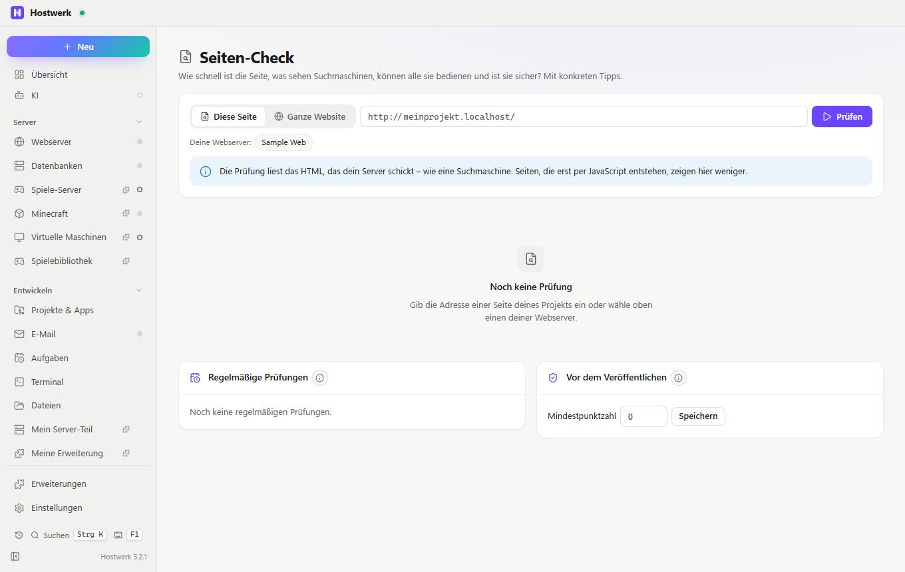

# Seiten-Check

[← Zurück zur Übersicht](README.md)

Wie schnell ist die Seite, was sehen Suchmaschinen, können alle sie bedienen und ist sie sicher? Mit konkreten Tipps.

### Gut zu wissen

- Regelmäßige Prüfungen Hostwerk prüft diese Adressen von selbst und meldet sich, wenn die Punktzahl um 5 oder mehr fällt.
- Mindestpunktzahl Erweiterungen zum Veröffentlichen (z. B. „Seiten veröffentlichen“) prüfen die Seite vorher und halten unter dieser Punktzahl an. 0 = aus.

### Bereiche auf dieser Seite

- Regelmäßige Prüfungen
- Vor dem Veröffentlichen

### Was du hier tun kannst

- Prüfen
- Sample Web
- Speichern

Erzeugt am 2026-11-18 · Hostwerk 3.2.1
