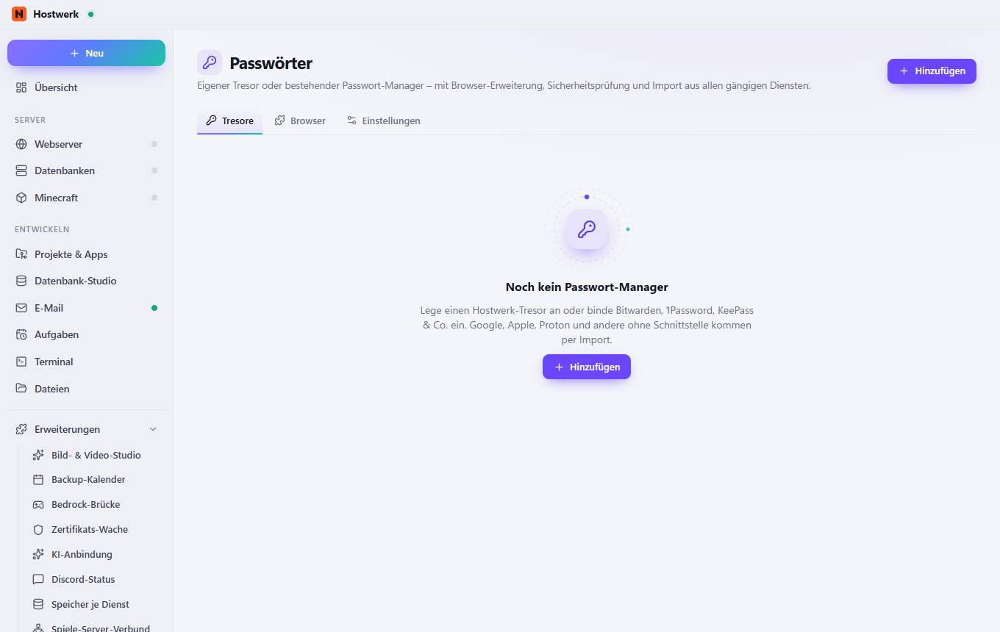
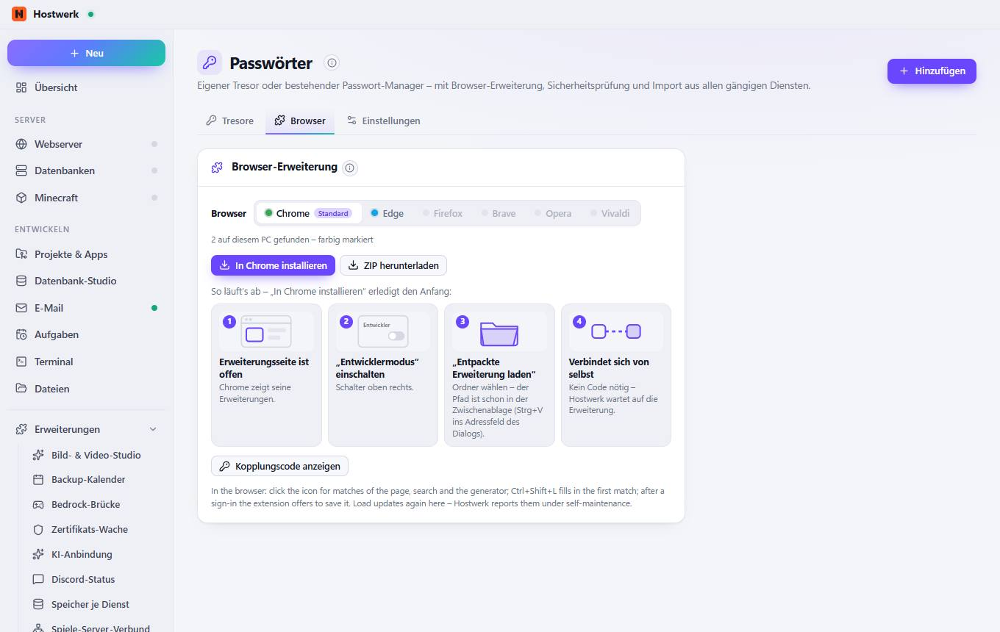
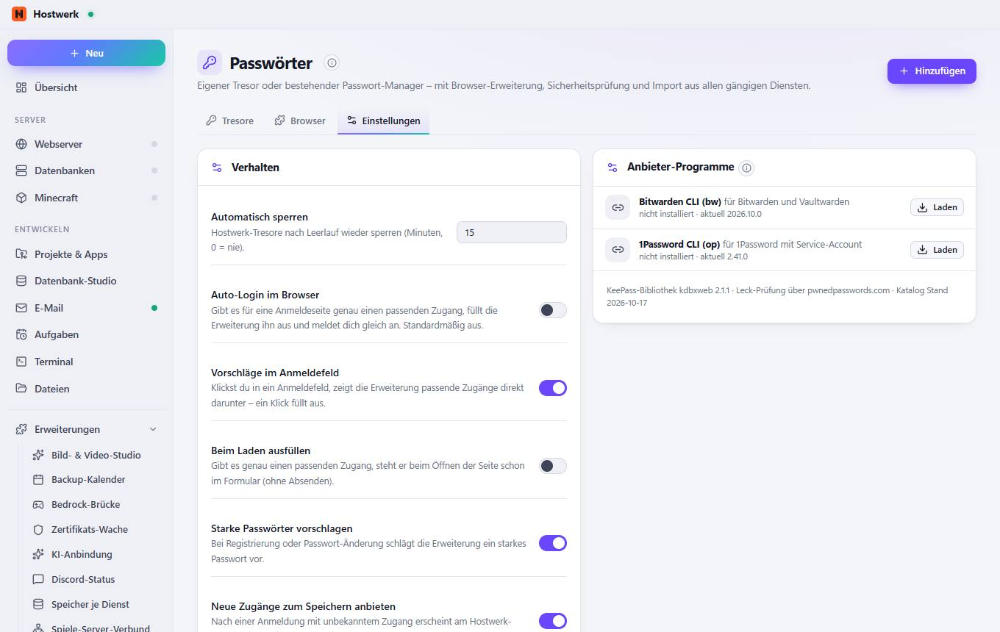

# Passwörter → Tresore

[← Zurück zur Übersicht](README.md)

Eigener Tresor oder bestehender Passwort-Manager – mit Browser-Erweiterung, Sicherheitsprüfung und Import aus allen gängigen Diensten.

### Was du hier tun kannst

- Hinzufügen

## Reiter

### Browser

> Wie installiert Hostwerk? Gibt es die Erweiterung im Store des Browsers, meldet Hostwerk sie dem Browser auf dem offiziellen Weg und öffnet die Store-Seite – ein Klick „Hinzufügen“. Sonst lädt der Browser sie als „entpackte Erweiterung“ (Entwicklermodus). In beiden Fällen koppelt sie sich selbst, ohne Code.
> Die Erweiterung spricht nur mit deinem Hostwerk (127.0.0.1).

**Bereiche auf dieser Seite:** Browser-Erweiterung

**Was du hier tun kannst:** Hinzufügen · In Chrome installieren · ZIP herunterladen · Kopplungscode anzeigen

### Einstellungen

> Ohne Wartung: Anbieter-Programme werden täglich geprüft und mit Probelauf aktualisiert, neue Import-Formate und Dienste kommen über den Online-Katalog. Der KI-Helfer hat keinerlei Zugriff auf Tresore, Einträge oder Tresor-Dateien – weder lesend noch suchend.
> Selbstwartung: Versionsprüfung täglich, Update mit Probelauf.

**Bereiche auf dieser Seite:** Verhalten · Tresore verwalten · Anbieter-Programme

**Was du hier tun kannst:** Hinzufügen · Laden

Erzeugt am 2026-10-19 · Hostwerk 2.9.0
