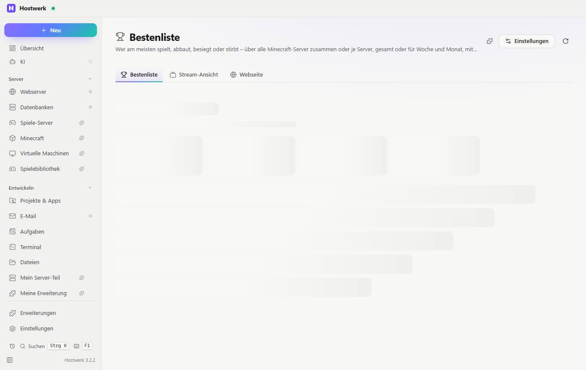
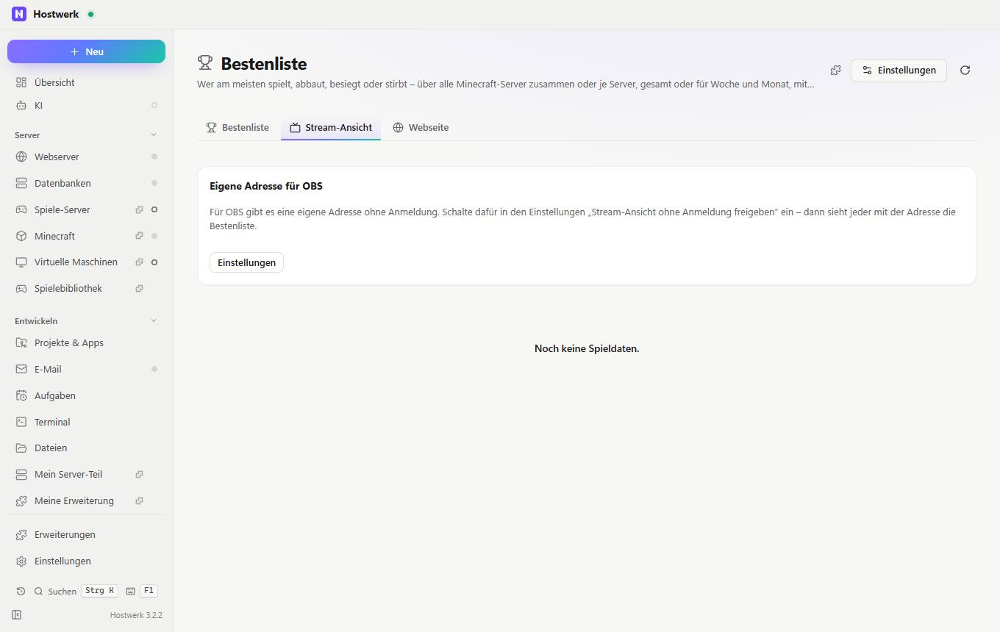
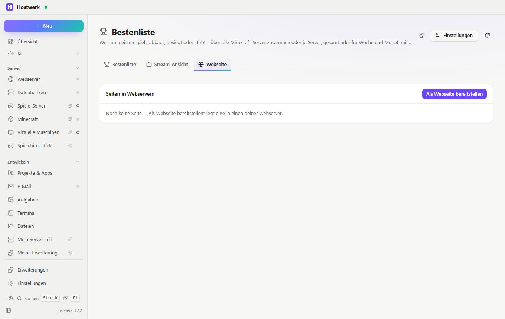

# Bestenliste → Bestenliste

[← Zurück zur Übersicht](README.md)

Wer am meisten spielt, abbaut, besiegt oder stirbt – über alle Minecraft-Server zusammen oder je Server, gesamt oder für Woche und Monat, mit Spielersuche, Profilkarte, Abzeichen und Verlauf. Direkt im Reiter „Spieler“ jedes Minecraft-Servers, als Stream-Ansicht für OBS und auf Wunsch als eigene Webseite in deinem Webserver.

### Was du hier tun kannst

- Von der Erweiterung „Bestenliste“ – Infos
- Einstellungen
- Neu laden

## Reiter

### Stream-Ansicht

**Was du hier tun kannst:** Von der Erweiterung „Bestenliste“ – Infos · Einstellungen · Neu laden

### Webseite

**Was du hier tun kannst:** Von der Erweiterung „Bestenliste“ – Infos · Einstellungen · Neu laden

Erzeugt am 2026-11-20 · Hostwerk 3.2.2
